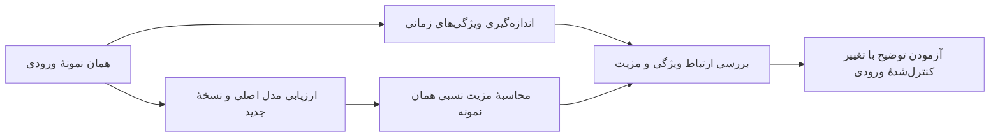

<div dir="rtl" lang="fa">

# نقشهٔ راه اجرای راهنمای استاد: ویژگی‌های ورودی و سازوکارهای تطبیقی

تاریخ: **۱۰ نوامبر ۲۰۲۶**

وضعیت این سند: **پایلوت محدود AMT/MT روی اعتبارسنجی SHD* پیاده‌سازی شده است؛ مراحل بعدی همچنان برنامه‌اند.** [راهنمای اجرا و پیش‌نیازها](adaptation-mechanism-pilot-v1.md) و سه فرمان [command.txt](../../command.txt) مرجع اجرای فعلی هستند. این ابزار فقط وزن‌های ثابت موجود را ارزیابی می‌کند؛ آموزش جدید آغاز نمی‌کند و به آزمون رسمی دسترسی ندارد.

مبنای کار: [راهنمای استاد و تحلیل تکمیلی](../../supervisor_guideline.md).

ترجیح اجرایی فعلی، گام‌های کوچک با بازبینی در پایان هر نوبتِ حدوداً روزانه است. [برنامهٔ سه رایانهٔ RTX 4090](supervisor-three-pc-daily-plan-fa.md) کارهای موازی و نقاط توقف مشترک را مشخص می‌کند. نوبت بعد خودکار شروع نمی‌شود و زمان اجرا ابتدا با پایلوت اندازه‌گیری خواهد شد.

برای شروع، بخش‌های ۱، ۲، ۳ و ۱۶ مسیر کلی را توضیح می‌دهند. بخش‌های میانی مرجع جزئیات پیاده‌سازی و کنترل اعتبار نتایج هستند.

## ۱. مفهوم اصلی، با یک مثال ساده

قرار است بفهمیم **چرا یک تغییر در مدل، برای بعضی ورودی‌ها مفید و برای بعضی دیگر مضر است**.

این کار سه بخش دارد:

1. یک ویژگی از ورودی اندازه می‌گیریم؛ مثلاً شدت تفاوت تغییرات سریع و آهستهٔ فعالیت.
2. همان نمونه را به مدل اصلی و نسخهٔ تغییر‌یافته می‌دهیم و اختلاف خطای آن‌ها را محاسبه می‌کنیم.
3. بررسی می‌کنیم آیا این اختلاف با ویژگی ورودی ارتباط منظمی دارد؛ سپس با تغییر کنترل‌شدهٔ ورودی، توضیح پیشنهادی را آزمایش می‌کنیم.



مثال زیر **کاملاً آموزشی است و نتیجهٔ پروژه نیست**:

| نوع نمونه | زیان MT | زیان AMT | مزیت AMT |
|---|---:|---:|---:|
| تغییرات سریع و آهستهٔ بسیار متفاوت | 1.00 | 0.60 | +0.40 |
| تغییرات سریع و آهستهٔ مشابه | 0.30 | 0.50 | −0.20 |

در ردیف اول AMT بهتر و در ردیف دوم ضعیف‌تر است. فرضیهٔ ما این خواهد بود که فایدهٔ سازوکار AMT به ویژگی زمانی ورودی وابسته است. برای پذیرش این فرضیه، دو ردیف یا چند تصویر کافی نیست؛ باید الگو در نمونه‌های متعدد و بذرهای مختلف بررسی شود و امکان رد آن نیز وجود داشته باشد.

**ویژگی داده به‌تنهایی دقت را افزایش نمی‌دهد. موضوع تحقیق، تعامل ویژگی داده و سازوکار مدل است.** همچنین بهتر بودن یک میانگین کلی، به‌تنهایی علت بهبود را مشخص نمی‌کند.

## ۲. هدف و محدودهٔ ثابت مطالعه

- چهار جفت اصلی: AMT/MT، MT-TC/MT، SA-MT/MT و LT-DTH/DTH.
- استنتاج معمولی؛ **TTA و میانگین‌گیری پیش‌بینی بین نسخه‌های مختلف ورودی وارد تحلیل اصلی نمی‌شوند**.
- استفاده از چک‌پوینت‌های موجود که قبلاً با اعتبارسنجی انتخاب شده‌اند؛ بدون انتخاب دوباره بر اساس نتیجهٔ این مطالعه.
- شروع روی اعتبارسنجی SHD* با همان تقسیم تصادفی ۲۰٪ و بذر تقسیم 42؛ مطالعهٔ تفکیک گوینده، آزمایش جداگانه‌ای است.
- توسعه و انتخاب ویژگی‌ها بر اساس اعتبارسنجی؛ سپس تثبیت روش تحلیل پیش از مرحلهٔ تأیید.
- فعلاً بدون مدل جدید، تغییر معماری، تنظیم مجدد آموزش یا بازآموزی.
- هر نوع آموزش احتمالی در مراحل بعد، مطالعهٔ جداگانه است و فقط توسط کاربر اجرا می‌شود.

چهار جفت به معنی هشت مدل مستقل نیست: MT میان سه جفت مشترک است. در مجموع **شش نوع مدل** داریم. برای سه مجموعه‌داده و سه بذر، حداکثر **۵۴ چک‌پوینت منتخبِ یکتا** نیاز است. پیش‌بینی MT و ویژگی‌های ورودی باید بازاستفاده شوند، نه اینکه برای هر جفت جداگانه دوباره محاسبه شوند.

## ۳. وضعیت واقعی دارایی‌ها در این سیستم

بررسی فقط‌خواندنی در تاریخ تهیهٔ سند:

| مورد | وضعیت |
|---|---|
| چک‌پوینت‌های منتخب شش مدل روی SHD | ۱۸ مورد موجود؛ تطبیق SHA-256 تأیید شد |
| چک‌پوینت‌های منتخب شش مدل روی SSC | ۱۸ مورد موجود؛ تطبیق SHA-256 تأیید شد |
| چک‌پوینت‌های منتخب شش مدل روی ECG | ۱۸ مورد موجود؛ تطبیق SHA-256 تأیید شد |
| دادهٔ خام SHD | فایل‌های train/test در `data/SHDWrapper/` موجودند |
| دادهٔ خام SSC | در درخت دادهٔ فعلی این سیستم پیدا نشد |
| دادهٔ خام ECG | فایل‌های QTDB MAT در درخت دادهٔ فعلی پیدا نشدند |
| استخراج ویژگی، استنتاج زوجی و آزمایش اختلال این مطالعه | ابزار پایلوت آماده؛ اجرای علمی کامل سه رایانه بر عهدهٔ کاربر است |

وجود چک‌پوینت به معنی موجود بودن داده نیست. هیچ فایل داده‌ای در این مرحله دانلود یا منتقل نشده است. پیش از ساخت DataModule باید مسیر داده بررسی شود، چون بعضی سازنده‌های دیتاست می‌توانند دانلود را آغاز کنند.

## ۴. تعریف معیار مشترک مقایسه

برای هر نمونهٔ یکسان و بذر آموزش یکسان:

<div dir="ltr">

```text
benefit(sample, seed) = supervised_loss(parent) - supervised_loss(variant)
```

</div>

- مقدار مثبت: نسخهٔ جدید برای آن نمونه زیان کمتری دارد.
- مقدار منفی: مدل اصلی زیان کمتری دارد.
- برای MT-TC، جریمهٔ کمکی JS داخل این مقایسه قرار نمی‌گیرد؛ زیان پیش‌بینی مشترک مقایسه می‌شود.
- تجمیع زمانی خروجی، برچسب‌های نادیده‌گرفته‌شده، burn-in و ماسک padding مطابق پیکربندی ذخیره‌شده باقی می‌مانند.
- در ECG، زیان ابتدا روی موقعیت‌های معتبر هر رکورد محاسبه می‌شود. میانگین رکوردی و میانگین وزن‌دار بر حسب تعداد گام زمانی باید جداگانه تعریف و گزارش شوند.
- مقدار عددی زیان‌های متفاوتِ سه وظیفه بدون توجیه مستقیماً با هم تجمیع نمی‌شود؛ تحلیل اصلی ابتدا داخل هر مجموعه‌داده انجام می‌شود.

برای بررسی تغییر مزیت بر اثر یک تبدیل ورودی:

<div dir="ltr">

```text
benefit_change = benefit(transformed_input) - benefit(original_input)
```

</div>

این معیار می‌گوید تبدیل ورودی، مزیت نسبی سازوکار جدید را بیشتر یا کمتر کرده است. صرف افت دقت هر دو مدل به معنی برتری یکی از سازوکارها نیست.

## ۵. مرحلهٔ صفر: تثبیت شواهد و تعریف مطالعه

**وضعیت فعلی:** قرارداد پایلوت AMT/MT در [فایل مطالعه](../../config/studies/adaptation_mechanism_pilot_v1.yaml) ثبت شده و پیش‌بررسی آن با `--check-only` بدون اجرای مدل انجام می‌شود. گسترش فهرست دارایی‌ها به کل مطالعه، مرحلهٔ بعدی است.

برای هر چک‌پوینت ثبت شود: مسیر نسبی، SHA-256، مدل، بذر، مجموعه‌داده، تقسیم داده، پیکربندی کامل، دورهٔ انتخاب‌شده، معیار عادی موجود و خط پایهٔ متناظر. شناسهٔ نسخهٔ کد، داده و خطاهای احتمالی نیز ذخیره شوند.

نمایش ورودی باید بررسی شود: شکل، نوع، مقادیر ممکن، منفی یا غیرمنفی بودن، شمارشی یا دودویی بودن و قرارداد زمان. مقاله ECG را با کدگذاری عبور از سطح توصیف می‌کند؛ `x.float()` به‌تنهایی نشان‌دهندهٔ ورودی آنالوگ نیست. پیش از تحلیل ECG باید مقادیر واقعی فایل MAT بررسی شوند.

**خروجی پیشنهادی:** `STUDY_MANIFEST.json` و فهرست موجود/ناموجود بودن داده و مدل.

**شرط عبور:** چک‌پوینت و نمونهٔ داده جایگزین نشوند؛ ناسازگاری پروتکل یا فایل مفقود، صریحاً مشخص باشد. وضعیت آماده‌بودن دادهٔ SHD نباید با آماده‌بودن SSC/ECG اشتباه شود.

## ۶. مرحلهٔ یک: نقشهٔ کد مقاله و تعریف دو ویژگی اولیه

ابتدا مشخص شود کدام کد تحلیلی مقاله واقعاً در دسترس است. وجود کد آموزش به معنی موجود بودن ابزار همهٔ شکل‌های تحلیلی مقاله نیست.

دو ویژگی پیشنهادی برای پایلوت، پیش از مشاهدهٔ ارتباط آن‌ها با نتایج آزمون:

1. **تضاد فعالیت سریع و آهسته:** معیاری نرمال‌شده از اختلاف روند فعالیت در دو پنجرهٔ کوتاه و بلند.
2. **مقیاس زمانی خودهمبستگی:** یک شاخص مشخص از سرعت کاهش خودهمبستگی فعالیت؛ این شاخص باید به‌عنوان تقریب تعریف شود، نه اندازه‌گیری مستقیم و کامل «حافظه».

تعریف پایلوت برای ویژگی اول، اختلاف فعالیت کوتاه و بلند نسبت به میانگین فعالیت است. پنجره‌های 20 و 200 میلی‌ثانیه و bin چهار میلی‌ثانیه در نسخهٔ فعلی مطالعه تثبیت شده‌اند. فرمول و رفتار ورودی خالی/کوتاه در ابزار ویژگی و راهنمای پایلوت مشخص‌اند. تغییر تعریف‌ها فقط در نسخهٔ جدید و با اعتبارسنجی ثبت‌شده انجام شود.

تعداد کل رخدادها، طول نمونه و کلاس نیز ثبت شوند تا بتوان اثر آن‌ها را کنترل کرد. CV-ISI به مرحلهٔ بعد موکول شود: از فریم‌های شمارشی نمی‌توان زمان دقیق رخدادهای داخل هر فریم را بازیابی کرد. شاخص مبتنی بر زمان خام و تقریب مبتنی بر فریم باید جداگانه نام‌گذاری شوند.

سه طول متفاوت ثبت شوند:

- مدت واقعی/پشتیبانی رخدادهای ورودی؛
- طول ذخیره‌شده پس از padding حداقلی؛
- طول پس از padding دسته‌ای.

ویژگی زمانی نباید به‌طور مصنوعی از دنبالهٔ صفرِ padding نتیجه بگیرد. در عین حال، دنباله‌ای که به مدل داده می‌شود و قرارداد زیان موجود تغییر نکند. ماسک محاسبهٔ ویژگی و ماسک محاسبهٔ زیان الزاماً یکسان نیستند؛ ورودی burn-in می‌تواند بر حالت شبکه اثر بگذارد، حتی اگر خروجی آن در زیان نادیده گرفته شود.

**خروجی پیشنهادی:** `FEATURE_DEFINITIONS.md` شامل فرمول، واحد، مرز پنجره‌ها، رفتار نمونهٔ خالی/کوتاه، شرط حداقل رخداد و کنترل‌های آماری.

**شرط عبور:** تعریف‌ها مشخص، قابل تکرار و دارای فرضیهٔ نظری باشند؛ عبارت‌های مبهمی مانند «burstiness بیشتر» جای فرمول مشخص را نگیرند.

## ۷. مرحلهٔ دو: استخراج ویژگی بدون اجرای مدل

از یک زیرمجموعهٔ کوچک و از پیش ثبت‌شدهٔ اعتبارسنجی SHD شروع شود. شناسهٔ نمونه، کلاس، شناسهٔ گوینده در صورت وجود، طول‌ها، تعداد رخدادها، ویژگی‌ها و پرچم کیفیت محاسبه ذخیره شوند.

شناسه باید به ردیف اصلی داده متصل باشد؛ شمارهٔ نمونه داخل batch برای شناسهٔ پایدار کافی نیست. ویژگی ورودی به بذر آموزش مدل وابسته نیست و برای همهٔ مدل‌ها یک بار محاسبه می‌شود.

**خروجی پیشنهادی:** `FEATURES.parquet` یا CSV و دو نمودار توزیع؛ نام خروجی هنوز پیشنهادی است.

**شرط عبور:** آزمون‌های بدون آموزش برای ورودی صفر، کوتاه، نرخ ثابت و تغییر نرخ معلوم، رفتار مورد انتظار بدهند. نمونهٔ نامعتبر حذف خاموش نشود و مقدار ساختگی دریافت نکند؛ علت نامعتبر بودن ثبت شود.

## ۸. مرحلهٔ سه: پایلوت استنتاج معمولی AMT در برابر MT

ابتدا بذر 42 فقط برای بررسی فنی استفاده شود؛ پیش از هر تفسیر علمی، بذرهای 123 و 456 نیز اضافه شوند.

مدل‌ها با وزن منتخب و پیکربندی ذخیره‌شده در حالت ارزیابی قرار بگیرند؛ dropout و افزایش دادهٔ آموزشی فعال نباشند. پارامترهای مدل تغییر نکنند. برای همان نمونه‌ها، پیش‌بینی، زیان نظارت‌شدهٔ بدون کاهش، درستی پاسخ و مشخصات ماسک ذخیره شود.

پایلوت کوچک برای رفع اشکال است. تطبیق با معیار ذخیره‌شدهٔ کامل، روی **کل همان مجموعهٔ اعتبارسنجی** انجام شود؛ نمی‌توان دقت یک زیرمجموعه را با دقت کامل برابر دانست.

**خروجی پیشنهادی:** `PREDICTIONS.parquet` برای هر مدل/بذر و جدول زوجی ویژگی و مزیت.

**شرط عبور:** تجمیع دوبارهٔ نتایج کامل با معیار اعتبارسنجی ثبت‌شده، در تلورانس عددی از پیش تعیین‌شده سازگار باشد. اختلاف ابتدا از نظر داده، ماسک، padding، مدل و تجمیع بررسی شود؛ برای درست‌شدن عدد، چک‌پوینت یا معیار عوض نشود.

فایل `test_checkpoint.py` میان‌بر مناسبی برای این پایلوت نیست: آن ابزار مجموعهٔ آزمون را ارزیابی می‌کند و ممکن است فایل نتایج آزمون یا خلاصهٔ آموزش را بنویسد. این مطالعه به ابزار تشخیصیِ اعتبارسنجی با خروجی جداگانه نیاز دارد.

## ۹. مرحلهٔ چهار: فقط یک مداخلهٔ کنترل‌شده، حذف اسپایک

در پایلوت فعلی فقط حذف 0% و 10% با سه تحقق ثبت‌شده برای شدت غیرصفر بررسی می‌شود. سطوح 5% و 20% گزینه‌های مرحلهٔ بعد هستند؛ پیش از اجرا باید جداگانه تثبیت شوند. هم‌زمان، PC2 کشش/فشردگی زمانی 0.9، 1.0 و 1.1 را مستقل از خروجی PC1 بررسی می‌کند.

در ورودی شمارشی، مقدار یک فریم می‌تواند بیشتر از یک باشد. حذف باید بر رخدادها اعمال شود؛ نمونه‌گیری دوجمله‌ای از شمارش هر فریم می‌تواند مناسب باشد. حذف کامل یک فریم، معادل حذف مستقل اسپایک‌ها نیست.

- برای هر نمونه/شدت/تکرار، همان ورودی تبدیل‌شده به مدل اصلی و نسخهٔ جدید داده شود.
- بذر تبدیل ورودی از بذر آموزش مدل جدا باشد و ثبت شود.
- ویژگی‌ها پس از تبدیل دوباره محاسبه شوند.
- برای هر شدت، عملکرد جداگانه گزارش شود؛ پیش‌بینی نسخه‌های مختلف ورودی با هم میانگین‌گیری نشود.
- تکرار تصادفیِ اختلال، بذر مستقلِ آموزش به شمار نیاید.
- شدت صفر باید عین ورودی و نتیجهٔ اصلی را بازتولید کند.

این آزمایش TTA برای افزایش نمره نیست؛ مطالعهٔ حساسیت مدلِ ثابت تحت شرایط ورودی مشخص است. حذف اسپایک ممکن است هم‌زمان نرخ، تنکی و بعضی شاخص‌های تغییرپذیری را تغییر دهد؛ نباید آن را بدون کنترل، دست‌کاری خالص یک ویژگی نامید.

**خروجی پیشنهادی:** منحنی مزیت نسبی بر حسب شدت حذف و تغییر واقعی ویژگی‌ها.

**شرط عبور:** شمارش‌ها معتبر بمانند، شدت صفر هویت باشد، تبدیلات زوجی تکرارپذیر باشند و خواص حفظ‌شده/تغییرکرده ثبت شوند.

## ۱۰. مرحلهٔ پنج: تحلیل آماریِ قابل رد

تحلیل ابتدا داخل هر مجموعه‌داده و برای هر جفت مدل انجام شود. کلاس، طول و فعالیت کلی کنترل شوند و وابستگی بین پیش‌بینی‌های همان نمونه، بذرهای آموزش و گوینده/رکورد لحاظ شود. شناسهٔ بیمار فقط در صورت موجود و معتبر بودن استفاده شود.

سه میانگین مجموعه‌داده، برای نتیجه‌گیری آماری دربارهٔ رابطهٔ ویژگی و عملکرد کافی نیستند. همچنین هزاران پیش‌بینی تکراری از سه مدل آموزش‌دیده، هزاران اجرای مستقل محسوب نمی‌شوند.

آزمون رابطه، اندازهٔ اثر، عدم‌قطعیت و قواعد اصلاح چندگانگی پیش از نتیجهٔ نهایی مشخص شوند. اگر «سختی نمونه» از همان زیان خط پایه ساخته شود که داخل تعریف مزیت است، ارتباط مصنوعی ممکن است ایجاد شود؛ این کنترل باید مستقل یا با روش مناسب اعتبارسنجی متقاطع تعریف شود.

ویژگی‌های یادگرفته‌شدهٔ مدل مانند ثابت زمانی نیز سطح تحلیل خود را دارند: یک ثابت زمانیِ ثابتِ مدل را نباید به هزاران نمونه نسبت داد و آن هزاران ردیف را مشاهدهٔ مستقل از پارامتر تلقی کرد.

**خروجی پیشنهادی:** گزارش اندازهٔ اثر و عدم‌قطعیت، به تفکیک بذر، و نتیجهٔ «پشتیبانی»، «رد» یا «شواهد ناکافی» برای هر فرضیه.

**شرط عبور:** نتیجهٔ منفی یا نامشخص نیز گزارش شود. آستانهٔ انتخاب زیرگروه یا ویژگی بر اساس بهترین نتیجهٔ آزمون تنظیم نشود.

## ۱۱. مرحلهٔ شش: گسترش به بقیهٔ مدل‌ها و داده‌ها

پس از معتبرشدن مسیر پایلوت، همین قرارداد برای MT-TC/MT، SA-MT/MT و LT-DTH/DTH و سپس SSC/ECG اعمال شود. دادهٔ خامِ مفقود باید ابتدا تأمین و هویت آن با پروتکل ذخیره‌شده تطبیق داده شود.

در اجرای تک‌مسیره، پس از حذف اسپایک، کشش/فشردگی زمانی و جابه‌جایی پنجره‌ها اضافه شوند. در برنامهٔ سه PC، پس از عبور از پایلوت مشترک، حذف و کشش زمانی می‌توانند در دو شاخهٔ کوچک موازی بررسی شوند؛ شرط‌های اعتبارسنجی مشترک همچنان برقرارند. برای ECG، برچسب‌ها در زمان تغییر می‌کنند؛ تبدیل برچسب و ماسک باید سازگار باشد یا مداخله به قطعه‌های مناسب محدود شود. تبدیل شدیدِ گفتار نیز ممکن است هویت یا قابلیت تشخیص کلاس را تغییر دهد. نتیجهٔ مقاومت در برابر ورودی تخریب‌شده با بهبود روی دادهٔ طبیعی یکی نیست.

مرحلهٔ تأیید بر اساس تعریف‌های تثبیت‌شده انجام شود. مجموعه‌های آزمون رسمی قبلاً در توسعه مشاهده شده‌اند؛ استفاده از بذرهای تازه یا نام‌گذاری «تأیید» این سابقه را پاک نمی‌کند. در صورت نبود دادهٔ واقعاً مستقل، این محدودیت صریحاً گزارش شود.

## ۱۲. مرحلهٔ هفت: تحلیل گرادیان و ورودی تشخیصی

تحلیل گرادیان پس از معتبرشدن تحلیل ویژگی/زیان و اختلال اضافه شود. از مسیر معمول و مشتق‌پذیر `MLPSNN.forward` استفاده شود؛ مسیر تاریخچهٔ حالت که با `no_grad` برای نمایش تهیه شده، برای این کار مناسب نیست.

گرادیان SLAYER، حساسیت با تقریب گرادیان جانشین را نشان می‌دهد. آن را به‌تنهایی اثبات علّی ندانیم. برای ساخت ورودی تشخیصی، فقط خود ورودی بهینه شود؛ وزن مدل ثابت بماند و دامنهٔ مجاز، غیرمنفی/شمارشی بودن، طول و بودجهٔ رخدادها رعایت شوند. الگوی خارج از توزیع، بدون شاهد مداخله‌ای، توضیح مستقیم رفتار روی دادهٔ واقعی نیست.

**خروجی پیشنهادی:** شکل‌های قابل مقایسه با تنظیمات یکسان و ارجاع روشن به نتایج مداخله‌ای.

## ۱۳. مرحلهٔ هشت: گزارش نهایی و هزینه

گزارش شامل چهار بخش خواسته‌شدهٔ استاد باشد: عملکرد عادی، توزیع ویژگی‌ها/نمایش الگوها، رابطهٔ آماری ویژگی و مزیت، و آزمایش‌های کنترل‌شده.

فعالیت اسپایکی لایه‌های پنهان، تعریف نرخ شلیک، طول معتبر و اثر padding جداگانه گزارش شوند. لایهٔ خروجی فعلی از نوع انتگرال‌گیر بدون شلیک است؛ اصطلاح «اسپایک خروجی» باید دقیقاً به لایهٔ مورد اندازه‌گیری اشاره کند. زمان اجرا با سخت‌افزار، batch و روش اندازه‌گیری مشخص گزارش شود. اسپایک کمتر، به‌تنهایی اثبات کاهش انرژی یا زمان اجرا نیست.

برای هر سازوکار، یک نتیجهٔ روشن اما محدود نوشته شود: در چه شرایطی مفید/مضر است، اندازهٔ اثر چقدر است، کدام شاهد از توضیح حمایت می‌کند و چه چیزی هنوز ثابت نشده است. بهترشدن جهانی روی دو مجموعه‌داده شرط لازمِ این سؤال مکانیزمی نیست؛ ادعای چنین بهبودی فقط در صورت وجود شواهد مستقلِ کافی مطرح شود.

## ۱۴. پیاده‌سازی پایلوت و ساختار مراحل آینده

پیاده‌سازی فعلی در [pilot.py](../../scripts/adaptation_analysis/pilot.py)، [features.py](../../scripts/adaptation_analysis/features.py)، [perturbations.py](../../scripts/adaptation_analysis/perturbations.py) و [shd_data.py](../../scripts/adaptation_analysis/shd_data.py) قرار دارد. این نسخه فقط پایلوت اعتبارسنجی SHD* را پوشش می‌دهد؛ تحلیل گرادیان، گسترش به SSC/ECG و تحلیل تأییدی هنوز پیاده‌سازی نشده‌اند.

چیدمان زیر طرح اولیهٔ مراحل گسترده‌تر است و ساختار خروجی فعلی را تعیین نمی‌کند. نام‌های فعلی و روش ادامهٔ ارزیابی در [راهنمای پایلوت](adaptation-mechanism-pilot-v1.md) آمده‌اند:

<div dir="ltr">

```text
scripts/adaptation_analysis/
    preflight.py
    features.py
    evaluate.py
    perturbations.py
    statistics.py
    saliency.py

results/experiments/adaptation_mechanism_analysis_v1/
    STUDY_MANIFEST.json
    FEATURE_DEFINITIONS.md
    SHD/validation/features.parquet
    SHD/validation/seed_42/MT_SE_adLIF/...
    SHD/validation/seed_42/AMT_SE_adLIF/...
    pairs/AMT_vs_MT/SHD/...
```

</div>

ماژول‌های تحلیل جدید باید از رابط‌های موجود استفاده کنند و رفتار آموزش را عوض نکنند:

- [تجمیع خروجی و منطق زیان](../../models/pl_module.py): تابع `aggregate_temporal_outputs` و منطق `process_predictions_and_compute_losses`. زیان موجود کاهش‌یافته است؛ ابزار آینده باید زیان بدون کاهش را با همان قرارداد استخراج کند.
- [padding و شاخص بلوک‌ها](../../datasets/utils/pad_tensors.py): هدف نادیده‌گرفته‌شده و `block_idx` حفظ شوند.
- [تبدیلات آموزشی SHD](../../datasets/shd_augmentation.py): مرجع فنی احتمالی، نه جایگزین آمادهٔ تبدیل کنترل‌شده با شدت و بذر صریح.
- [منظم‌سازی زمانی](../../functional/temporal_consistency.py): مبنای شناخت ماسک‌ها و مرز کلاس؛ جریمهٔ کمکی وارد زیان مقایسه‌ای نشود.
- [حل و ثبت مسیرها](../../project_paths.py): مسیرها نسبت به ریشهٔ مخزن ثبت شوند و به تغییر مسیر کاری Hydra وابسته نباشند.

کد اصلی مدل‌ها، `run.py`، `runner.py`، فایل baseline، `evaluation.yaml`، کش‌های قبلی و نتایج آموزش موجود در این مرحله تغییر نمی‌کنند. هر آموزش احتمالی آینده از مسیر رسمی runner و با مجوز صریح اجرای کاربر خواهد بود.

## ۱۵. یادگیری مفاهیم در کنار پیشرفت فنی

نیازی نیست پیش از اولین خروجی، تمام تحلیل مقاله را کاملاً بدانیم. هر مرحله می‌تواند یک خروجی کوچک و یک مفهوم آموزشی داشته باشد:

| مرحله | خروجی ملموس | مفهوم قابل یادگیری |
|---|---|---|
| فهرست دارایی‌ها | یک فهرست مدل، داده و بذر | تفاوت مدل، وزن آموزش‌دیده و تقسیم داده |
| ویژگی‌ها | دو نمودار توزیع ورودی | ویژگی از ورودی می‌آید و به مدل وابسته نیست |
| مقایسهٔ زوجی | یک جدول زیان برای همان نمونه‌ها | تفاوت میانگین دقت و مزیت نمونه‌ای |
| اختلال کنترل‌شده | یک منحنی شدت و مزیت | تفاوت همبستگی و شاهد مداخله‌ای |
| تحلیل آماری | اثر و عدم‌قطعیت | تفاوت تعداد نمونه و تعداد مدل مستقل |
| جمع‌بندی | یک فرضیهٔ تأییدشده، ردشده یا نامشخص | نتیجهٔ معتبر الزاماً نتیجهٔ مثبت نیست |

پیشرفت فنی باید با خروجی کوچک، قابل بررسی و قابل توضیح انجام شود؛ هم‌زمان فرصت مطالعهٔ عمیق‌تر باقی می‌ماند. مراحل نامعتبر برای سریع‌تر رسیدن به نتیجهٔ مثبت کنار گذاشته نمی‌شوند.

## ۱۶. قدم‌های عملی بعدی، به ترتیب

1. همان نسخهٔ کد و شش چک‌پوینت منتخب AMT/MT، دادهٔ train، سوابق هزینه و metrics اصلی را روی هر سه رایانه آماده کنیم؛ Git به‌تنهایی داده و وزن را منتقل نمی‌کند.
2. با افزودن `--self-check --check-only` به فرمان هر PC، قراردادهای مصنوعی و پیش‌نیازهای محلی را بررسی کنیم؛ این حالت استنتاج و نوشتن خروجی ندارد.
3. کاربر سه فرمان آمادهٔ `command.txt` را اجرا کند: PC1 ارتباط ویژگی، PC2 کشش زمانی و PC3 حذف اسپایک؛ هر سه روی همان ۲۵۶ نمونه و بذرهای 42، 123 و 456.
4. ابتدا تطبیق معیار پاک کل اعتبارسنجی با شواهد ذخیره‌شده الزامی است؛ سپس خروجی تشخیصی زیرمجموعه تولید می‌شود. وزن‌ها ثابت می‌مانند و آزمون رسمی خوانده نمی‌شود.
5. پس از پایان این بستهٔ محدود، خلاصه‌ها، نمودارها، کنترل‌ها و زمان واقعی را بررسی و فقط یک گام کوچک بعدی را تعریف کنیم.

**ابزار اجرای این پایلوت آماده است؛ اجرای علمی کامل و بررسی پایان نوبت هنوز لازم است.** ادامه به کل اعتبارسنجی، جفت مدل‌های دیگر، داده‌های دیگر یا تحلیل گرادیان خودکار نیست. زمان حدود یک روز، بازهٔ برنامه‌ریزی است؛ مدت واقعی با اندازه‌گیری مشخص می‌شود.

</div>
