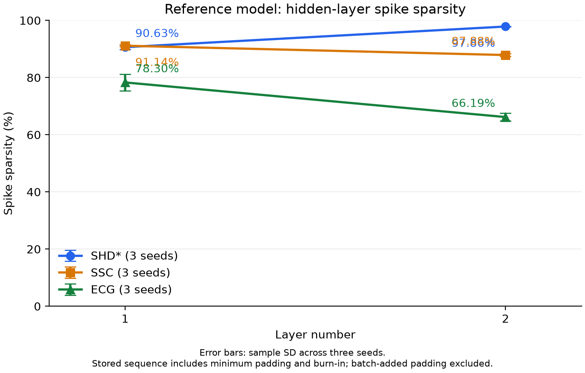

# Paper, reference and proposed-model comparison

## Test accuracy

| Dataset | Paper | Reference (Δ paper) | DTH (Δ paper) | MT (Δ paper) | AMT (Δ paper) | MT-TC (Δ paper) | LT-DTH (Δ paper) | SA-MT (Δ paper) |
|---|---:|---:|---:|---:|---:|---:|---:|---:|
| SHD* | 93.79 ± 0.76 | 93.15 ± 0.42 (-0.64 pp) | **94.64 ± 0.54** (+0.85 pp) | **94.61 ± 0.23** (+0.82 pp) | 92.76 ± 2.11 (-1.03 pp) | **93.80 ± 0.95** (+0.01 pp) | **93.98 ± 0.63** (+0.19 pp) | 93.77 ± 0.61 (-0.02 pp) |
| SSC | 80.44 ± 0.26 | **80.47 ± 0.20** (+0.03 pp) | 80.34 ± 0.49 (-0.10 pp) | 80.39 ± 0.01 (-0.05 pp) | **80.72 ± 0.28** (+0.28 pp) | **80.47 ± 0.10** (+0.03 pp) | **80.60 ± 0.31** (+0.16 pp) | **80.54 ± 0.22** (+0.10 pp) |
| ECG | 88.18 ± 0.36 | **88.32 ± 0.35** (+0.14 pp) | **88.40 ± 0.17** (+0.22 pp) | **88.53 ± 0.54** (+0.35 pp) | **88.60 ± 0.17** (+0.42 pp) | **88.80 ± 0.41** (+0.62 pp) | **88.42 ± 0.61** (+0.24 pp) | **89.06 ± 0.28** (+0.88 pp) |

Snapshot: 26 October 2026. Models: DTH, MT, AMT, MT-TC, LT-DTH and SA-MT.

Accuracy (%) is mean ± sample SD across matching training seeds 42, 123 and 456 (n=3). Each proposed model shows the higher three-seed mean between ordinary inference and TTA, retaining the SD of that evaluation; individual seed maxima are not combined. Reference uses ordinary inference. **Bold** marks a local mean above the paper mean. Δ paper = local mean minus the published paper mean, in percentage points (pp), calculated before rounding.

### Selected accuracy evaluation

| Dataset | DTH | MT | AMT | MT-TC | LT-DTH | SA-MT |
|---|---:|---:|---:|---:|---:|---:|
| SHD* | TTA | Ordinary (tie) | TTA | Ordinary (tie) | Ordinary | TTA |
| SSC | TTA | TTA | TTA | TTA | TTA | TTA |
| ECG | TTA | TTA | TTA | TTA | TTA | TTA |

TTA averages class probabilities from frozen-checkpoint input gains 1.0, 0.95 and 1.05. Ties use ordinary inference. Selecting the better test mean is exploratory because test scores were already inspected; these are not independent final-test improvements or evidence of statistical significance. Paper sample sizes are SHD*/ECG n=20 and SSC n=5.

All six models share the dataset-specific baseline optimization, preprocessing and budget. MT-TC intentionally adds a training-only temporal consistency loss. SSC uses `ssc_mean_loss_v1`. SHD* uses a fixed 20% training-derived validation split with split seed 42. ECG reference is accepted historical evidence with unmatched stopping/budget: 383 epochs for seed 42 and early stopping at 283/185 epochs for seeds 123/456, versus a 400-epoch budget for proposed models; its comparisons are descriptive.

## Inference time

| Dataset | Paper | Reference | DTH | MT | AMT | MT-TC | LT-DTH | SA-MT |
|---|---:|---:|---:|---:|---:|---:|---:|---:|
| SHD* | Not reported | 1.24 ± 0.01 | 1.61 ± 0.04 | 1.67 ± 0.03 | 1.84 ± 0.12 | 1.54 ± 0.08 | 1.79 ± 0.01 | 1.59 ± 0.01 |
| SSC | Not reported | 1.41 ± 0.07 | 1.74 ± 0.16 | 1.70 ± 0.14 | 2.02 ± 0.11 | 1.83 ± 0.11 | 1.91 ± 0.01 | 1.76 ± 0.02 |
| ECG | Not reported | 33.87 ± 4.54 | 43.91 ± 0.31 | 44.67 ± 0.53 | 45.96 ± 1.06 | 46.34 ± 0.49 | 45.91 ± 1.14 | 42.43 ± 1.12 |

All remaining tables use **ordinary inference without TTA**, regardless of the accuracy selection above. These costs must not be presented as the cost of TTA accuracy. TTA runtime and energy are not measured here. Timing is forward-only milliseconds/sample, mean ± sample SD across three seeds.

Saved timing uses three repeats, two warm-up batches, batch sizes 256 for SHD*/SSC and 64 for ECG, RTX 4090 and high matmul precision. It excludes loading, transfer, loss and temporal prediction aggregation. Sessions and evaluator environments differ; these are descriptive measurements, not a controlled hardware speed benchmark.

## Parameters, activity and computational cost

### Total parameters

| Dataset | Paper | Reference (Δ paper) | DTH (Δ paper) | MT (Δ paper) | AMT (Δ paper) | MT-TC (Δ paper) | LT-DTH (Δ paper) | SA-MT (Δ paper) |
|---|---:|---:|---:|---:|---:|---:|---:|---:|
| SHD* | 0.45M | 450,760 (≈+760 params) | 451,484 (≈+1,484 params) | 452,200 (≈+2,200 params) | 452,920 (≈+2,920 params) | 452,200 (≈+2,200 params) | 451,488 (≈+1,488 params) | 452,920 (≈+2,920 params) |
| SSC | 1.6M | 1,689,910 (≈+89,910 params) | 1,691,354 (≈+91,354 params) | 1,692,790 (≈+92,790 params) | 1,694,230 (≈+94,230 params) | 1,692,790 (≈+92,790 params) | 1,691,358 (≈+91,358 params) | 1,694,230 (≈+94,230 params) |
| ECG | 4.6k | 4,692 (≈+92 params) | 4,768 (≈+168 params) | 4,836 (≈+236 params) | 4,908 (≈+308 params) | 4,836 (≈+236 params) | 4,772 (≈+172 params) | 4,908 (≈+308 params) |

Published counts are rounded: 0.45M = 450,000, 1.6M = 1,600,000 and 4.6k = 4,600. Count differences from those rounded baselines are approximate (≈), in parameters.

All statistics below come from the same per-seed cost records. Parameter counts are exact and identical across seeds. Other values are mean ± sample SD (n=3); zero SD means equal counted costs, not measurement certainty.

### Trainable parameters

| Dataset | Paper | Reference | DTH | MT | AMT | MT-TC | LT-DTH | SA-MT |
|---|---:|---:|---:|---:|---:|---:|---:|---:|
| SHD* | Not reported | 450,020 | 450,744 | 451,460 | 452,180 | 451,460 | 450,748 | 452,180 |
| SSC | Not reported | 1,688,435 | 1,689,879 | 1,691,315 | 1,692,755 | 1,691,315 | 1,689,883 | 1,692,755 |
| ECG | Not reported | 4,614 | 4,690 | 4,758 | 4,830 | 4,758 | 4,694 | 4,830 |

### Hidden spikes per sample

| Dataset | Paper | Reference | DTH | MT | AMT | MT-TC | LT-DTH | SA-MT |
|---|---:|---:|---:|---:|---:|---:|---:|---:|
| SHD* | Not reported | 10,365.8 ± 726.0 | 10,513.9 ± 612.6 | 10,637.4 ± 608.6 | 10,739.6 ± 375.6 | 10,628.1 ± 514.5 | 10,220.3 ± 502.9 | 10,712.1 ± 587.9 |
| SSC | Not reported | 45,301.2 ± 1,640.2 | 45,601.5 ± 4,030.9 | 49,500.0 ± 580.7 | 49,383.4 ± 2,491.1 | 48,358.8 ± 2,136.6 | 43,980.5 ± 1,696.4 | 49,151.0 ± 1,644.4 |
| ECG | Not reported | 26,000.4 ± 2,012.7 | 30,057.7 ± 2,822.3 | 26,665.3 ± 378.0 | 27,536.2 ± 386.6 | 28,281.4 ± 989.2 | 29,788.9 ± 1,455.6 | 27,166.5 ± 950.0 |

### Event-driven synaptic-operation estimate (million SynOps/sample)

| Dataset | Paper | Reference | DTH | MT | AMT | MT-TC | LT-DTH | SA-MT |
|---|---:|---:|---:|---:|---:|---:|---:|---:|
| SHD* | Not reported | 9.76 ± 0.51 | 9.78 ± 0.30 | 9.86 ± 0.42 | 9.98 ± 0.12 | 9.88 ± 0.34 | 9.71 ± 0.39 | 9.87 ± 0.37 |
| SSC | Not reported | 53.34 ± 1.69 | 53.51 ± 4.73 | 58.35 ± 0.32 | 58.29 ± 3.00 | 57.23 ± 2.56 | 52.34 ± 1.80 | 58.17 ± 2.31 |
| ECG | Not reported | 1.40 ± 0.13 | 1.61 ± 0.17 | 1.42 ± 0.04 | 1.48 ± 0.03 | 1.53 ± 0.06 | 1.61 ± 0.13 | 1.45 ± 0.05 |

### Hidden spike sparsity (%)

| Dataset | Paper | Reference | DTH | MT | AMT | MT-TC | LT-DTH | SA-MT |
|---|---:|---:|---:|---:|---:|---:|---:|---:|
| SHD* | Not reported | 90.63 ± 0.76 / 97.86 ± 0.13 | 90.76 ± 0.26 / 97.56 ± 0.48 | 90.67 ± 0.62 / 97.52 ± 0.10 | 90.39 ± 0.11 / 97.68 ± 0.50 | 90.57 ± 0.52 / 97.62 ± 0.33 | 90.62 ± 0.64 / 98.03 ± 0.08 | 90.70 ± 0.47 / 97.40 ± 0.20 |
| SSC | Not reported | 91.14 ± 0.32 / 87.88 ± 0.47 | 91.18 ± 1.14 / 87.71 ± 0.72 | 89.89 ± 0.12 / 87.20 ± 0.37 | 89.87 ± 0.77 / 87.27 ± 0.40 | 90.06 ± 0.68 / 87.55 ± 0.47 | 91.15 ± 0.35 / 88.49 ± 0.43 | 89.83 ± 0.73 / 87.42 ± 0.16 |
| ECG | Not reported | 78.30 ± 2.92 / 66.19 ± 1.38 | 75.17 ± 3.99 / 60.66 ± 2.86 | 78.77 ± 2.62 / 64.30 ± 2.49 | 77.25 ± 1.12 / 63.96 ± 0.78 | 75.31 ± 1.50 / 64.31 ± 1.32 | 74.61 ± 5.07 / 61.79 ± 1.97 | 77.69 ± 1.22 / 64.31 ± 2.18 |

Each cell reports L1 / L2. Sparsity is 100 minus the saved firing percentage over stored sample timesteps, including minimum padding and burn-in but excluding added batch padding.

[Download vector figure](figures/reference-layer-sparsity.svg). Reproduce from saved measurements with `.\.venv\Scripts\python.exe scripts/plot_reference_sparsity.py`; no inference or training is performed.

### Dense matrix cost (GFLOPs/sample)

| Dataset | Paper | Reference | DTH | MT | AMT | MT-TC | LT-DTH | SA-MT |
|---|---:|---:|---:|---:|---:|---:|---:|---:|
| SHD* | Not reported | 0.242895 ± 0.000000 | 0.242895 ± 0.000000 | 0.242895 ± 0.000000 | 0.242895 ± 0.000000 | 0.242895 ± 0.000000 | 0.242895 ± 0.000000 | 0.242895 ± 0.000000 |
| SSC | Not reported | 1.008720 ± 0.000000 | 1.008720 ± 0.000000 | 1.008720 ± 0.000000 | 1.008720 ± 0.000000 | 1.008720 ± 0.000000 | 1.008720 ± 0.000000 | 1.008720 ± 0.000000 |
| ECG | Not reported | 0.011053 ± 0.000000 | 0.011053 ± 0.000000 | 0.011053 ± 0.000000 | 0.011053 ± 0.000000 | 0.011053 ± 0.000000 | 0.011053 ± 0.000000 | 0.011053 ± 0.000000 |

### Matrix plus scalar arithmetic cost (GFLOPs/sample)

| Dataset | Paper | Reference | DTH | MT | AMT | MT-TC | LT-DTH | SA-MT |
|---|---:|---:|---:|---:|---:|---:|---:|---:|
| SHD* | Not reported | 0.247824 ± 0.000000 | 0.250372 ± 0.000000 | 0.249006 ± 0.000000 | 0.250769 ± 0.000000 | 0.249006 ± 0.000000 | 0.250372 ± 0.000000 | 0.249789 ± 0.000000 |
| SSC | Not reported | 1.019584 ± 0.000000 | 1.025202 ± 0.000000 | 1.022190 ± 0.000000 | 1.026077 ± 0.000000 | 1.022190 ± 0.000000 | 1.025202 ± 0.000000 | 1.023918 ± 0.000000 |
| ECG | Not reported | 0.013455 ± 0.000000 | 0.014678 ± 0.000000 | 0.014033 ± 0.000000 | 0.014879 ± 0.000000 | 0.014033 ± 0.000000 | 0.014678 ± 0.000000 | 0.014407 ± 0.000000 |

### Logical operation estimate (GOp/sample)

| Dataset | Paper | Reference | DTH | MT | AMT | MT-TC | LT-DTH | SA-MT |
|---|---:|---:|---:|---:|---:|---:|---:|---:|
| SHD* | Not reported | 0.248414 ± 0.000000 | 0.251353 ± 0.000000 | 0.249597 ± 0.000000 | 0.251555 ± 0.000000 | 0.249597 ± 0.000000 | 0.251353 ± 0.000000 | 0.250380 ± 0.000000 |
| SSC | Not reported | 1.020884 ± 0.000000 | 1.027365 ± 0.000000 | 1.023493 ± 0.000000 | 1.027811 ± 0.000000 | 1.023493 ± 0.000000 | 1.027365 ± 0.000000 | 1.025221 ± 0.000000 |
| ECG | Not reported | 0.013740 ± 0.000000 | 0.015150 ± 0.000000 | 0.014322 ± 0.000000 | 0.015260 ± 0.000000 | 0.014322 ± 0.000000 | 0.015151 ± 0.000000 | 0.014696 ± 0.000000 |

Hidden spikes sum both hidden layers and exclude output activity. SynOps estimate ideal event-driven fan-out additions; they do not measure dense GPU operations or energy. ECG analog-input projection is excluded from SynOps and counted separately as dense MACs in source records.

Dense matrix cost counts each multiply-add as two FLOPs. Arithmetic adds counted neuron scalar arithmetic, excluding nonlinearities and comparisons. Logical GOp additionally includes counted nonlinear/comparison operations and is not hardware GFLOPs. Compute uses executed batch-padded sequence extent and excludes memory traffic, loading, transfer, loss and temporal aggregation. Paper classification activity/compute values are unavailable; rounded parameter counts come from Table 2 (PDF page 11), which does not separate trainable counts. Audio-bottleneck spike rates are not comparable classification activity.

## Per-seed measurements and sources

| Dataset | Model | Per-seed ms/sample | Cost records by seed |
|---|---:|---:|---:|
| SHD* | Reference | 1.23 / 1.24 / 1.25 | [42](../results/valid/reference/SHD/seed_42/COST_RESULTS.json), [123](../results/valid/reference/SHD/seed_123/COST_RESULTS.json), [456](../results/valid/reference/SHD/seed_456/COST_RESULTS.json) |
| SHD* | DTH | 1.66 / 1.60 / 1.58 | [42](../results/valid/DTH_SE_adLIF/SHD/seed_42/COST_RESULTS.json), [123](../results/valid/DTH_SE_adLIF/SHD/seed_123/COST_RESULTS.json), [456](../results/valid/DTH_SE_adLIF/SHD/seed_456/COST_RESULTS.json) |
| SHD* | MT | 1.64 / 1.68 / 1.68 | [42](../results/valid/MT_SE_adLIF/SHD/seed_42/COST_RESULTS.json), [123](../results/valid/MT_SE_adLIF/SHD/seed_123/COST_RESULTS.json), [456](../results/valid/MT_SE_adLIF/SHD/seed_456/COST_RESULTS.json) |
| SHD* | AMT | 1.98 / 1.77 / 1.78 | [42](../results/not_improved/AMT_SE_adLIF/SHD/seed_42/COST_RESULTS.json), [123](../results/not_improved/AMT_SE_adLIF/SHD/seed_123/COST_RESULTS.json), [456](../results/not_improved/AMT_SE_adLIF/SHD/seed_456/COST_RESULTS.json) |
| SHD* | MT-TC | 1.63 / 1.51 / 1.49 | [42](../results/experiments/mt_consistency_runner_v1/MT_TC_SE_adLIF/SHD/seed_42/COST_RESULTS.json), [123](../results/experiments/mt_consistency_runner_v1/MT_TC_SE_adLIF/SHD/seed_123/COST_RESULTS.json), [456](../results/experiments/mt_consistency_runner_v1/MT_TC_SE_adLIF/SHD/seed_456/COST_RESULTS.json) |
| SHD* | LT-DTH | 1.78 / 1.79 / 1.79 | [42](../results/not_improved/LT_DTH_SE_adLIF/SHD/seed_42/COST_RESULTS.json), [123](../results/not_improved/LT_DTH_SE_adLIF/SHD/seed_123/COST_RESULTS.json), [456](../results/not_improved/LT_DTH_SE_adLIF/SHD/seed_456/COST_RESULTS.json) |
| SHD* | SA-MT | 1.59 / 1.58 / 1.59 | [42](../results/experiments/sa_mt_v1/SA_MT_SE_adLIF/SHD/seed_42/COST_RESULTS.json), [123](../results/experiments/sa_mt_v1/SA_MT_SE_adLIF/SHD/seed_123/COST_RESULTS.json), [456](../results/experiments/sa_mt_v1/SA_MT_SE_adLIF/SHD/seed_456/COST_RESULTS.json) |
| SSC | Reference | 1.32 / 1.46 / 1.44 | [42](../results/valid/reference/SSC/seed_42/COST_RESULTS.json), [123](../results/valid/reference/SSC/seed_123/COST_RESULTS.json), [456](../results/valid/reference/SSC/seed_456/COST_RESULTS.json) |
| SSC | DTH | 1.61 / 1.92 / 1.70 | [42](../results/valid/DTH_SE_adLIF/SSC/seed_42/COST_RESULTS.json), [123](../results/valid/DTH_SE_adLIF/SSC/seed_123/COST_RESULTS.json), [456](../results/valid/DTH_SE_adLIF/SSC/seed_456/COST_RESULTS.json) |
| SSC | MT | 1.56 / 1.85 / 1.69 | [42](../results/valid/MT_SE_adLIF/SSC/seed_42/COST_RESULTS.json), [123](../results/valid/MT_SE_adLIF/SSC/seed_123/COST_RESULTS.json), [456](../results/valid/MT_SE_adLIF/SSC/seed_456/COST_RESULTS.json) |
| SSC | AMT | 1.98 / 1.94 / 2.15 | [42](../results/not_improved/AMT_SE_adLIF/SSC/seed_42/COST_RESULTS.json), [123](../results/not_improved/AMT_SE_adLIF/SSC/seed_123/COST_RESULTS.json), [456](../results/not_improved/AMT_SE_adLIF/SSC/seed_456/COST_RESULTS.json) |
| SSC | MT-TC | 1.95 / 1.74 / 1.81 | [42](../results/experiments/mt_consistency_runner_v1/MT_TC_SE_adLIF/SSC/seed_42/COST_RESULTS.json), [123](../results/experiments/mt_consistency_runner_v1/MT_TC_SE_adLIF/SSC/seed_123/COST_RESULTS.json), [456](../results/experiments/mt_consistency_runner_v1/MT_TC_SE_adLIF/SSC/seed_456/COST_RESULTS.json) |
| SSC | LT-DTH | 1.92 / 1.93 / 1.90 | [42](../results/not_improved/LT_DTH_SE_adLIF/SSC/seed_42/COST_RESULTS.json), [123](../results/not_improved/LT_DTH_SE_adLIF/SSC/seed_123/COST_RESULTS.json), [456](../results/not_improved/LT_DTH_SE_adLIF/SSC/seed_456/COST_RESULTS.json) |
| SSC | SA-MT | 1.75 / 1.75 / 1.78 | [42](../results/experiments/sa_mt_v1/SA_MT_SE_adLIF/SSC/seed_42/COST_RESULTS.json), [123](../results/experiments/sa_mt_v1/SA_MT_SE_adLIF/SSC/seed_123/COST_RESULTS.json), [456](../results/experiments/sa_mt_v1/SA_MT_SE_adLIF/SSC/seed_456/COST_RESULTS.json) |
| ECG | Reference | 38.64 / 33.38 / 29.60 | [42](../results/valid/reference/ECG/seed_42/COST_RESULTS.json), [123](../results/valid/reference/ECG/seed_123/COST_RESULTS.json), [456](../results/valid/reference/ECG/seed_456/COST_RESULTS.json) |
| ECG | DTH | 43.81 / 43.67 / 44.26 | [42](../results/valid/DTH_SE_adLIF/ECG/seed_42/COST_RESULTS.json), [123](../results/valid/DTH_SE_adLIF/ECG/seed_123/COST_RESULTS.json), [456](../results/valid/DTH_SE_adLIF/ECG/seed_456/COST_RESULTS.json) |
| ECG | MT | 45.26 / 44.52 / 44.23 | [42](../results/valid/MT_SE_adLIF/ECG/seed_42/COST_RESULTS.json), [123](../results/valid/MT_SE_adLIF/ECG/seed_123/COST_RESULTS.json), [456](../results/valid/MT_SE_adLIF/ECG/seed_456/COST_RESULTS.json) |
| ECG | AMT | 46.88 / 46.20 / 44.80 | [42](../results/not_improved/AMT_SE_adLIF/ECG/seed_42/COST_RESULTS.json), [123](../results/not_improved/AMT_SE_adLIF/ECG/seed_123/COST_RESULTS.json), [456](../results/not_improved/AMT_SE_adLIF/ECG/seed_456/COST_RESULTS.json) |
| ECG | MT-TC | 45.78 / 46.50 / 46.73 | [42](../results/experiments/mt_consistency_runner_v1/MT_TC_SE_adLIF/ECG/seed_42/COST_RESULTS.json), [123](../results/experiments/mt_consistency_runner_v1/MT_TC_SE_adLIF/ECG/seed_123/COST_RESULTS.json), [456](../results/experiments/mt_consistency_runner_v1/MT_TC_SE_adLIF/ECG/seed_456/COST_RESULTS.json) |
| ECG | LT-DTH | 46.02 / 46.99 / 44.72 | [42](../results/not_improved/LT_DTH_SE_adLIF/ECG/seed_42/COST_RESULTS.json), [123](../results/not_improved/LT_DTH_SE_adLIF/ECG/seed_123/COST_RESULTS.json), [456](../results/not_improved/LT_DTH_SE_adLIF/ECG/seed_456/COST_RESULTS.json) |
| ECG | SA-MT | 42.77 / 43.33 / 41.18 | [42](../results/experiments/sa_mt_v1/SA_MT_SE_adLIF/ECG/seed_42/COST_RESULTS.json), [123](../results/experiments/sa_mt_v1/SA_MT_SE_adLIF/ECG/seed_123/COST_RESULTS.json), [456](../results/experiments/sa_mt_v1/SA_MT_SE_adLIF/ECG/seed_456/COST_RESULTS.json) |

Seed values are in order 42 / 123 / 456. Links retain checkpoint identities, configs, measurements and environment evidence.

Accuracy sources: [paper](paper-results.md), [reference](paper-vs-reference.md), [DTH SHD*/ECG TTA](../results/experiments/dth_tta_v1/RESULTS.md), [DTH SSC TTA](../results/experiments/dth_tta_v2/RESULTS.md), [MT SHD*/ECG TTA](../results/experiments/mt_tta_v1/RESULTS.md), [MT SSC TTA](../results/experiments/mt_tta_v2/RESULTS.md), [AMT TTA](../results/experiments/amt_tta_v1/RESULTS.md), [MT-TC TTA](../results/experiments/mt_tc_tta_v1/RESULTS.md), [LT-DTH TTA](../results/experiments/lt_dth_tta_v1/RESULTS.md), [SA-MT TTA](../results/experiments/sa_mt_tta_v1/RESULTS.md).

[TTA protocol](../docs/experiments/four-candidate-tta.md), [configuration audit](../docs/audits/tta-config-comparison-2026-10-26.json), [TTA transfer verification](../results/provenance/reza-tta-import-2026-10-26.json), [training-result transfer verification](../results/provenance/reza-mt-tc-completion-import-2026-10-26.json), and [SSC transfer verification](../results/provenance/ssc-local-import-2026-10-21.json).
