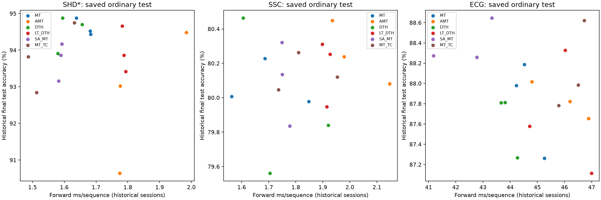
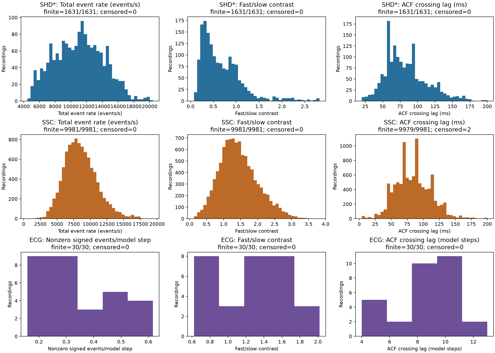
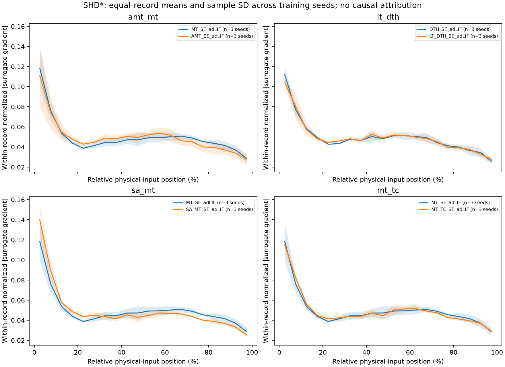
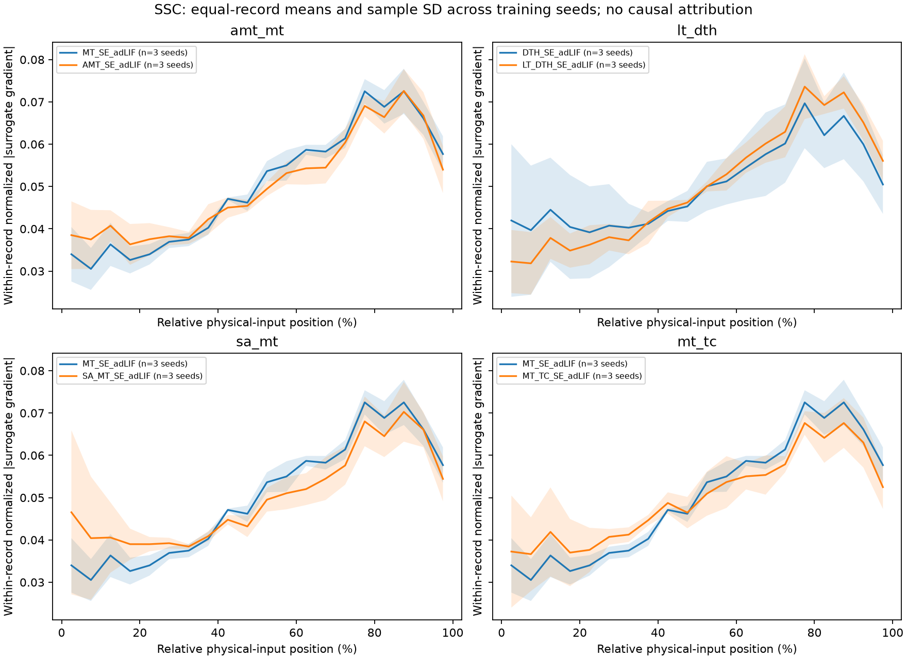
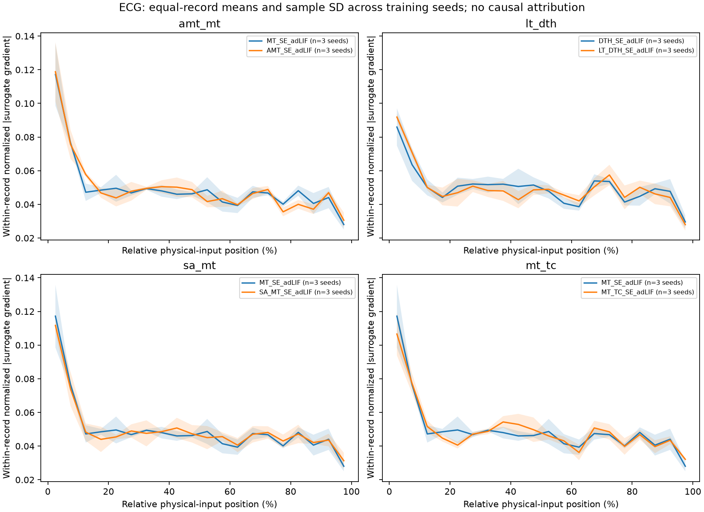
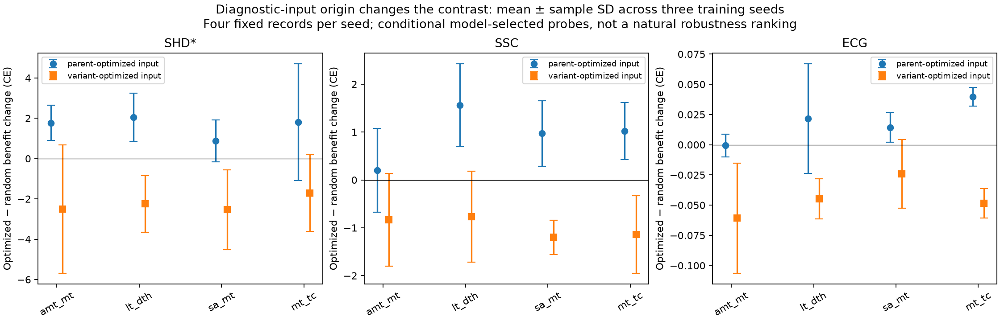

# گزارش پژوهش

## ارتباط آمار زمانی ورودی با عملکرد سازوکارهای تطبیقی در شبکه‌های عصبی اسپایکی

**تاریخ تهیه: ۱۷ نوامبر ۲۰۲۶** 
**وضعیت: گزارش فارسیِ نتایج اجراشده و تأییدشده در دامنهٔ اکتشافی ثبت‌شده**

در این پژوهش بررسی کرده‌ام که آیا ویژگی‌های کمی قطارهای اسپایک ورودی می‌توانند تفاوت عملکرد چهار سازوکار AMT، MT-TC، SA-MT و LT-DTH را نسبت به مدل والد خود توضیح دهند. هدف این بررسی، تحلیل رابطهٔ ویژگی ورودی، رفتار مدل و پاسخ به مداخله، در کنار مقایسهٔ دقت مدل‌هاست.

اعداد و شکل‌های این گزارش بر [نتایج نهایی مطالعه](results/experiments/adaptation_stage8_synthesis_v1/SUMMARY.md) و [بازبینی تأییدشدهٔ آن‌ها](results/experiments/adaptation_stage8_synthesis_v1/POST_RUN_REVIEW.md) استوارند. متن و جدول‌ها بر اساس شواهد ذخیره‌شده تدوین شده‌اند؛ در تدوین گزارش، آموزش، ارزیابی عصبی، استخراج ویژگی، برازش یا نمونه‌گیری مجددی انجام نشده است.

### چکیدهٔ یافته‌ها

نتایج، یک برتری عمومی و پایدار برای چهار سازوکار نشان نمی‌دهند. جهت و اندازهٔ اثر به مجموعه‌داده، بذر آموزش، معیار عملکرد و نوع مداخله وابسته است. در SHD*، میانگین دقت آزمون تاریخی هر چهار نسخه از مدل والد خود پایین‌تر است؛ در SSC و ECG برخی تفاوت‌های مثبت دیده می‌شود، اما این تفاوت‌ها به‌تنهایی توضیح مکانیزمی یا تأیید مستقل محسوب نمی‌شوند.

ویژگی تفاوت تغییرات سریع و کند، پشتیبانی آماری یکدستی برای فرضیه‌های اولیه فراهم نکرد. در SHD*، رابطهٔ مقیاس خودهمبستگی با مزیت AMT و SA-MT دارای بازهٔ اکتشافی مثبت بود، اما جهت ضریب میان بذرها یکسان نبود. در SSC هر هشت بازهٔ اصلی ویژگی/مدل شامل صفر است. تحلیل ECG به‌دلیل نبود شناسهٔ معتبر بیمار، توصیفی باقی می‌ماند.

آزمایش‌های کنترل‌شده نیز نتایج مختلط دارند. برای نمونه، در SHD* حذف رخداد، مزیت نسبی LT-DTH را کاهش می‌دهد و فشرده‌سازی زمانی 0.9 برای MT-TC اثر نسبی منفی دارد؛ در SSC کشش 1.1 برای LT-DTH نشانهٔ مثبتِ مشروط به همین داده‌ها نشان می‌دهد. تحلیل گرادیان و ورودی تشخیصی نیز روشن کرد که نتیجه به مدلی که ورودی را انتخاب و بهینه کرده است وابستگی زیادی دارد. این مشاهدات، با ادعای مقاومت عمومی یا توجه علّی یک مدل برابر نیستند.

### دامنه و قرارداد مقایسه

| سازوکار مورد بررسی | مدل والد مستقیم | سؤال مکانیزمی |
|---|---|---|
| AMT | MT | آیا تفاوت تغییرات سریع و کند ورودی با مزیت مدل ارتباط دارد؟ |
| MT-TC | MT | آیا سازگاری شواهد در پنجره‌های زمانی مجاور به تصمیم بهتر کمک می‌کند؟ |
| SA-MT | MT | آیا تنظیم جداگانهٔ شدت تطبیق سریع و کند، برای الگوهای گذرا و پایدار مفید است؟ |
| LT-DTH | DTH | آیا یادگیری مقیاس زمانی مسیرهای تطبیقی با مقیاس زمانی مؤثر ورودی ارتباط دارد؟ |

در هر مقایسه، سه بذر آموزش 42، 123 و 456 با هم تطبیق داده شده‌اند. تقسیم SHD* با بذر ثابت 42، شامل ۲۰ درصد از مجموعهٔ آموزش رسمی برای اعتبارسنجی است. SSC از اعتبارسنجی رسمی و ECG از همان تقسیم اعتبارسنجی ذخیره‌شده استفاده می‌کند. تعداد نمونه‌های اعتبارسنجی به‌ترتیب ۱۶۳۱، ۹۹۸۱ و ۳۰ است.

در مجموع شش نوع مدل و ۵۴ چک‌پوینت یکتا وجود دارد: شش مدل × سه بذر × سه مجموعه‌داده. MT میان سه مقایسه مشترک است؛ بنابراین، تکرار آن در چند جدول به معنای چند خط پایهٔ مستقل نیست. میانگین‌ها و انحراف معیارهای عملکرد، روی سه بذر آموزش محاسبه شده‌اند. تکرارهای حذف رخداد، پنجره‌ها یا رکوردهای ورودی، بذر آموزش جدید محسوب نمی‌شوند. انحراف معیار نمونه‌ای، بازهٔ اطمینان میانگین نیست.

مقایسه‌ها بدون افزایش داده هنگام آزمون یا **TTA** هستند. مدل‌ها تنظیمات پایهٔ مختص مجموعه‌داده را حفظ کرده‌اند؛ MT-TC علاوه بر تفاوت سازوکار، تابع هدف آموزشی متفاوتی دارد. در مقایسهٔ زیان، جریمهٔ کمکی سازگاری زمانی وارد زیان نظارت‌شده نمی‌شود.

### استفاده از کد موجود و حدود انطباق با مقالهٔ مبنا

در [ممیزی کد موجود](docs/audits/supervisor-stage6-closeout-2026-11-16.md)، مسیر اصلی پیشروی مدل، تجمیع خروجی زمانی، پیاده‌سازی لایه‌ها و مشتق جانشین SLAYER قابل استفاده تشخیص داده شدند. برای ECG، ورودی‌های علامت‌دار، برچسب زمانی و ماسک‌ها با قرارداد ذخیره‌شده تطبیق داده شدند. برای گرادیان، از مسیر معمول `MLPSNN.forward` استفاده شد؛ مسیر ثبت تاریخچهٔ حالت که گرادیان را غیرفعال می‌کند، مبنای مشتق‌گیری نبود.

تعریف ویژگی‌ها و ابزارهای تحلیلی این مطالعه نسخه‌دار و محلی هستند. در بررسی فایل‌های موجود، بستهٔ مستقلی برای بازتولید دقیق شکل‌های تحلیلی مقالهٔ مبنا شناسایی نشد. بنابراین، استفاده از زیرساخت موجود و انطباق آن مستند شده است، اما برابری دقیق تمام روش‌ها و شکل‌ها با تحلیل‌های مقالهٔ مبنا ادعا نمی‌شود.

## بخش اول ـ عملکرد چهار سازوکار و هزینهٔ محاسباتی

### ۱ـ۱. عملکرد روی ورودی پاکِ اعتبارسنجی

در جدول زیر، اختلاف دقت برابر دقت نسخهٔ پیشنهادی منهای دقت مدل والد است. واحد اختلاف، **واحد درصدی** یا pp است؛ مثلاً اختلاف 0.3 pp با افزایش نسبی 0.3 درصد یکسان نیست. مزیت زیان به‌شکل زیر تعریف می‌شود:

`benefit = supervised_loss(parent) - supervised_loss(variant)`

مزیت مثبت یعنی نسخهٔ پیشنهادی برای همان ورودی زیان کمتری دارد. مثبت‌بودن مزیت زیان لزوماً با بالاتربودن دقت همراه نیست. SHD* و SSC دقت را بر اساس رکورد می‌سنجند؛ دقت ECG بر اساس گام‌های زمانی دارای برچسب محاسبه می‌شود. زیان‌های سه مجموعه‌داده نیز تجمیع زمانی متفاوت دارند و نباید در یک میانگین مشترک ادغام شوند.

| داده | مقایسهٔ نسخه / والد | دقت والد، درصد | دقت نسخه، درصد | اختلاف زوجی دقت، pp | مزیت زیان CE |
|---|---|---|---|---|---|
| SHD* | AMT / MT | 99.2643 ± 0.0613 | 99.0190 ± 0.1062 | -0.2452 ± 0.1226 | -0.007344 ± 0.036602 |
| SHD* | LT-DTH / DTH | 99.0803 ± 0.0613 | 99.1416 ± 0.3186 | 0.0613 ± 0.3729 | 0.008296 ± 0.015704 |
| SHD* | SA-MT / MT | 99.2643 ± 0.0613 | 99.1416 ± 0.2452 | -0.1226 ± 0.2211 | -0.004300 ± 0.007345 |
| SHD* | MT-TC / MT | 99.2643 ± 0.0613 | 99.1825 ± 0.0937 | -0.0817 ± 0.0937 | -0.002075 ± 0.012946 |
| SSC | AMT / MT | 82.1528 ± 0.2719 | 82.0459 ± 0.1735 | -0.1069 ± 0.3889 | -0.003752 ± 0.027020 |
| SSC | LT-DTH / DTH | 81.5783 ± 0.3465 | 81.5917 ± 0.0504 | 0.0134 ± 0.3357 | 0.015176 ± 0.030407 |
| SSC | SA-MT / MT | 82.1528 ± 0.2719 | 81.8822 ± 0.0652 | -0.2705 ± 0.2768 | -0.005840 ± 0.016573 |
| SSC | MT-TC / MT | 82.1528 ± 0.2719 | 82.1127 ± 0.1796 | -0.0401 ± 0.4513 | 0.006200 ± 0.028200 |
| ECG | AMT / MT | 86.2405 ± 0.0706 | 86.5659 ± 0.1751 | 0.3254 ± 0.2149 | 0.006222 ± 0.008670 |
| ECG | LT-DTH / DTH | 86.0278 ± 0.2287 | 86.4660 ± 0.3089 | 0.4381 ± 0.2159 | 0.013440 ± 0.015810 |
| ECG | SA-MT / MT | 86.2405 ± 0.0706 | 86.4216 ± 0.4442 | 0.1811 ± 0.4065 | 0.002323 ± 0.014520 |
| ECG | MT-TC / MT | 86.2405 ± 0.0706 | 86.1004 ± 0.3605 | -0.1401 ± 0.2906 | -0.009249 ± 0.011215 |

در SHD* و SSC، AMT و SA-MT میانگین دقت اعتبارسنجی پایین‌تری از MT دارند. LT-DTH در این دو داده اختلاف میانگین مثبت ولی کوچک دارد. در ECG، میانگین اختلاف اعتبارسنجی AMT، LT-DTH و SA-MT مثبت است، در حالی که MT-TC میانگین منفی دارد. این الگوها دلیل کافی برای تعمیم برتری به همهٔ داده‌ها یا بذرهای جدید نیستند.

### ۱ـ۲. دقت آزمون تاریخی؛ جدا از تحلیل اعتبارسنجی

جدول بعدی از نتایج آزمون نهاییِ ذخیره‌شده در تاریخچهٔ آموزش استفاده می‌کند. ارزیابی هزینهٔ ذخیره‌شده نیز این دقت‌ها را در تلرانس ثبت‌شده بازتولید کرده است. این گزارش دادهٔ آزمون رسمی را دوباره باز نکرده است. به‌دلیل مشاهدهٔ نتایج آزمون در مراحل قبلی توسعه، این اعداد **شاهد تاریخی و توصیفی‌اند، نه تأیید مستقل فرضیه‌های فعلی**. نتایج توسعهٔ ده‌بذری و TTA در این جدول مخلوط نشده‌اند.

| داده | مدل | دقت آزمون تاریخی، درصد | دقت بذرهای 42 / 123 / 456، درصد |
|---|---|---|---|
| SHD* | MT | 94.6113 ± 0.2337 | 94.8763 / 94.5230 / 94.4346 |
| SHD* | AMT | 92.7120 ± 1.9399 | 94.4788 / 90.6360 / 93.0212 |
| SHD* | DTH | 94.4935 ± 0.5176 | 94.6996 / 94.8763 / 93.9046 |
| SHD* | LT-DTH | 93.9782 ± 0.6267 | 94.6555 / 93.4187 / 93.8604 |
| SHD* | SA-MT | 93.7279 ± 0.5208 | 94.1696 / 93.1537 / 93.8604 |
| SHD* | MT-TC | 93.8015 ± 0.9497 | 94.7438 / 92.8445 / 93.8163 |
| SSC | MT | 80.0706 ± 0.1368 | 80.0069 / 79.9774 / 80.2276 |
| SSC | AMT | 80.2555 ± 0.1846 | 80.2375 / 80.4484 / 80.0805 |
| SSC | DTH | 79.9545 ± 0.4621 | 80.4632 / 79.8401 / 79.5604 |
| SSC | LT-DTH | 80.1704 ± 0.1949 | 79.9480 / 80.2522 / 80.3111 |
| SSC | SA-MT | 80.0968 ± 0.2450 | 80.1344 / 80.3209 / 79.8351 |
| SSC | MT-TC | 80.1426 ± 0.1097 | 80.1197 / 80.0461 / 80.2620 |
| ECG | MT | 87.8095 ± 0.4854 | 87.2618 / 88.1864 / 87.9803 |
| ECG | AMT | 87.8302 ± 0.1814 | 87.6532 / 87.8217 / 88.0158 |
| ECG | DTH | 87.6298 ± 0.3135 | 87.8119 / 87.8097 / 87.2678 |
| ECG | LT-DTH | 87.6725 ± 0.6132 | 88.3281 / 87.1130 / 87.5764 |
| ECG | SA-MT | 88.3925 ± 0.2192 | 88.2578 / 88.6454 / 88.2742 |
| ECG | MT-TC | 88.1297 ± 0.4380 | 87.7830 / 87.9841 / 88.6220 |

تفاوت الگوی اعتبارسنجی و آزمون، به‌ویژه در SHD*، نشان می‌دهد که نتیجه‌گیری از یک امتیاز یا یک نوع زیان کافی نیست. مقایسهٔ عددی با مقادیر مقاله و مرجع SE-adLIF در [گزارش مقایسهٔ اصلی](reports/comparison-summary.md) نگهداری می‌شود؛ آن مقایسه، جای کنترل مستقیم با مدل والد را نمی‌گیرد. در این گزارش، عدد آزمون مقاله با معیارهای ناسازگار اعتبارسنجی مقایسه نشده است.

### ۱ـ۳. فعالیت اسپایکی و زمان استنتاج

منظور از تعداد اسپایک در این بخش، اسپایک‌های دودویی دو لایهٔ پنهان L1 و L2 است. لایهٔ خروجی مدل، انتگرال‌گیر بدون شلیک است؛ بنابراین، «اسپایک خروجی» برای آن لایه گزارش نمی‌شود. در گزارش فعالیت شبکه، خروجی اسپایکی لایه‌های پنهان و نقش لایهٔ خروجی به‌صورت جداگانه بررسی شده‌اند.

کسر شلیک هر لایه از تقسیم تعداد اسپایک‌های آن بر حاصل‌ضرب تعداد نورون‌ها و مجموع گام‌های زمانی ذخیره‌شده به دست می‌آید و به درصد گزارش می‌شود. این طول، حداقل padding ذخیره‌شده و burn-in را شامل می‌شود؛ padding اضافیِ batch از فعالیت کنار گذاشته می‌شود، اما در هزینهٔ محاسباتیِ padded باقی می‌ماند. بنابراین، این درصدها نرخ شلیک بر حسب زمان فیزیکی نیستند و با ویژگی‌های ورودیِ محاسبه‌شده روی طول فیزیکی تفاوت دارند.

| داده | مدل | اسپایک L1 در هر توالی | اسپایک L2 در هر توالی | کسر شلیک L1، درصد | کسر شلیک L2، درصد | زمان پیشروی، ms در هر توالی |
|---|---|---|---|---|---|---|
| SHD* | MT | 8405.5 ± 556.0 | 2231.9 ± 88.4 | 9.334 ± 0.617 | 2.478 ± 0.098 | 1.668 ± 0.026 |
| SHD* | AMT | 8651.6 ± 97.8 | 2088.0 ± 448.1 | 9.607 ± 0.109 | 2.319 ± 0.498 | 1.845 ± 0.121 |
| SHD* | DTH | 8319.9 ± 238.5 | 2193.9 ± 434.4 | 9.239 ± 0.265 | 2.436 ± 0.482 | 1.610 ± 0.040 |
| SHD* | LT-DTH | 8446.5 ± 577.3 | 1773.8 ± 75.0 | 9.379 ± 0.641 | 1.970 ± 0.083 | 1.788 ± 0.005 |
| SHD* | SA-MT | 8373.5 ± 424.8 | 2338.6 ± 179.1 | 9.298 ± 0.472 | 2.597 ± 0.199 | 1.588 ± 0.005 |
| SHD* | MT-TC | 8487.8 ± 467.8 | 2140.3 ± 301.4 | 9.425 ± 0.519 | 2.377 ± 0.335 | 1.544 ± 0.077 |
| SSC | MT | 21845.8 ± 257.3 | 27654.2 ± 791.1 | 10.114 ± 0.119 | 12.803 ± 0.366 | 1.699 ± 0.143 |
| SSC | AMT | 21880.0 ± 1658.9 | 27503.4 ± 870.4 | 10.130 ± 0.768 | 12.733 ± 0.403 | 2.020 ± 0.112 |
| SSC | DTH | 19055.3 ± 2472.6 | 26546.2 ± 1561.2 | 8.822 ± 1.145 | 12.290 ± 0.723 | 1.744 ± 0.161 |
| SSC | LT-DTH | 19125.7 ± 765.1 | 24854.8 ± 936.1 | 8.854 ± 0.354 | 11.507 ± 0.433 | 1.913 ± 0.014 |
| SSC | SA-MT | 21969.7 ± 1584.8 | 27181.3 ± 336.5 | 10.171 ± 0.734 | 12.584 ± 0.156 | 1.759 ± 0.016 |
| SSC | MT-TC | 21468.1 ± 1472.9 | 26890.8 ± 1013.7 | 9.939 ± 0.682 | 12.449 ± 0.469 | 1.834 ± 0.110 |
| ECG | MT | 9945.2 ± 1226.3 | 16720.1 ± 1165.8 | 21.234 ± 2.618 | 35.699 ± 2.489 | 44.670 ± 0.529 |
| ECG | AMT | 10657.2 ± 524.5 | 16879.0 ± 366.1 | 22.754 ± 1.120 | 36.039 ± 0.782 | 45.960 ± 1.061 |
| ECG | DTH | 11631.2 ± 1866.7 | 18426.6 ± 1337.8 | 24.834 ± 3.986 | 39.343 ± 2.856 | 43.915 ± 0.310 |
| ECG | LT-DTH | 11891.2 ± 2374.4 | 17897.7 ± 920.7 | 25.389 ± 5.070 | 38.214 ± 1.966 | 45.911 ± 1.139 |
| ECG | SA-MT | 10451.1 ± 569.9 | 16715.4 ± 1020.5 | 22.314 ± 1.217 | 35.689 ± 2.179 | 42.426 ± 1.115 |
| ECG | MT-TC | 11565.3 ± 700.2 | 16716.1 ± 619.5 | 24.693 ± 1.495 | 35.691 ± 1.323 | 46.337 ± 0.493 |

زمان‌ها اندازه‌گیری‌های موجود روی RTX 4090، با دقت ماتریسی `high`، اندازهٔ batch برابر 256 برای SHD*/SSC و 64 برای ECG هستند. هر اندازه‌گیری سه تکرار زمانی و دو batch گرم‌کردن داشته است. زمان فقط اجرای پیشروی مدل را در بر می‌گیرد؛ بارگذاری داده، انتقال، محاسبهٔ زیان و تجمیع پیش‌بینی زمانی خارج از آن‌اند. انحراف معیار جدول، تغییر میان بذرهای آموزش است، نه تغییر میان سه تکرار زمان‌سنجی.

نشست‌های اندازه‌گیری و نسخه‌های محیط ارزیابی یکسان نبوده‌اند؛ ازاین‌رو اختلاف‌های زمانی توصیفی‌اند و یک آزمایش سخت‌افزاری کاملاً کنترل‌شده برای اثبات سرعت بیشتر محسوب نمی‌شوند. همچنین، طول رکورد و batch میان مجموعه‌داده‌ها متفاوت است و زمان آن‌ها مقایسهٔ هم‌حجم نیست.

جدول زیر اختلاف هزینهٔ نسخهٔ پیشنهادی با والد را در بذرهای متناظر نشان می‌دهد. انحراف معیار از **اختلاف‌های زوجی بذرها** محاسبه شده است، نه از تفریق دو انحراف معیار.

| داده | مقایسه | اختلاف نسخه−والد در اسپایک پنهانِ هر توالی | اختلاف نسخه−والد در زمان؛ ms در هر توالی |
|---|---|---|---|
| SHD* | AMT / MT | 102.2 ± 653.8 | 0.177 ± 0.146 |
| SHD* | LT-DTH / DTH | -293.6 ± 1043.7 | 0.178 ± 0.044 |
| SHD* | SA-MT / MT | 74.7 ± 491.8 | -0.079 ± 0.030 |
| SHD* | MT-TC / MT | -9.3 ± 698.5 | -0.124 ± 0.103 |
| SSC | AMT / MT | -116.7 ± 2961.6 | 0.321 ± 0.204 |
| SSC | LT-DTH / DTH | -1621.0 ± 5193.2 | 0.170 ± 0.153 |
| SSC | SA-MT / MT | -349.1 ± 1527.7 | 0.060 ± 0.146 |
| SSC | MT-TC / MT | -1141.2 ± 2180.8 | 0.135 ± 0.251 |
| ECG | AMT / MT | 870.9 ± 240.8 | 1.290 ± 0.627 |
| ECG | LT-DTH / DTH | -268.8 ± 2881.1 | 1.997 ± 1.443 |
| ECG | SA-MT / MT | 501.2 ± 688.0 | -2.244 ± 0.952 |
| ECG | MT-TC / MT | 1616.0 ± 763.7 | 1.668 ± 1.021 |

برای مثال، LT-DTH در میانگین هر سه داده اسپایک پنهان کمتری از DTH دارد، اما زمان پیشروی ثبت‌شدهٔ آن بیشتر است. این مثال نشان می‌دهد کاهش اسپایک، به‌تنهایی کاهش زمان اجرا یا انرژی را ثابت نمی‌کند. هیچ اندازه‌گیری انرژی بر حسب ژول در این مطالعه انجام نشده است.

## بخش دوم ـ ویژگی‌های زمانی ورودی و الگوهای تشخیصی

### ۲ـ۱. تعریف ویژگی‌ها و واحدها

ویژگی‌ها از همان نمایش ورودی مورد استفادهٔ مدل اندازه‌گیری شده‌اند. در SHD*/SSC، ورودی شمارش رخداد در فریم‌های 4 ms است و ویژگی‌ها بر طول فیزیکی ورودی، بدون padding مصنوعی، تکیه دارند. ECG ورودی علامت‌دار با مقادیر −1، 0 و +1 دارد؛ تعداد رخداد آن بر اساس خانه‌های غیرصفر اندازه‌گیری می‌شود، نه جمع علامت‌دار که می‌تواند دچار خنثی‌شدن شود.

سه ویژگی اصلیِ نمایش‌داده‌شده عبارت‌اند از:

1. **نرخ کل رخداد:** تعداد رخدادها نسبت به مدت معتبر ورودی. در SHD*/SSC واحد آن رخداد بر ثانیه است و نرخ کل همهٔ کانال‌ها را توصیف می‌کند. در ECG واحد، رخداد غیرصفر بر گام مدل است؛ میلی‌ثانیهٔ فیزیکی مستقلاً تأیید نشده است.
2. **تضاد تغییرات سریع و کند:** انحراف معیار اختلاف نرخ‌های کوتاه‌پنجره و بلندپنجره، تقسیم بر میانگین نرخ کل. این شاخص، یک تعریف عملیاتی از تغییرپذیری زمانی است؛ معادل مستقیم همهٔ انواع burst یا CV-ISI نیست. پنجره‌ها برای SHD*/SSC برابر 20 و 200 ms و برای ECG برابر 20 و 200 گام مدل‌اند.
3. **مقیاس خودهمبستگی ورودی:** نخستین تأخیر مثبت که خودهمبستگی شمارش رخداد از آستانهٔ 1/e عبور می‌کند. این شاخص، توصیف محدود به افق اندازه‌گیری است و ثابت حافظهٔ واقعی نورون محسوب نمی‌شود. نبود عبور در افق، به‌صورت سانسور راست ثبت می‌شود، نه مقدار صفر.

ویژگی‌های دیگری مانند تعداد رخداد و فعالیت کانال‌ها در شواهد اولیه نگهداری شده‌اند؛ تمرکز تحلیل تعدیل‌شده روی تضاد سریع/کند و خودهمبستگی است. CV-ISI اندازه‌گیری نشده است. افزون بر این، زمان دقیق رخدادهای خام از دادهٔ فریم‌شده به‌طور کامل بازیابی نمی‌شود؛ هر تقریب فریمی احتمالی باید در کار آینده جداگانه نام‌گذاری شود.

### ۲ـ۲. توزیع مشاهده‌شدهٔ ویژگی‌ها

در جدول، Q25 و Q75 چارک اول و سوم‌اند. این توصیف‌ها از هر رکورد فقط یک بار استفاده می‌کنند؛ تکرار یک ورودی برای چند مدل یا بذر، حجم نمونهٔ توزیع ویژگی را افزایش نداده است.

| داده | ویژگی | معتبر / کل | سانسور / نامعتبر / مفقود | Q25 / میانه / Q75 |
|---|---|---|---|---|
| SHD* | نرخ کل رخداد بر ثانیه | 1631 / 1631 | 0 / 0 / 0 | 8663.32 / 11106.7 / 13269.9 |
| SHD* | تضاد سریع/کند | 1631 / 1631 | 0 / 0 / 0 | 0.333219 / 0.554307 / 0.903567 |
| SHD* | تأخیر ACF؛ ms | 1631 / 1631 | 0 / 0 / 0 | 60 / 76 / 100 |
| SSC | نرخ کل رخداد بر ثانیه | 9981 / 9981 | 0 / 0 / 0 | 6806.6 / 8318.27 / 10055.4 |
| SSC | تضاد سریع/کند | 9981 / 9981 | 0 / 0 / 0 | 1.04269 / 1.37595 / 1.7836 |
| SSC | تأخیر ACF؛ ms | 9979 / 9981 | 2 / 0 / 0 | 64 / 84 / 104 |
| ECG | رخداد غیرصفر بر گام مدل | 30 / 30 | 0 / 0 / 0 | 0.246157 / 0.295926 / 0.482513 |
| ECG | تضاد سریع/کند | 30 / 30 | 0 / 0 / 0 | 0.853778 / 1.39877 / 1.55903 |
| ECG | تأخیر ACF؛ گام مدل | 30 / 30 | 0 / 0 / 0 | 8 / 9 / 10 |

در همین نمونه‌های اعتبارسنجی، میانهٔ تضاد سریع/کند در SSC از SHD* بزرگ‌تر است؛ میانهٔ تأخیر خودهمبستگی آن‌ها به‌ترتیب 84 و 76 ms است. این مشاهده، تفاوت توصیفی دو مجموعهٔ بررسی‌شده است و به‌تنهایی اثر مجموعه‌داده را مستقل از طول، کلاس، نمایش ورودی یا شیوهٔ نمونه‌گیری مشخص نمی‌کند. مقایسهٔ مستقیم تأخیر ECG با این دو عدد مجاز نیست، چون واحد آن گام مدل است.

دو رکورد SSC دارای ACF سانسورشده‌اند؛ از رگرسیون مشترک کنار گذاشته شده‌اند، اما در ارزیابی مداخله‌ای و عملکرد باقی مانده‌اند. در ECG هر ۳۰ رکورد ویژگی‌های معتبر داشته‌اند. مقدار نامعتبر یا سانسورشده با صفر یا مقدار ساختگی جایگزین نشده است.

### ۲ـ۳. حساسیت گرادیانی و نمایش الگوها

تحلیل گرادیان برای هر چهار جفت، سه داده و سه بذر انجام شده است. وزن‌ها ثابت و مدل در حالت ارزیابی بوده است؛ مشتق فقط نسبت به ورودی و برای زیان نظارت‌شدهٔ همان رکورد محاسبه شده است. مشتق SLAYER، **مشتق جانشین** است و به‌تنهایی اثر علّی تغییر یک رخداد یا «توجه واقعی مدل» را ثابت نمی‌کند.

دامنهٔ گرادیان شامل ۴۰ رکورد متوازن SHD*، ۷۰ رکورد متوازن SSC و تمام ۳۰ رکورد اعتبارسنجی ECG در هر چک‌پوینت است. در SHD*/SSC از هر کلاس دو رکورد انتخاب شده‌اند؛ انتخاب بر اساس نتیجهٔ مدل انجام نشده است. این پوشش برای SHD*/SSC، گرادیان کل اعتبارسنجی نیست. برای هر چک‌پوینت هشت رکورد کنترل تکرار و چهار رکورد ثابت برای ورودی تشخیصی وجود دارد.

در مجموع ۲۵۲۰ گرادیان اصلی و ۴۳۲ گرادیان تکرار ثبت شد و کنترل‌های تکرار و هم‌ارزی پیشروی با/بدون autograd در قرارداد خود گذشتند. حساسیت ورودی‌های burn-in حفظ و گرادیان padding جدا گزارش شده است. مقیاس‌های رنگی شکل‌های تشخیصی برای نمونه‌های متناظر میان مدل‌ها و بذرها مشترک‌اند. نتایج دقت `highest` این تشخیص، جای امتیازهای عادی `high` را نگرفته‌اند.

نقشه‌های حساسیت به تفکیک کلاس برای [SHD*](results/experiments/adaptation_stage7_suite_v1/presentation_v1/figures/SHD_class_gradient_profiles.png) و [SSC](results/experiments/adaptation_stage7_suite_v1/presentation_v1/figures/SSC_class_gradient_profiles.png)، و نمونه‌های ورودی واقعی/تغییریافته در [مجموعهٔ کامل شکل‌ها](results/experiments/adaptation_stage7_suite_v1/presentation_v1/SUMMARY.md) موجودند. اختلاف پروفایل‌ها نشانهٔ تفاوت حساسیت در همین شرایط است؛ از آن نمی‌توان بدون شاهد بیشتر، سازوکار علّی یا برتری روی ورودی طبیعی نتیجه گرفت.

## بخش سوم ـ رابطهٔ آماری ویژگی ورودی با مزیت مدل

### ۳ـ۱. روش تحلیل و قدرت شواهد

متغیر پاسخ، مزیت زیانِ مدل پیشنهادی نسبت به والد روی همان نمونه است. در SHD*/SSC، دو ویژگی اصلی به‌صورت مشترک وارد تحلیل شده‌اند و اثر کلاس، گوینده، لگاریتم طول و فعالیت تا حد قرارداد مدل تعدیل شده است. هر ضریب، تغییر مزیت CE در برابر یک انحراف معیار جمعیتیِ ویژگی در همان مجموعهٔ اولیه را نشان می‌دهد. این تعدیل خطی، همهٔ عوامل دشواری یا مخدوش‌کننده را حذف نمی‌کند.

بازه‌های SHD* از خانوادهٔ دو ویژگی در هر جفت و بازه‌های SSC از خانوادهٔ هشت ویژگی/جفت در چهار مقایسه آمده‌اند. این بازه‌ها با نمونه‌گیری مجددِ خوشه‌های گوینده در تحلیل‌های قبلی ساخته شده‌اند؛ در تهیهٔ گزارش بازنمونه‌گیری تازه‌ای انجام نشده است. بازه‌ها تقریبی، اکتشافی و مشروط به مدل‌های آموزش‌دیدهٔ موجودند و تضمین هم‌زمان مشترکی میان همهٔ داده‌ها و آزمون‌ها ندارند. SHD* فقط ده خوشهٔ گوینده دارد؛ تعمیم عدم‌قطعیت آن باید با احتیاط انجام شود.

در ECG، تحلیل ۳۰ رکورد با کنترل نرخ رخداد و سهم کلاس‌های برچسب انجام شده و طول ثابت از کنترل‌ها حذف شده است. برای هر چهار طراحی، رتبهٔ ماتریس 9 و درجهٔ آزادی باقیمانده 21 است. شناسهٔ معتبر بیمار در دسترس نیست؛ بنابراین، بازهٔ بیمار، p-value یا تعمیم جمعیتی ارائه نمی‌شود. اختلاف میان سه بذر صرفاً به‌صورت انحراف معیار توصیفی گزارش شده است.

| داده | مقایسه | ویژگی | ضریب ± انحراف معیار بذر | بازهٔ ذخیره‌شده | جهت مشروط / یکسانی علامت بذرها |
|---|---|---|---|---|---|
| SHD* | AMT / MT | تضاد سریع/کند | 0.004764 ± 0.057977 | [-0.026625, +0.054401] | نامشخص / خیر |
| SHD* | AMT / MT | تأخیر ACF؛ ms | 0.026769 ± 0.059492 | [+0.003042, +0.063770] | مثبت در همین مجموعه / خیر |
| SHD* | LT-DTH / DTH | تضاد سریع/کند | -0.010032 ± 0.013365 | [-0.061780, +0.024167] | نامشخص / خیر |
| SHD* | LT-DTH / DTH | تأخیر ACF؛ ms | -0.014033 ± 0.049306 | [-0.053943, +0.008900] | نامشخص / خیر |
| SHD* | SA-MT / MT | تضاد سریع/کند | -0.019664 ± 0.025721 | [-0.047620, +0.001216] | نامشخص / خیر |
| SHD* | SA-MT / MT | تأخیر ACF؛ ms | 0.032337 ± 0.068148 | [+0.005389, +0.078847] | مثبت در همین مجموعه / خیر |
| SHD* | MT-TC / MT | تضاد سریع/کند | 0.012434 ± 0.008796 | [-0.056932, +0.078558] | نامشخص / بله |
| SHD* | MT-TC / MT | تأخیر ACF؛ ms | 0.030419 ± 0.067993 | [-0.008861, +0.111900] | نامشخص / خیر |
| SSC | AMT / MT | تضاد سریع/کند | 0.011834 ± 0.016775 | [-0.022664, +0.044719] | نامشخص / خیر |
| SSC | AMT / MT | تأخیر ACF؛ ms | -0.000639 ± 0.019982 | [-0.028014, +0.027086] | نامشخص / خیر |
| SSC | LT-DTH / DTH | تضاد سریع/کند | -0.009214 ± 0.000870 | [-0.048210, +0.030794] | نامشخص / بله |
| SSC | LT-DTH / DTH | تأخیر ACF؛ ms | -0.006189 ± 0.028425 | [-0.032503, +0.016609] | نامشخص / خیر |
| SSC | SA-MT / MT | تضاد سریع/کند | 0.000653 ± 0.014209 | [-0.032253, +0.034704] | نامشخص / خیر |
| SSC | SA-MT / MT | تأخیر ACF؛ ms | 0.024939 ± 0.019015 | [-0.002811, +0.052444] | نامشخص / بله |
| SSC | MT-TC / MT | تضاد سریع/کند | 0.015104 ± 0.023384 | [-0.023361, +0.050295] | نامشخص / خیر |
| SSC | MT-TC / MT | تأخیر ACF؛ ms | -0.004884 ± 0.008953 | [-0.029624, +0.021098] | نامشخص / خیر |
| ECG | AMT / MT | تضاد سریع/کند | 0.014853 ± 0.037202 | بدون بازه؛ توصیفی | صرفاً توصیفی / گزارش نشده |
| ECG | AMT / MT | تأخیر ACF؛ گام مدل | 0.002388 ± 0.013452 | بدون بازه؛ توصیفی | صرفاً توصیفی / گزارش نشده |
| ECG | LT-DTH / DTH | تضاد سریع/کند | -0.032498 ± 0.049957 | بدون بازه؛ توصیفی | صرفاً توصیفی / گزارش نشده |
| ECG | LT-DTH / DTH | تأخیر ACF؛ گام مدل | -0.002303 ± 0.015758 | بدون بازه؛ توصیفی | صرفاً توصیفی / گزارش نشده |
| ECG | SA-MT / MT | تضاد سریع/کند | -0.023433 ± 0.037656 | بدون بازه؛ توصیفی | صرفاً توصیفی / گزارش نشده |
| ECG | SA-MT / MT | تأخیر ACF؛ گام مدل | 0.012046 ± 0.019428 | بدون بازه؛ توصیفی | صرفاً توصیفی / گزارش نشده |
| ECG | MT-TC / MT | تضاد سریع/کند | -0.039264 ± 0.040393 | بدون بازه؛ توصیفی | صرفاً توصیفی / گزارش نشده |
| ECG | MT-TC / MT | تأخیر ACF؛ گام مدل | 0.018726 ± 0.010735 | بدون بازه؛ توصیفی | صرفاً توصیفی / گزارش نشده |

### ۳ـ۲. تفسیر به تفکیک سازوکار

**AMT:** رابطهٔ مورد انتظار با تضاد سریع/کند در SHD* و SSC پشتیبانی یکدستی ندارد. در SHD*، ضریب ACF مثبت و بازهٔ مشروط آن بالاتر از صفر است، اما علامت ضرایب بذرها یکسان نیست. این مشاهده را نمی‌توان به برتری پایدار AMT یا توضیح علّی اثر حافظه تبدیل کرد. در ECG نیز ضرایب توصیفی برای نتیجه‌گیری جمعیتی کافی نیستند.

**MT-TC:** ویژگی ورودی، مستقیماً پایداری شواهد خروجی را اندازه نمی‌گیرد؛ به همین دلیل، تشخیص پنجرهٔ خروجی جدا انجام شده است. در SHD*، JS پنجره‌های مجاور فقط در بذر 42 کمتر می‌شود و در 123 و 456 جهت عکس دارد. در SSC، در هر سه عرض ۵، ۱۰ و ۲۰ فریم، بذرهای 42 و 123 به نفع هموارترشدن/CE پنجره‌ای MT-TC و بذر 456 در جهت معکوس‌اند. کاهش میانگین JS بدون بررسی درستی و اعتماد به کلاس صحیح، شاهد تصمیم بهتر نیست. رگرسیون اعتماد خروجی بر مزیت یا ادعای میانجی‌گری علّی انجام نشده است.

در تشخیص SSC، معیار JS توصیف احتمال‌های خروجی است، اما CE و دقت نظارت‌شدهٔ پنجره از میانگین پتانسیل غشا به دست می‌آیند؛ این معیارها یکسان نیستند. پنجره‌های توصیفی، burn-in و padding مصنوعی را کنار می‌گذارند؛ این کار ماسک اصلی زیان عادی را تغییر نمی‌دهد. نتیجه‌های پنجره‌ای و کل رکورد باید با همین تفکیک خوانده شوند.

**SA-MT:** در SHD*، بازهٔ رابطهٔ تضاد سریع/کند شامل صفر است و رابطهٔ ACF گرچه در میانگین مثبت است، علامت‌های متفاوتی میان بذرها دارد. در SSC نیز بازه‌های اصلی شامل صفرند. بنابراین، شواهد فعلی برای تأیید عمومی اینکه تنظیم مستقل مسیرهای سریع و کند، توضیح‌دهندهٔ مزیت عملکرد است کافی نیست. نتایج توصیفی ECG و شکل‌های حساسیت این محدودیت را برطرف نمی‌کنند.

**LT-DTH:** رابطهٔ تعدیل‌شدهٔ ACF با مزیت در SHD* و SSC بازه‌ای شامل صفر دارد. تغییر پارامترهای مسیرهای سریع و کند در مدل‌های ذخیره‌شده قابل مشاهده است، اما این پارامترها در سطح مدل/لایه ثابت‌اند؛ نباید آن‌ها را برای هر رکورد، مشاهدهٔ مستقل یا اثبات سازگاری با مقیاس زمانی همان ورودی شمرد.

### ۳ـ۳. ثابت‌های زمانی یادگرفته‌شده

جدول زیر خلاصهٔ ازپیش‌محاسبه‌شدهٔ SHD* را نشان می‌دهد. زمان e-folding از افت مسیر بر حسب فریم و اندازهٔ فریم 4 ms به دست آمده است؛ این زمان با `dt` داخلی نورون جایگزین نشده است. ثابت‌های DTH والد در سه بذر یکسان‌اند، اما LT-DTH آن‌ها را در سطح لایه تغییر می‌دهد.

| داده | مدل | لایه | مسیر | زمان e-folding، ms؛ میانگین ± انحراف معیار |
|---|---|---|---|---|
| SHD* | DTH | L1 | سریع | 37.9649 ± 0.0000 |
| SHD* | DTH | L1 | کند | 397.9966 ± 0.0000 |
| SHD* | DTH | L2 | سریع | 37.9649 ± 0.0000 |
| SHD* | DTH | L2 | کند | 397.9966 ± 0.0000 |
| SHD* | LT-DTH | L1 | سریع | 52.7158 ± 1.0877 |
| SHD* | LT-DTH | L1 | کند | 300.9292 ± 7.3205 |
| SHD* | LT-DTH | L2 | سریع | 147.7997 ± 17.5317 |
| SHD* | LT-DTH | L2 | کند | 507.7505 ± 108.9809 |

برای SSC، [پارامترهای ذخیره‌شدهٔ شش مدل/بذر والد و نسخهٔ LT-DTH](results/experiments/adaptation_ssc_suite_v2/pairs/lt_dth/evaluation/parameters) نیز موجودند. نبود خلاصهٔ تجمیعی آن‌ها در جدول بالا به معنی مقدار صفر یا نبود پارامتر نیست. در این گزارش استخراج تازه از وزن‌ها یا برازش رابطهٔ پارامتر مسیر با ویژگی تک‌رکورد انجام نشده است.

## بخش چهارم ـ آزمایش‌های کنترل‌شده و ارزیابی فرضیه‌ها

### ۴ـ۱. چه چیزهایی تغییر کرد و چه چیزهایی حفظ شد؟

| مداخله | عوامل حفظ‌شده | عوامل تغییرکرده و محدودیت تفسیر |
|---|---|---|
| حذف تصادفی ۱۰ درصد رخدادها | طول، ترتیب رخدادهای باقی‌مانده، برچسب و ماسک | تعداد و تراکم رخداد، و هم‌زمان چند ویژگی زمانی تغییر می‌کنند. |
| تغییر مقیاس زمانی 0.9 و 1.1 در SHD*/SSC | کلاس هدف و هویت نمونه | طول، نرخ، ساختار زمانی و بر اثر نگاشت/فریم‌بندی برخی شمارش‌ها می‌توانند تغییر کنند؛ اثر یک ویژگیِ منفرد جدا نمی‌شود. |
| بازنمونه‌گیری زمانی هم‌تراز در ECG | نگاشت مشترک ورودی، برچسب و ماسک؛ قرارداد اصلی برچسب صفر | شمارش رخداد و نسبت کلاس‌ها مشترکاً تغییر می‌کنند؛ واحد زمان گام مدل باقی می‌ماند. |
| جابه‌جایی محدود رخداد برای ورودی تشخیصی | طول، وزن مدل، برچسب/بلوک، تعداد رخداد هر کانال؛ در ECG تعداد مثبت و منفی جداگانه | جای رخدادها در زمان تغییر می‌کند؛ ثابت‌بودن برچسب عددی، حفظ معنای کلاس را تضمین نمی‌کند. |

آزمایش جابه‌جایی ترتیب پنجره‌ها در دامنهٔ اجراشده قرار ندارد. جابه‌جایی محدود رخداد در تحلیل تشخیصی، جایگزین همان آزمایش نیست. آموزش مجدد روی دادهٔ تخریب‌شده نیز انجام نشده است؛ مداخلات با مدل‌های آموزش‌دیده روی دادهٔ اصلی ارزیابی شده‌اند.

### ۴ـ۲. اثر حذف و تغییر مقیاس زمانی

جدول، **تغییر مزیت زیان نسبت به ورودی پاک** را نشان می‌دهد. مقدار مثبت به معنی بهترشدن وضعیت نسبی نسخهٔ پیشنهادی در برابر والد است؛ ممکن است هم‌زمان عملکرد مطلق هر دو مدل بدتر شده باشد. تکرارهای حذف، ابتدا درون رکورد و بذر میانگین‌گیری شده‌اند.

بازه‌های این جدول خانوادهٔ دیگری دارند: سه مداخله در هر جفت برای SHD* و دوازده اثر مداخله/جفت برای SSC. بازه‌های این بخش را نباید با خانوادهٔ ویژگی‌های بخش سوم یک تضمین مشترک دانست. ECG همچنان صرفاً توصیفی است.

| داده | مقایسه | مداخله | تغییر مزیت CE ± انحراف معیار بذر | بازهٔ ذخیره‌شده / جهت مشروط |
|---|---|---|---|---|
| SHD* | AMT / MT | مقیاس زمانی 0.9 | -0.008728 ± 0.011450 | [-0.032091, +0.007219] / نامشخص |
| SHD* | AMT / MT | مقیاس زمانی 1.1 | 0.002114 ± 0.028368 | [-0.021878, +0.026025] / نامشخص |
| SHD* | AMT / MT | حذف 0.1 | 0.001476 ± 0.022253 | [-0.006908, +0.011398] / نامشخص |
| SHD* | LT-DTH / DTH | مقیاس زمانی 0.9 | -0.011365 ± 0.018473 | [-0.037136, +0.015769] / نامشخص |
| SHD* | LT-DTH / DTH | مقیاس زمانی 1.1 | -0.002117 ± 0.017878 | [-0.015867, +0.012959] / نامشخص |
| SHD* | LT-DTH / DTH | حذف 0.1 | -0.005778 ± 0.007501 | [-0.013320, -0.000443] / منفی در همین مجموعه |
| SHD* | SA-MT / MT | مقیاس زمانی 0.9 | -0.011930 ± 0.012181 | [-0.036516, +0.004683] / نامشخص |
| SHD* | SA-MT / MT | مقیاس زمانی 1.1 | 0.000501 ± 0.014829 | [-0.021833, +0.018629] / نامشخص |
| SHD* | SA-MT / MT | حذف 0.1 | 0.002337 ± 0.006469 | [-0.009266, +0.011061] / نامشخص |
| SHD* | MT-TC / MT | مقیاس زمانی 0.9 | -0.023025 ± 0.023233 | [-0.046182, -0.002106] / منفی در همین مجموعه |
| SHD* | MT-TC / MT | مقیاس زمانی 1.1 | 0.009062 ± 0.009454 | [-0.007546, +0.028551] / نامشخص |
| SHD* | MT-TC / MT | حذف 0.1 | 0.008223 ± 0.008535 | [-0.003511, +0.021013] / نامشخص |
| SSC | AMT / MT | مقیاس زمانی 0.9 | 0.007364 ± 0.011155 | [-0.002490, +0.016732] / نامشخص |
| SSC | AMT / MT | مقیاس زمانی 1.1 | -0.005873 ± 0.021222 | [-0.017333, +0.005766] / نامشخص |
| SSC | AMT / MT | حذف 0.1 | 0.004651 ± 0.008227 | [-0.003387, +0.012263] / نامشخص |
| SSC | LT-DTH / DTH | مقیاس زمانی 0.9 | -0.008818 ± 0.020592 | [-0.023859, +0.005816] / نامشخص |
| SSC | LT-DTH / DTH | مقیاس زمانی 1.1 | 0.014089 ± 0.016510 | [+0.002457, +0.025773] / مثبت در همین مجموعه |
| SSC | LT-DTH / DTH | حذف 0.1 | -0.002363 ± 0.008844 | [-0.011064, +0.005775] / نامشخص |
| SSC | SA-MT / MT | مقیاس زمانی 0.9 | -0.002354 ± 0.013794 | [-0.013502, +0.009156] / نامشخص |
| SSC | SA-MT / MT | مقیاس زمانی 1.1 | -0.009045 ± 0.005128 | [-0.020826, +0.002160] / نامشخص |
| SSC | SA-MT / MT | حذف 0.1 | -0.003514 ± 0.010998 | [-0.011806, +0.004787] / نامشخص |
| SSC | MT-TC / MT | مقیاس زمانی 0.9 | 0.005802 ± 0.018028 | [-0.006674, +0.017803] / نامشخص |
| SSC | MT-TC / MT | مقیاس زمانی 1.1 | -0.006814 ± 0.007759 | [-0.016839, +0.004795] / نامشخص |
| SSC | MT-TC / MT | حذف 0.1 | -0.001385 ± 0.011688 | [-0.009116, +0.005744] / نامشخص |
| ECG | AMT / MT | حذف 0.1 | -0.005594 ± 0.014350 | بدون بازه / توصیفی |
| ECG | AMT / MT | مقیاس زمانی 0.9 | 0.006616 ± 0.021310 | بدون بازه / توصیفی |
| ECG | AMT / MT | مقیاس زمانی 1.1 | 0.002356 ± 0.012058 | بدون بازه / توصیفی |
| ECG | LT-DTH / DTH | حذف 0.1 | 0.006361 ± 0.019333 | بدون بازه / توصیفی |
| ECG | LT-DTH / DTH | مقیاس زمانی 0.9 | -0.003660 ± 0.032298 | بدون بازه / توصیفی |
| ECG | LT-DTH / DTH | مقیاس زمانی 1.1 | 0.004324 ± 0.021078 | بدون بازه / توصیفی |
| ECG | SA-MT / MT | حذف 0.1 | 0.007247 ± 0.007020 | بدون بازه / توصیفی |
| ECG | SA-MT / MT | مقیاس زمانی 0.9 | -0.001635 ± 0.028424 | بدون بازه / توصیفی |
| ECG | SA-MT / MT | مقیاس زمانی 1.1 | -0.006416 ± 0.016254 | بدون بازه / توصیفی |
| ECG | MT-TC / MT | حذف 0.1 | -0.000900 ± 0.020230 | بدون بازه / توصیفی |
| ECG | MT-TC / MT | مقیاس زمانی 0.9 | 0.009436 ± 0.013846 | بدون بازه / توصیفی |
| ECG | MT-TC / MT | مقیاس زمانی 1.1 | -0.003152 ± 0.016784 | بدون بازه / توصیفی |

سه مشاهدهٔ قابل توجه، با حفظ محدودیت اکتشافی، عبارت‌اند از:

- **SHD*، حذف برای LT-DTH:** تغییر مزیت حدود −0.005778 واحد CE است و بازهٔ مشروط شامل صفر نیست؛ شواهد در همین مجموعه به کاهش مزیت نسبی اشاره دارد، نه آسیب عمومی در همهٔ شرایط.
- **SHD*، فشرده‌سازی 0.9 برای MT-TC:** تغییر مزیت حدود −0.023025 است و بازهٔ مشروط منفی است. این نتیجه با ادعای مقاومت همیشگیِ منظم‌سازی زمانی سازگار نیست.
- **SSC، کشش 1.1 برای LT-DTH:** تغییر مزیت حدود +0.014089 است و بازهٔ مشروط مثبت است؛ این نشانه به‌تنهایی سازوکار تطبیق ثابت زمانی را اثبات نمی‌کند، چون چند خصوصیت ورودی مشترکاً تغییر کرده‌اند.

در دیگر موارد SHD*/SSC بازه‌های این خانواده شامل صفرند. این وضعیت نه اثبات برابری دو مدل است و نه مجوز حذف نتایج منفی؛ شواهد برای تعیین جهت عمومی اثر کافی نیست. برای ECG، جهت‌ها و اندازه‌ها فقط به همین ۳۰ رکورد و سه بذر مربوط‌اند.

### ۴ـ۳. ورودی تشخیصی بهینه‌شده و کنترل تصادفی هم‌بودجه

در این آزمایش، فقط ورودی با شش گام جست‌وجوی حریصانه برای افزایش CE مدل انتخاب‌کننده تغییر کرد و وزن‌ها ثابت ماندند. در SHD*/SSC دامنهٔ شمارش صحیح نامنفی و سقف اصلی شمارش کانال حفظ شد؛ در ECG دامنهٔ سه‌مقداری علامت‌دار و تعداد رخدادهای مثبت/منفی هر کانال جدا حفظ شد. بودجهٔ جابه‌جایی حداکثر یک درصد رخدادهای اصلی بود و در طول گام‌ها انباشته نشد.

برای هر ورودی، سه کنترل تصادفی با همان تعداد جابه‌جایی واقعی در هر کانال و قطبیت ساخته شد. ورودی تغییرکرده برای همهٔ مدل‌های هدفِ همان بذر یکسان بود. دو مبدأ انتخاب از پیش مشخص بودند: بهینه‌سازی بر اساس مدل والد و بهینه‌سازی بر اساس نسخهٔ پیشنهادی. گزارش‌کردن فقط مبدأ والد می‌تواند تصویری یک‌طرفه ایجاد کند.

از ۲۱۶ تلاش، ۱۷۱ مورد تغییر غیرصفرِ پذیرفته‌شده تولید کرد و ۴۵ تلاش بی‌اثر نیز حفظ شد. تعداد پذیرفته‌شده به‌ترتیب SHD* برابر 47/72، SSC برابر 69/72 و ECG برابر 55/72 بود. این نسبت‌ها رتبه‌بندی مقاومت طبیعی مدل‌ها نیستند. ناتوانی این جست‌وجوی محدود نیز نبود هر نوع اختلال مجاز دیگر را ثابت نمی‌کند.

در جدول، اثرِ ورودی بهینه‌شده منهای کنترل تصادفی بر تغییر مزیت والد−نسخه گزارش می‌شود. کنترل‌ها درون رکورد، چهار رکورد ثابت درون بذر، و سپس سه بذر میانگین‌گیری شده‌اند؛ انحراف معیار مربوط به سه بذر است. برای این جدول p-value یا بازهٔ جمعیتی ارائه نشده است.

| داده | مقایسه | مدلِ مبدأ بهینه‌سازی | اثر ورودی بهینه منهای کنترل تصادفی؛ CE ± انحراف معیار بذر |
|---|---|---|---|
| SHD* | AMT / MT | والد | +1.772487 ± 0.877257 |
| SHD* | LT-DTH / DTH | والد | +2.059113 ± 1.193917 |
| SHD* | SA-MT / MT | والد | +0.879852 ± 1.037291 |
| SHD* | MT-TC / MT | والد | +1.808941 ± 2.903006 |
| SHD* | AMT / MT | نسخهٔ پیشنهادی | -2.505384 ± 3.185007 |
| SHD* | LT-DTH / DTH | نسخهٔ پیشنهادی | -2.243875 ± 1.406143 |
| SHD* | SA-MT / MT | نسخهٔ پیشنهادی | -2.538050 ± 1.988435 |
| SHD* | MT-TC / MT | نسخهٔ پیشنهادی | -1.710105 ± 1.898341 |
| SSC | AMT / MT | والد | +0.199685 ± 0.872498 |
| SSC | LT-DTH / DTH | والد | +1.563769 ± 0.867728 |
| SSC | SA-MT / MT | والد | +0.970893 ± 0.682787 |
| SSC | MT-TC / MT | والد | +1.020111 ± 0.595680 |
| SSC | AMT / MT | نسخهٔ پیشنهادی | -0.835282 ± 0.968735 |
| SSC | LT-DTH / DTH | نسخهٔ پیشنهادی | -0.766841 ± 0.952837 |
| SSC | SA-MT / MT | نسخهٔ پیشنهادی | -1.200433 ± 0.358732 |
| SSC | MT-TC / MT | نسخهٔ پیشنهادی | -1.139297 ± 0.812272 |
| ECG | AMT / MT | والد | -0.000687 ± 0.009490 |
| ECG | LT-DTH / DTH | والد | +0.021700 ± 0.045470 |
| ECG | SA-MT / MT | والد | +0.014282 ± 0.012358 |
| ECG | MT-TC / MT | والد | +0.039677 ± 0.007801 |
| ECG | AMT / MT | نسخهٔ پیشنهادی | -0.060808 ± 0.045624 |
| ECG | LT-DTH / DTH | نسخهٔ پیشنهادی | -0.044812 ± 0.016684 |
| ECG | SA-MT / MT | نسخهٔ پیشنهادی | -0.024159 ± 0.028489 |
| ECG | MT-TC / MT | نسخهٔ پیشنهادی | -0.048419 ± 0.012206 |

در مبدأ والد، میانگین ۱۱ مورد از ۱۲ حالت داده/جفت مثبت است؛ در مبدأ نسخهٔ پیشنهادی، هر ۱۲ میانگین منفی‌اند. بنابراین، نتیجه به انتخاب‌کنندهٔ ورودی وابستگی زیادی دارد. این الگو نشان نمی‌دهد که نسخه‌های پیشنهادی همواره در برابر اختلال مقاوم‌ترند یا علت تفاوت دقت روی دادهٔ طبیعی مشخص شده است. انتخاب ورودی بر اساس زیان همان مدل، خود بخشی از شرایط آزمایش است.

### ۴ـ۴. ارزیابی نهایی فرضیه‌های پژوهش

| فرضیه | داوری بر اساس شواهد موجود | دلیل اصلی |
|---|---|---|
| مزیت AMT با تضاد سریع/کند بیشتر می‌شود. | شواهد کافی و یکدست برای تأیید عمومی وجود ندارد. | بازه‌های اصلی تضاد سریع/کند در SHD*/SSC شامل صفرند؛ اثر ACF در SHD* میان بذرها یک‌جهت نیست. |
| MT-TC از شواهد پایدار زمانی سود می‌برد. | نتیجه مختلط؛ ادعای پایداری و سود همیشگی پشتیبانی نمی‌شود. | معیارهای پنجره‌ای میان بذرها جهت عوض می‌کنند و فشرده‌سازی SHD* اثر نسبی منفی دارد. |
| SA-MT برای تفاوت فعالیت گذرا و پایدار مفیدتر است. | پشتیبانی عمومی کافی نیست. | رابطهٔ ویژگی‌ها در همهٔ داده‌ها/بذرها یکدست نیست؛ حساسیت جانشین نیز تنظیم علّی مسیرها را ثابت نمی‌کند. |
| LT-DTH مقیاس زمانی مؤثر ورودی را بهتر تطبیق می‌دهد. | تغییر پارامتر دیده می‌شود؛ توضیح مکانیزمی عمومی تأیید نشده است. | روابط ACF شامل صفرند؛ اثر مثبت کشش SSC در کنار اثر منفی حذف SHD* قرار دارد و تغییرات ورودی تک‌عاملی نیستند. |

این داوری‌ها به معنی رد قطعیِ هر سازوکار در همهٔ شرایط نیستند. نتیجهٔ مناسبِ بسیاری از فرضیه‌ها «شواهد ناکافی یا وابسته به شرایط» است؛ داده‌ها اجازه نمی‌دهند آن را به «تأیید عمومی» یا «بی‌اثری کامل» تبدیل کنیم.

## جمع‌بندی، حدود تکمیل و پیشنهاد برای ادامه

مطالعهٔ ثبت‌شده، مسیر مشترکی برای مقایسهٔ زوجی، ویژگی‌های ورودی، مداخلات، گرادیان جانشین و هزینه فراهم کرده است. نتیجهٔ اصلی این است که تفاوت عملکرد چهار سازوکار را نمی‌توان با یک ویژگی یا یک میانگین دقت به‌طور عمومی توضیح داد. برخی نشانه‌های مشروط وجود دارند، اما جهت‌های متفاوت بذرها، ارتباط ویژگی‌ها با عوامل دشواری، تغییر هم‌زمان چند عامل در مداخلات و وابستگی ورودی تشخیصی به مدل انتخاب‌کننده، قدرت ادعای مکانیزمی را محدود می‌کنند.

در بازبینی نهایی، ده آزمون بررسی صحت پیاده‌سازی، ۱۶ خروجی گزارش و اتصال آن‌ها به منابع تأیید شد. محاسبات تجمیعی بذرها، شمارش اسپایک، مخرج فعالیت، چارک‌های ویژگی و موارد سانسور نیز جداگانه راستی‌آزمایی شدند. صحت این محاسبات با تأیید علمی روی دادهٔ مستقل متفاوت است.

**دامنهٔ تکمیل‌شده به آزمایش‌ها و تحلیل‌های ثبت‌شده محدود است.** CV-ISI، جابه‌جایی ترتیب پنجره‌ها، آموزش روی دادهٔ تغییر‌یافته، تحلیل میانجی‌گری ثابت‌های زمانی و اندازه‌گیری کنترل‌شدهٔ انرژی/سرعت انجام نشده‌اند. همچنین، سابقهٔ مشاهدهٔ آزمون رسمی در توسعه با اضافه‌کردن نام «تأیید» یا بذر جدید پاک نمی‌شود.

برای ادامهٔ پژوهش، پیشنهاد می‌کنم پس از بررسی این نتایج، یک فرضیهٔ مشخص را برای پیگیری انتخاب کنیم: مثلاً تکرار اثر کشش SSC در LT-DTH روی دادهٔ مستقل، یا آزمون مستقیم ترتیب پنجره‌ها با بودجه و ماسک روشن. هر پیگیری باید تعریف، خروجی و محدودیت مستقل داشته باشد. در این مرحله، پیشنهاد من تعیین فرضیه و طرح ارزیابی بعدی، پیش از افزودن معماری یا آغاز آموزش جدید است.

## پیوست ـ اندازهٔ مدل و برآورد عملیات

| داده | مدل | پارامترها؛ دقیق | SynOps؛ میلیون در هر توالی | GFLOPs متراکم در هر توالی | GFLOPs حسابی در هر توالی | GOps منطقی در هر توالی |
|---|---|---|---|---|---|---|
| SHD* | MT | 452,200 | 9.857 ± 0.418 | 0.24290 ± 0.00000 | 0.24901 ± 0.00000 | 0.24960 ± 0.00000 |
| SHD* | AMT | 452,920 | 9.979 ± 0.124 | 0.24290 ± 0.00000 | 0.25077 ± 0.00000 | 0.25156 ± 0.00000 |
| SHD* | DTH | 451,484 | 9.782 ± 0.305 | 0.24290 ± 0.00000 | 0.25037 ± 0.00000 | 0.25135 ± 0.00000 |
| SHD* | LT-DTH | 451,488 | 9.713 ± 0.386 | 0.24290 ± 0.00000 | 0.25037 ± 0.00000 | 0.25135 ± 0.00000 |
| SHD* | SA-MT | 452,920 | 9.875 ± 0.366 | 0.24290 ± 0.00000 | 0.24979 ± 0.00000 | 0.25038 ± 0.00000 |
| SHD* | MT-TC | 452,200 | 9.881 ± 0.338 | 0.24290 ± 0.00000 | 0.24901 ± 0.00000 | 0.24960 ± 0.00000 |
| SSC | MT | 1,692,790 | 58.349 ± 0.323 | 1.00872 ± 0.00000 | 1.02219 ± 0.00000 | 1.02349 ± 0.00000 |
| SSC | AMT | 1,694,230 | 58.287 ± 3.001 | 1.00872 ± 0.00000 | 1.02608 ± 0.00000 | 1.02781 ± 0.00000 |
| SSC | DTH | 1,691,354 | 53.514 ± 4.726 | 1.00872 ± 0.00000 | 1.02520 ± 0.00000 | 1.02737 ± 0.00000 |
| SSC | LT-DTH | 1,691,358 | 52.341 ± 1.800 | 1.00872 ± 0.00000 | 1.02520 ± 0.00000 | 1.02737 ± 0.00000 |
| SSC | SA-MT | 1,694,230 | 58.172 ± 2.309 | 1.00872 ± 0.00000 | 1.02392 ± 0.00000 | 1.02522 ± 0.00000 |
| SSC | MT-TC | 1,692,790 | 57.233 ± 2.561 | 1.00872 ± 0.00000 | 1.02219 ± 0.00000 | 1.02349 ± 0.00000 |
| ECG | MT | 4,836 | 1.418 ± 0.044 | 0.01105 ± 0.00000 | 0.01403 ± 0.00000 | 0.01432 ± 0.00000 |
| ECG | AMT | 4,908 | 1.475 ± 0.030 | 0.01105 ± 0.00000 | 0.01488 ± 0.00000 | 0.01526 ± 0.00000 |
| ECG | DTH | 4,768 | 1.611 ± 0.171 | 0.01105 ± 0.00000 | 0.01468 ± 0.00000 | 0.01515 ± 0.00000 |
| ECG | LT-DTH | 4,772 | 1.607 ± 0.132 | 0.01105 ± 0.00000 | 0.01468 ± 0.00000 | 0.01515 ± 0.00000 |
| ECG | SA-MT | 4,908 | 1.454 ± 0.046 | 0.01105 ± 0.00000 | 0.01441 ± 0.00000 | 0.01470 ± 0.00000 |
| ECG | MT-TC | 4,836 | 1.534 ± 0.059 | 0.01105 ± 0.00000 | 0.01403 ± 0.00000 | 0.01432 ± 0.00000 |

تعداد پارامترها شمارش دقیق است. SynOps برآورد جمع‌های رخدادمحور با اتصال متراکم است و تعداد دستور اجراشدهٔ GPU یا انرژی واقعی نیست. در قرارداد تاریخی هزینهٔ ECG، تصویرسازی نخست ورودی از SynOps کنار گذاشته و جدا به‌صورت MAC متراکم ذخیره شده است؛ با اینکه بررسی اعتبارسنجی، ورودی علامت‌دار را تأیید می‌کند، این گزارش شمارش تاریخی را بازتعریف نکرده است. در برآورد متراکم، هر MAC برابر دو FLOP شمرده می‌شود؛ شمارش حسابی، غیرخطی‌ها/مقایسه‌ها را کنار می‌گذارد و شمارش منطقی آن‌ها را هرکدام یک عمل می‌گیرد. این دو معیار، انرژی سخت‌افزار نیستند.

## منابع و شواهد پروژه

- [گزارش نهایی مبنای اعداد](results/experiments/adaptation_stage8_synthesis_v1/SUMMARY.md) و [بازبینی خروج مرحلهٔ هشت](results/experiments/adaptation_stage8_synthesis_v1/POST_RUN_REVIEW.md).
- [اعداد اعتبارسنجی به تفکیک بذر](results/experiments/adaptation_stage8_synthesis_v1/VALIDATION_PER_SEED.csv)، [عملکرد آزمون و هزینه به تفکیک بذر](results/experiments/adaptation_stage8_synthesis_v1/COST_AND_TEST_PER_SEED.csv) و [رکوردهای کامل هزینه](results/experiments/adaptation_stage8_synthesis_v1/COST_RECORDS.json).
- [ضرایب و پروتکل بازه‌های آماری](results/experiments/adaptation_stage8_synthesis_v1/ASSOCIATIONS.csv)، [اثر مداخلات](results/experiments/adaptation_stage8_synthesis_v1/INTERVENTIONS.csv) و [توزیع ویژگی‌ها](results/experiments/adaptation_stage8_synthesis_v1/FEATURE_DISTRIBUTIONS.csv).
- [بازبینی گرادیان و ورودی تشخیصی](results/experiments/adaptation_stage7_suite_v1/POST_RUN_REVIEW.md)، [هر دو مبدأ بهینه‌سازی](results/experiments/adaptation_stage7_suite_v1/origin_controls_v1/SUMMARY.md) و [شکل‌های کامل مرحلهٔ هفت](results/experiments/adaptation_stage7_suite_v1/presentation_v1/SUMMARY.md).
- [ممیزی کد و دامنهٔ مرحلهٔ شش](docs/audits/supervisor-stage6-closeout-2026-11-16.md)، [شواهد پنجره‌ای SSC](results/experiments/adaptation_ssc_windows_v1/SUMMARY.md) و [شواهد پنجره‌ای SHD*](results/experiments/adaptation_mt_tc_full_validation_v1/window_evidence_v1/SUMMARY.md).
- [راستی‌آزمایی مستقل محاسبات گزارش](results/experiments/adaptation_stage8_synthesis_v1/INDEPENDENT_FINAL_VERIFICATION.json) و [ممیزی دامنهٔ نهایی](results/experiments/adaptation_stage8_synthesis_v1/STAGE8_SCOPE_AUDIT.json).

