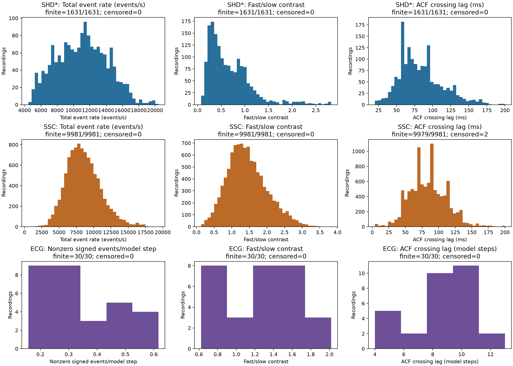
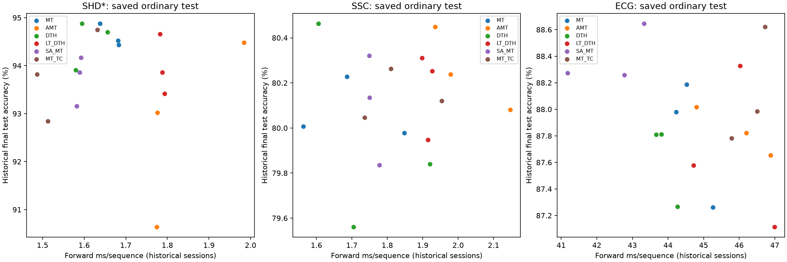

# Supervisor study: final exploratory synthesis

Source review: 17 November 2026. This report presents saved evidence and seed-matched arithmetic. No new model execution, feature extraction, regression, bootstrap, training or official-test access.

**Main conclusion:** the four mechanisms show dataset- and seed-dependent behavior. The registered experiments do not establish a universal architectural winner or a causal explanation of natural accuracy. Negative, ineffective and inconclusive results are retained.

Scope: AMT/MT, LT-DTH/DTH, SA-MT/MT and MT-TC/MT; six unique models, three matching training seeds (42/123/456), SHD*/SSC/ECG. Shared MT parents and repeated controls are shared observations, not additional training runs. All means use sample SD across those three seeds; SD is not a confidence interval. No numeric paper baseline is mixed with incompatible validation scores. The existing paper/reference comparison remains separate: [main accuracy and cost comparison](../../../reports/comparison-summary.md).

## 1. Ordinary performance

Full clean validation uses source-high precision and original supervision: SHD* 1,631 records (fixed 20% training split, split seed 42), SSC 9,981 official-validation records, ECG 30 validation sequences. SHD*/SSC accuracy counts recordings; ECG accuracy counts labeled timesteps. CE benefit = parent loss minus variant loss; accuracy gap = variant minus parent, in percentage points (pp). MT-TC auxiliary training JS is excluded from evaluation CE. Dataset-specific losses differ (SHD* temporal-softmax sum, SSC mean membrane, ECG per-block summed membrane); do not pool their CE.

| Dataset | Pair | Parent validation % | Variant validation % | Paired gap (pp) | CE benefit |
|---|---|---|---|---|---|
| SHD* | amt_mt | 99.2643 ± 0.0613 | 99.0190 ± 0.1062 | -0.2452 ± 0.1226 | -0.007344 ± 0.036602 |
| SHD* | lt_dth | 99.0803 ± 0.0613 | 99.1416 ± 0.3186 | 0.0613 ± 0.3729 | 0.008296 ± 0.015704 |
| SHD* | sa_mt | 99.2643 ± 0.0613 | 99.1416 ± 0.2452 | -0.1226 ± 0.2211 | -0.004300 ± 0.007345 |
| SHD* | mt_tc | 99.2643 ± 0.0613 | 99.1825 ± 0.0937 | -0.0817 ± 0.0937 | -0.002075 ± 0.012946 |
| SSC | amt_mt | 82.1528 ± 0.2719 | 82.0459 ± 0.1735 | -0.1069 ± 0.3889 | -0.003752 ± 0.027020 |
| SSC | lt_dth | 81.5783 ± 0.3465 | 81.5917 ± 0.0504 | 0.0134 ± 0.3357 | 0.015176 ± 0.030407 |
| SSC | sa_mt | 82.1528 ± 0.2719 | 81.8822 ± 0.0652 | -0.2705 ± 0.2768 | -0.005840 ± 0.016573 |
| SSC | mt_tc | 82.1528 ± 0.2719 | 82.1127 ± 0.1796 | -0.0401 ± 0.4513 | 0.006200 ± 0.028200 |
| ECG | amt_mt | 86.2405 ± 0.0706 | 86.5659 ± 0.1751 | 0.3254 ± 0.2149 | 0.006222 ± 0.008670 |
| ECG | lt_dth | 86.0278 ± 0.2287 | 86.4660 ± 0.3089 | 0.4381 ± 0.2159 | 0.013440 ± 0.015810 |
| ECG | sa_mt | 86.2405 ± 0.0706 | 86.4216 ± 0.4442 | 0.1811 ± 0.4065 | 0.002323 ± 0.014520 |
| ECG | mt_tc | 86.2405 ± 0.0706 | 86.1004 ± 0.3605 | -0.1401 ± 0.2906 | -0.009249 ± 0.011215 |

The following ordinary final-test scores were already present in each training history. The saved cost evaluation independently reproduces them within 1e-6 accuracy. No official test data is opened here. These historical test results were exposed during earlier development and are descriptive, not independent confirmation. No TTA or extra-seed extension is included.

| Dataset | Model | Historical final test (%) | Test seeds 42 / 123 / 456 (%) |
|---|---|---|---|
| SHD* | MT_SE_adLIF | 94.6113 ± 0.2337 | 94.8763 / 94.5230 / 94.4346 |
| SHD* | AMT_SE_adLIF | 92.7120 ± 1.9399 | 94.4788 / 90.6360 / 93.0212 |
| SHD* | DTH_SE_adLIF | 94.4935 ± 0.5176 | 94.6996 / 94.8763 / 93.9046 |
| SHD* | LT_DTH_SE_adLIF | 93.9782 ± 0.6267 | 94.6555 / 93.4187 / 93.8604 |
| SHD* | SA_MT_SE_adLIF | 93.7279 ± 0.5208 | 94.1696 / 93.1537 / 93.8604 |
| SHD* | MT_TC_SE_adLIF | 93.8015 ± 0.9497 | 94.7438 / 92.8445 / 93.8163 |
| SSC | MT_SE_adLIF | 80.0706 ± 0.1368 | 80.0069 / 79.9774 / 80.2276 |
| SSC | AMT_SE_adLIF | 80.2555 ± 0.1846 | 80.2375 / 80.4484 / 80.0805 |
| SSC | DTH_SE_adLIF | 79.9545 ± 0.4621 | 80.4632 / 79.8401 / 79.5604 |
| SSC | LT_DTH_SE_adLIF | 80.1704 ± 0.1949 | 79.9480 / 80.2522 / 80.3111 |
| SSC | SA_MT_SE_adLIF | 80.0968 ± 0.2450 | 80.1344 / 80.3209 / 79.8351 |
| SSC | MT_TC_SE_adLIF | 80.1426 ± 0.1097 | 80.1197 / 80.0461 / 80.2620 |
| ECG | MT_SE_adLIF | 87.8095 ± 0.4854 | 87.2618 / 88.1864 / 87.9803 |
| ECG | AMT_SE_adLIF | 87.8302 ± 0.1814 | 87.6532 / 87.8217 / 88.0158 |
| ECG | DTH_SE_adLIF | 87.6298 ± 0.3135 | 87.8119 / 87.8097 / 87.2678 |
| ECG | LT_DTH_SE_adLIF | 87.6725 ± 0.6132 | 88.3281 / 87.1130 / 87.5764 |
| ECG | SA_MT_SE_adLIF | 88.3925 ± 0.2192 | 88.2578 / 88.6454 / 88.2742 |
| ECG | MT_TC_SE_adLIF | 88.1297 ± 0.4380 | 87.7830 / 87.9841 / 88.6220 |

The main paper/reference tables document their own provenance and reference ECG stopping-budget mismatch. The mechanism comparisons here use each variant’s matching trained parent. All six study models inherit their dataset-specific paper_classification_v1 settings; MT-TC intentionally changes the training objective. Checkpoint identities and resolved configs are pinned.

## 2. Input features and diagnostic patterns

The figures below plot existing clean-input descriptors once per recording, rather than once per model or seed. They use all 1,631 / 9,981 / 30 validation records. SHD*/SSC feature support excludes synthetic padding; feature windows are 20/200 ms with 4-ms frames. ECG uses signed-event activity and 20/200 model-step windows; physical milliseconds have not been established. Panels use native units and independent axes, not a pooled physical scale. Invalid/censored ACF values are counted explicitly and excluded from numeric summaries, without imputation. CV-ISI was not measured and is not claimed.

| Dataset | Feature | Eligible / total | Censored / invalid / missing | Q25 / median / Q75 |
|---|---|---|---|---|
| SHD* | mean_rate_hz | 1631 / 1631 | 0 / 0 / 0 | 8663.32 / 11106.7 / 13269.9 |
| SHD* | fast_slow_contrast | 1631 / 1631 | 0 / 0 / 0 | 0.333219 / 0.554307 / 0.903567 |
| SHD* | autocorr_tau_ms | 1631 / 1631 | 0 / 0 / 0 | 60 / 76 / 100 |
| SSC | mean_rate_hz | 9981 / 9981 | 0 / 0 / 0 | 6806.6 / 8318.27 / 10055.4 |
| SSC | fast_slow_contrast | 9981 / 9981 | 0 / 0 / 0 | 1.04269 / 1.37595 / 1.7836 |
| SSC | autocorr_tau_ms | 9979 / 9981 | 2 / 0 / 0 | 64 / 84 / 104 |
| ECG | events_per_step | 30 / 30 | 0 / 0 / 0 | 0.246157 / 0.295926 / 0.482513 |
| ECG | fast_slow_contrast | 30 / 30 | 0 / 0 / 0 | 0.853778 / 1.39877 / 1.55903 |
| ECG | autocorr_tau_steps | 30 / 30 | 0 / 0 / 0 | 8 / 9 / 10 |

This distribution comparison describes the observed cohorts. It does not identify a dataset effect independent of duration, representation, class mix or sampling. The saved stage-7 class/temporal maps and input-optimization examples are available in [the comparable diagnostic figure collection](../adaptation_stage7_suite_v1/presentation_v1/SUMMARY.md). Those gradient cohorts are only 40 SHD*, 70 SSC and all 30 ECG records per checkpoint; four fixed records/checkpoint undergo input optimization. Physical-input gradients include burn-in sensitivity and report padding separately. SLAYER maps are surrogate sensitivities, not causal attention.

## 3. Feature–benefit relationships and mechanism conclusions

The next table copies existing adjusted coefficients; no model is refitted. Coefficients are CE benefit per fixed original-cohort population-SD increase in a predictor. SHD*/SSC jointly control class, speaker, log duration and activity. Saved SHD intervals use a two-feature family within each pair; SSC uses an eight-feature/pair family across four pairs. They are approximate, speaker-clustered exploratory intervals conditional on the observed trained models. They do not give joint coverage across datasets or robustness over new training seeds. SHD has only ten speaker clusters. ECG uses record descriptors and label-class proportions, drops constant duration, has no verified patient identities and supplies no population interval, bootstrap or p-value.

| Dataset | Pair | Feature | Coefficient ± seed SD | Saved interval | Saved direction / consistent seed signs |
|---|---|---|---|---|---|
| SHD* | amt_mt | fast_slow_contrast | 0.004764 ± 0.057977 | [-0.026625, +0.054401] | inconclusive / False |
| SHD* | amt_mt | autocorr_tau_ms | 0.026769 ± 0.059492 | [+0.003042, +0.063770] | positive_within_fixed_cohort / False |
| SHD* | lt_dth | fast_slow_contrast | -0.010032 ± 0.013365 | [-0.061780, +0.024167] | inconclusive / False |
| SHD* | lt_dth | autocorr_tau_ms | -0.014033 ± 0.049306 | [-0.053943, +0.008900] | inconclusive / False |
| SHD* | sa_mt | fast_slow_contrast | -0.019664 ± 0.025721 | [-0.047620, +0.001216] | inconclusive / False |
| SHD* | sa_mt | autocorr_tau_ms | 0.032337 ± 0.068148 | [+0.005389, +0.078847] | positive_within_fixed_cohort / False |
| SHD* | mt_tc | fast_slow_contrast | 0.012434 ± 0.008796 | [-0.056932, +0.078558] | inconclusive / True |
| SHD* | mt_tc | autocorr_tau_ms | 0.030419 ± 0.067993 | [-0.008861, +0.111900] | inconclusive / False |
| SSC | amt_mt | fast_slow_contrast | 0.011834 ± 0.016775 | [-0.022664, +0.044719] | inconclusive / False |
| SSC | amt_mt | autocorr_tau_ms | -0.000639 ± 0.019982 | [-0.028014, +0.027086] | inconclusive / False |
| SSC | lt_dth | fast_slow_contrast | -0.009214 ± 0.000870 | [-0.048210, +0.030794] | inconclusive / True |
| SSC | lt_dth | autocorr_tau_ms | -0.006189 ± 0.028425 | [-0.032503, +0.016609] | inconclusive / False |
| SSC | sa_mt | fast_slow_contrast | 0.000653 ± 0.014209 | [-0.032253, +0.034704] | inconclusive / False |
| SSC | sa_mt | autocorr_tau_ms | 0.024939 ± 0.019015 | [-0.002811, +0.052444] | inconclusive / True |
| SSC | mt_tc | fast_slow_contrast | 0.015104 ± 0.023384 | [-0.023361, +0.050295] | inconclusive / False |
| SSC | mt_tc | autocorr_tau_ms | -0.004884 ± 0.008953 | [-0.029624, +0.021098] | inconclusive / False |
| ECG | amt_mt | fast_slow_contrast | 0.014853 ± 0.037202 | none (descriptive) | descriptive_only / None |
| ECG | amt_mt | autocorr_tau_steps | 0.002388 ± 0.013452 | none (descriptive) | descriptive_only / None |
| ECG | lt_dth | fast_slow_contrast | -0.032498 ± 0.049957 | none (descriptive) | descriptive_only / None |
| ECG | lt_dth | autocorr_tau_steps | -0.002303 ± 0.015758 | none (descriptive) | descriptive_only / None |
| ECG | sa_mt | fast_slow_contrast | -0.023433 ± 0.037656 | none (descriptive) | descriptive_only / None |
| ECG | sa_mt | autocorr_tau_steps | 0.012046 ± 0.019428 | none (descriptive) | descriptive_only / None |
| ECG | mt_tc | fast_slow_contrast | -0.039264 ± 0.040393 | none (descriptive) | descriptive_only / None |
| ECG | mt_tc | autocorr_tau_steps | 0.018726 ± 0.010735 | none (descriptive) | descriptive_only / None |

All exact seed coefficients, complete-case counts, cluster counts and interval-family labels are exported in ASSOCIATIONS.csv. SSC exclusions affect only joint regression; interventions retain all validation recordings. Difficulty controls do not remove every confound.

| Mechanism / initial hypothesis | Bounded verdict | Evidence and limitation |
|---|---|---|
| AMT: benefit grows with fast/slow contrast | Insufficient consistent support | SHD* fast/slow interval includes zero; SHD* ACF interval is positive but seed signs conflict. SSC primary intervals include zero; ECG is descriptive. |
| SA-MT: separate transient/sustained strengths help | Insufficient consistent support | SHD* fast/slow interval includes zero and ACF is positive with mixed seed signs. Other datasets and interventions must be considered; surrogate maps do not establish pathway mediation. |
| LT-DTH: learned trace aligns with input timescale | Insufficient consistent support | SHD* adjusted ACF interval includes zero; SHD* deletion weakens relative benefit within its fixed-cohort interval. Learned trace constants are model/layer observations, not per-record mediators. |
| MT-TC: stable adjacent evidence helps decisions | Mixed; general stability claim unsupported | SHD* adjacent-window JS improves only in seed 42; SSC smoothing/window CE improve in 42/123 and reverse in 456 at every tested width. Lower mean JS alone is not useful class evidence. |

Saved learned-trace descriptors are summarized below where authenticated records exist. Only existing pre-aggregated trace tables are reproduced. SSC per-checkpoint trace records also remain available in [the authenticated parameter archive](../adaptation_ssc_suite_v2/pairs/lt_dth/evaluation/parameters); their absence from this pre-aggregated table is not a zero-valued estimate. No new checkpoint parameter extraction or trace-to-feature regression is performed.

| Dataset | Model | Layer | Trace | Saved e-folding time (ms) ± seed SD |
|---|---|---|---|---|
| SHD* | DTH_SE_adLIF | l1 | fast | 37.9649 ± 0.0000 |
| SHD* | DTH_SE_adLIF | l1 | slow | 397.9966 ± 0.0000 |
| SHD* | DTH_SE_adLIF | l2 | fast | 37.9649 ± 0.0000 |
| SHD* | DTH_SE_adLIF | l2 | slow | 397.9966 ± 0.0000 |
| SHD* | LT_DTH_SE_adLIF | l1 | fast | 52.7158 ± 1.0877 |
| SHD* | LT_DTH_SE_adLIF | l1 | slow | 300.9292 ± 7.3205 |
| SHD* | LT_DTH_SE_adLIF | l2 | fast | 147.7997 ± 17.5317 |
| SHD* | LT_DTH_SE_adLIF | l2 | slow | 507.7505 ± 108.9809 |

## 4. Controlled experiments and input selection

Positive changes below favor the variant relative to its own clean CE gap; they do not require absolute accuracy or CE improvement. Entries copy the three predeclared conditions from saved studies. Random deletion realizations average within recording and seed before any seed summary. SHD uses a separate three-intervention interval family within each pair, SSC a twelve-effect family; ECG is descriptive without intervals.

| Dataset | Pair | Condition | Change in CE benefit ± seed SD | Saved interval / direction |
|---|---|---|---|---|
| SHD* | amt_mt | time_scale_0.9 | -0.008728 ± 0.011450 | [-0.032091, +0.007219] / inconclusive |
| SHD* | amt_mt | time_scale_1.1 | 0.002114 ± 0.028368 | [-0.021878, +0.026025] / inconclusive |
| SHD* | amt_mt | delete_0.1 | 0.001476 ± 0.022253 | [-0.006908, +0.011398] / inconclusive |
| SHD* | lt_dth | time_scale_0.9 | -0.011365 ± 0.018473 | [-0.037136, +0.015769] / inconclusive |
| SHD* | lt_dth | time_scale_1.1 | -0.002117 ± 0.017878 | [-0.015867, +0.012959] / inconclusive |
| SHD* | lt_dth | delete_0.1 | -0.005778 ± 0.007501 | [-0.013320, -0.000443] / negative_within_fixed_cohort |
| SHD* | sa_mt | time_scale_0.9 | -0.011930 ± 0.012181 | [-0.036516, +0.004683] / inconclusive |
| SHD* | sa_mt | time_scale_1.1 | 0.000501 ± 0.014829 | [-0.021833, +0.018629] / inconclusive |
| SHD* | sa_mt | delete_0.1 | 0.002337 ± 0.006469 | [-0.009266, +0.011061] / inconclusive |
| SHD* | mt_tc | time_scale_0.9 | -0.023025 ± 0.023233 | [-0.046182, -0.002106] / negative_within_fixed_cohort |
| SHD* | mt_tc | time_scale_1.1 | 0.009062 ± 0.009454 | [-0.007546, +0.028551] / inconclusive |
| SHD* | mt_tc | delete_0.1 | 0.008223 ± 0.008535 | [-0.003511, +0.021013] / inconclusive |
| SSC | amt_mt | time_scale_0.9 | 0.007364 ± 0.011155 | [-0.002490, +0.016732] / inconclusive |
| SSC | amt_mt | time_scale_1.1 | -0.005873 ± 0.021222 | [-0.017333, +0.005766] / inconclusive |
| SSC | amt_mt | delete_0.1 | 0.004651 ± 0.008227 | [-0.003387, +0.012263] / inconclusive |
| SSC | lt_dth | time_scale_0.9 | -0.008818 ± 0.020592 | [-0.023859, +0.005816] / inconclusive |
| SSC | lt_dth | time_scale_1.1 | 0.014089 ± 0.016510 | [+0.002457, +0.025773] / positive_within_fixed_cohort |
| SSC | lt_dth | delete_0.1 | -0.002363 ± 0.008844 | [-0.011064, +0.005775] / inconclusive |
| SSC | sa_mt | time_scale_0.9 | -0.002354 ± 0.013794 | [-0.013502, +0.009156] / inconclusive |
| SSC | sa_mt | time_scale_1.1 | -0.009045 ± 0.005128 | [-0.020826, +0.002160] / inconclusive |
| SSC | sa_mt | delete_0.1 | -0.003514 ± 0.010998 | [-0.011806, +0.004787] / inconclusive |
| SSC | mt_tc | time_scale_0.9 | 0.005802 ± 0.018028 | [-0.006674, +0.017803] / inconclusive |
| SSC | mt_tc | time_scale_1.1 | -0.006814 ± 0.007759 | [-0.016839, +0.004795] / inconclusive |
| SSC | mt_tc | delete_0.1 | -0.001385 ± 0.011688 | [-0.009116, +0.005744] / inconclusive |
| ECG | amt_mt | delete_0.1 | -0.005594 ± 0.014350 | none / descriptive |
| ECG | amt_mt | time_scale_0.9 | 0.006616 ± 0.021310 | none / descriptive |
| ECG | amt_mt | time_scale_1.1 | 0.002356 ± 0.012058 | none / descriptive |
| ECG | lt_dth | delete_0.1 | 0.006361 ± 0.019333 | none / descriptive |
| ECG | lt_dth | time_scale_0.9 | -0.003660 ± 0.032298 | none / descriptive |
| ECG | lt_dth | time_scale_1.1 | 0.004324 ± 0.021078 | none / descriptive |
| ECG | sa_mt | delete_0.1 | 0.007247 ± 0.007020 | none / descriptive |
| ECG | sa_mt | time_scale_0.9 | -0.001635 ± 0.028424 | none / descriptive |
| ECG | sa_mt | time_scale_1.1 | -0.006416 ± 0.016254 | none / descriptive |
| ECG | mt_tc | delete_0.1 | -0.000900 ± 0.020230 | none / descriptive |
| ECG | mt_tc | time_scale_0.9 | 0.009436 ± 0.013846 | none / descriptive |
| ECG | mt_tc | time_scale_1.1 | -0.003152 ± 0.016784 | none / descriptive |

Deletion preserves lengths and targets but changes event density and several temporal statistics. Time rescaling changes duration/rate/structure jointly. ECG nearest-bin-center resampling maps signed inputs, labels and masks together, rebuilds temporal blocks and preserves the saved all-zero-label argmax-to-class-0 policy; event totals and class proportions can change. Thus these transformations do not isolate one latent mechanism. No temporal-window permutation or retraining-on-corrupted-data experiment is claimed.

The direct MT-TC window diagnostics distinguish frame-probability JS/concentration from window mean-membrane CE/accuracy and exclude burn-in and synthetic padding only from descriptor windows. Ordinary loss masks remain unchanged. See [SHD* window evidence](../adaptation_mt_tc_full_validation_v1/window_evidence_v1/SUMMARY.md) and [SSC windows at 5/10/20 frames](../adaptation_ssc_windows_v1/SUMMARY.md). Windows are not independent seeds; no confidence-to-benefit regression is inferred.

Stage 7 adds frozen-weight, six-step constrained input optimization: native nonnegative integer event counts (SHD*/SSC) or signed ternary events (ECG), fixed length, targets and block masks, preserved per-channel event totals and separately preserved ECG polarity totals. At most 1% of original events move from occupied to originally empty cells within channel; the budget never accumulates across steps. Three random controls match actual channel/polarity movement allocations. Every source input is evaluated identically by all six target models at the matching seed. Both predeclared optimization origins are required. Random controls average within record; four fixed diagnostic records average within training seed before the three-seed mean and sample SD.

| Dataset | Pair | Optimization origin | Optimized-minus-random parent–variant CE contrast ± seed SD |
|---|---|---|---|
| SHD* | amt_mt | parent | +1.772487 ± 0.877257 |
| SHD* | lt_dth | parent | +2.059113 ± 1.193917 |
| SHD* | sa_mt | parent | +0.879852 ± 1.037291 |
| SHD* | mt_tc | parent | +1.808941 ± 2.903006 |
| SHD* | amt_mt | variant | -2.505384 ± 3.185007 |
| SHD* | lt_dth | variant | -2.243875 ± 1.406143 |
| SHD* | sa_mt | variant | -2.538050 ± 1.988435 |
| SHD* | mt_tc | variant | -1.710105 ± 1.898341 |
| SSC | amt_mt | parent | +0.199685 ± 0.872498 |
| SSC | lt_dth | parent | +1.563769 ± 0.867728 |
| SSC | sa_mt | parent | +0.970893 ± 0.682787 |
| SSC | mt_tc | parent | +1.020111 ± 0.595680 |
| SSC | amt_mt | variant | -0.835282 ± 0.968735 |
| SSC | lt_dth | variant | -0.766841 ± 0.952837 |
| SSC | sa_mt | variant | -1.200433 ± 0.358732 |
| SSC | mt_tc | variant | -1.139297 ± 0.812272 |
| ECG | amt_mt | parent | -0.000687 ± 0.009490 |
| ECG | lt_dth | parent | +0.021700 ± 0.045470 |
| ECG | sa_mt | parent | +0.014282 ± 0.012358 |
| ECG | mt_tc | parent | +0.039677 ± 0.007801 |
| ECG | amt_mt | variant | -0.060808 ± 0.045624 |
| ECG | lt_dth | variant | -0.044812 ± 0.016684 |
| ECG | sa_mt | variant | -0.024159 ± 0.028489 |
| ECG | mt_tc | variant | -0.048419 ± 0.012206 |

All 54 checkpoint jobs and 432 repeat checks passed. 171 of 216 input-optimization attempts produced accepted nonzero changes; all 45 ineffective attempts remain recorded. Nine transfer bundles contain 5,184 target evaluations, 864 unique shared optimized/random inputs and 288 paired record/seed/origin rows. Parent-optimized mean contrasts are positive in 11/12 dataset/pair cells, while variant-optimized means are negative in all 12. This is strong input-selection-model dependence, not universal robustness or natural-accuracy superiority. No zero map was replaced by fabricated guidance. Fixed labels do not guarantee unchanged semantic class; a failed greedy attempt does not prove that no admissible perturbation exists. See [independent stage-7 review](../adaptation_stage7_suite_v1/POST_RUN_REVIEW.md).

## Activity, computational estimates and timing

All 54 saved ordinary-inference cost records match the exact study checkpoint SHA-256, selected epoch and normalized resolved config. They measured historical test data; this report reads only the saved measurements. Their accuracy checks match one unambiguous final-test row per history. This section does not measure validation or perturbation-specific cost.

Activity means hidden layers L1 and L2, whose outputs are binary spikes. The output layer is a nonspiking integrator and contributes no output-spike count. Layer firing fraction = 100 × hidden spikes / (neurons × summed stored sequence steps). Stored extent includes configured minimum padding and burn-in; extra batch padding is excluded from activity but retained in padded compute. These are not physical-duration firing rates and are distinct from the physical-support input features and stage-7 padding-gradient summaries. Raw stored and batch-padded counts are exported.

| Dataset | Model | L1 spikes/sequence | L2 spikes/sequence | L1 firing % | L2 firing % | Forward ms/sequence |
|---|---|---|---|---|---|---|
| SHD* | MT_SE_adLIF | 8405.5 ± 556.0 | 2231.9 ± 88.4 | 9.334 ± 0.617 | 2.478 ± 0.098 | 1.668 ± 0.026 |
| SHD* | AMT_SE_adLIF | 8651.6 ± 97.8 | 2088.0 ± 448.1 | 9.607 ± 0.109 | 2.319 ± 0.498 | 1.845 ± 0.121 |
| SHD* | DTH_SE_adLIF | 8319.9 ± 238.5 | 2193.9 ± 434.4 | 9.239 ± 0.265 | 2.436 ± 0.482 | 1.610 ± 0.040 |
| SHD* | LT_DTH_SE_adLIF | 8446.5 ± 577.3 | 1773.8 ± 75.0 | 9.379 ± 0.641 | 1.970 ± 0.083 | 1.788 ± 0.005 |
| SHD* | SA_MT_SE_adLIF | 8373.5 ± 424.8 | 2338.6 ± 179.1 | 9.298 ± 0.472 | 2.597 ± 0.199 | 1.588 ± 0.005 |
| SHD* | MT_TC_SE_adLIF | 8487.8 ± 467.8 | 2140.3 ± 301.4 | 9.425 ± 0.519 | 2.377 ± 0.335 | 1.544 ± 0.077 |
| SSC | MT_SE_adLIF | 21845.8 ± 257.3 | 27654.2 ± 791.1 | 10.114 ± 0.119 | 12.803 ± 0.366 | 1.699 ± 0.143 |
| SSC | AMT_SE_adLIF | 21880.0 ± 1658.9 | 27503.4 ± 870.4 | 10.130 ± 0.768 | 12.733 ± 0.403 | 2.020 ± 0.112 |
| SSC | DTH_SE_adLIF | 19055.3 ± 2472.6 | 26546.2 ± 1561.2 | 8.822 ± 1.145 | 12.290 ± 0.723 | 1.744 ± 0.161 |
| SSC | LT_DTH_SE_adLIF | 19125.7 ± 765.1 | 24854.8 ± 936.1 | 8.854 ± 0.354 | 11.507 ± 0.433 | 1.913 ± 0.014 |
| SSC | SA_MT_SE_adLIF | 21969.7 ± 1584.8 | 27181.3 ± 336.5 | 10.171 ± 0.734 | 12.584 ± 0.156 | 1.759 ± 0.016 |
| SSC | MT_TC_SE_adLIF | 21468.1 ± 1472.9 | 26890.8 ± 1013.7 | 9.939 ± 0.682 | 12.449 ± 0.469 | 1.834 ± 0.110 |
| ECG | MT_SE_adLIF | 9945.2 ± 1226.3 | 16720.1 ± 1165.8 | 21.234 ± 2.618 | 35.699 ± 2.489 | 44.670 ± 0.529 |
| ECG | AMT_SE_adLIF | 10657.2 ± 524.5 | 16879.0 ± 366.1 | 22.754 ± 1.120 | 36.039 ± 0.782 | 45.960 ± 1.061 |
| ECG | DTH_SE_adLIF | 11631.2 ± 1866.7 | 18426.6 ± 1337.8 | 24.834 ± 3.986 | 39.343 ± 2.856 | 43.915 ± 0.310 |
| ECG | LT_DTH_SE_adLIF | 11891.2 ± 2374.4 | 17897.7 ± 920.7 | 25.389 ± 5.070 | 38.214 ± 1.966 | 45.911 ± 1.139 |
| ECG | SA_MT_SE_adLIF | 10451.1 ± 569.9 | 16715.4 ± 1020.5 | 22.314 ± 1.217 | 35.689 ± 2.179 | 42.426 ± 1.115 |
| ECG | MT_TC_SE_adLIF | 11565.3 ± 700.2 | 16716.1 ± 619.5 | 24.693 ± 1.495 | 35.691 ± 1.323 | 46.337 ± 0.493 |

Timing uses the recorded RTX 4090, float32 high matmul precision, batch 256 for SHD*/SSC and 64 for ECG, three timing repeats and two warm-up batches. It measures synchronized MLPSNN.forward wall time excluding loading, transfer, loss and temporal prediction aggregation. SD above is across training seeds, not across timing repeats. Sessions, evaluator versions and environment snapshots differ, so paired differences are descriptive and do not establish hardware speed superiority. Cross-dataset lengths/batches are unequal. Full environment and repeat timings are retained in COST_RECORDS.json.

| Dataset | Model | Parameters (exact) | SynOps M/sequence | Dense GFLOPs/sequence | Arithmetic GFLOPs/sequence | Logical GOps/sequence |
|---|---|---|---|---|---|---|
| SHD* | MT_SE_adLIF | 452,200 | 9.857 ± 0.418 | 0.24290 ± 0.00000 | 0.24901 ± 0.00000 | 0.24960 ± 0.00000 |
| SHD* | AMT_SE_adLIF | 452,920 | 9.979 ± 0.124 | 0.24290 ± 0.00000 | 0.25077 ± 0.00000 | 0.25156 ± 0.00000 |
| SHD* | DTH_SE_adLIF | 451,484 | 9.782 ± 0.305 | 0.24290 ± 0.00000 | 0.25037 ± 0.00000 | 0.25135 ± 0.00000 |
| SHD* | LT_DTH_SE_adLIF | 451,488 | 9.713 ± 0.386 | 0.24290 ± 0.00000 | 0.25037 ± 0.00000 | 0.25135 ± 0.00000 |
| SHD* | SA_MT_SE_adLIF | 452,920 | 9.875 ± 0.366 | 0.24290 ± 0.00000 | 0.24979 ± 0.00000 | 0.25038 ± 0.00000 |
| SHD* | MT_TC_SE_adLIF | 452,200 | 9.881 ± 0.338 | 0.24290 ± 0.00000 | 0.24901 ± 0.00000 | 0.24960 ± 0.00000 |
| SSC | MT_SE_adLIF | 1,692,790 | 58.349 ± 0.323 | 1.00872 ± 0.00000 | 1.02219 ± 0.00000 | 1.02349 ± 0.00000 |
| SSC | AMT_SE_adLIF | 1,694,230 | 58.287 ± 3.001 | 1.00872 ± 0.00000 | 1.02608 ± 0.00000 | 1.02781 ± 0.00000 |
| SSC | DTH_SE_adLIF | 1,691,354 | 53.514 ± 4.726 | 1.00872 ± 0.00000 | 1.02520 ± 0.00000 | 1.02737 ± 0.00000 |
| SSC | LT_DTH_SE_adLIF | 1,691,358 | 52.341 ± 1.800 | 1.00872 ± 0.00000 | 1.02520 ± 0.00000 | 1.02737 ± 0.00000 |
| SSC | SA_MT_SE_adLIF | 1,694,230 | 58.172 ± 2.309 | 1.00872 ± 0.00000 | 1.02392 ± 0.00000 | 1.02522 ± 0.00000 |
| SSC | MT_TC_SE_adLIF | 1,692,790 | 57.233 ± 2.561 | 1.00872 ± 0.00000 | 1.02219 ± 0.00000 | 1.02349 ± 0.00000 |
| ECG | MT_SE_adLIF | 4,836 | 1.418 ± 0.044 | 0.01105 ± 0.00000 | 0.01403 ± 0.00000 | 0.01432 ± 0.00000 |
| ECG | AMT_SE_adLIF | 4,908 | 1.475 ± 0.030 | 0.01105 ± 0.00000 | 0.01488 ± 0.00000 | 0.01526 ± 0.00000 |
| ECG | DTH_SE_adLIF | 4,768 | 1.611 ± 0.171 | 0.01105 ± 0.00000 | 0.01468 ± 0.00000 | 0.01515 ± 0.00000 |
| ECG | LT_DTH_SE_adLIF | 4,772 | 1.607 ± 0.132 | 0.01105 ± 0.00000 | 0.01468 ± 0.00000 | 0.01515 ± 0.00000 |
| ECG | SA_MT_SE_adLIF | 4,908 | 1.454 ± 0.046 | 0.01105 ± 0.00000 | 0.01441 ± 0.00000 | 0.01470 ± 0.00000 |
| ECG | MT_TC_SE_adLIF | 4,836 | 1.534 ± 0.059 | 0.01105 ± 0.00000 | 0.01403 ± 0.00000 | 0.01432 ± 0.00000 |

SynOps are ideal dense-fan-out event-addition estimates, not GPU executed instructions or energy. The historical ECG evaluator excludes its first input projection from SynOps and records that projection separately as dense MACs under its "analog input" accounting convention. The mechanism analysis independently verifies signed ternary ECG validation inputs; this report preserves the historical compute convention rather than reclassifying its counts. Dense MAC=2 FLOPs. Arithmetic excludes nonlinearities/comparisons; logical operations count each such scalar operation once and are not hardware FLOPs. No joules or hardware energy were measured. Lower spikes alone does not prove lower energy or latency.

| Dataset | Pair | Variant–parent hidden spikes/sequence | Variant–parent forward ms/sequence |
|---|---|---|---|
| SHD* | amt_mt | 102.2 ± 653.8 | 0.177 ± 0.146 |
| SHD* | lt_dth | -293.6 ± 1043.7 | 0.178 ± 0.044 |
| SHD* | sa_mt | 74.7 ± 491.8 | -0.079 ± 0.030 |
| SHD* | mt_tc | -9.3 ± 698.5 | -0.124 ± 0.103 |
| SSC | amt_mt | -116.7 ± 2961.6 | 0.321 ± 0.204 |
| SSC | lt_dth | -1621.0 ± 5193.2 | 0.170 ± 0.153 |
| SSC | sa_mt | -349.1 ± 1527.7 | 0.060 ± 0.146 |
| SSC | mt_tc | -1141.2 ± 2180.8 | 0.135 ± 0.251 |
| ECG | amt_mt | 870.9 ± 240.8 | 1.290 ± 0.627 |
| ECG | lt_dth | -268.8 ± 2881.1 | 1.997 ± 1.443 |
| ECG | sa_mt | 501.2 ± 688.0 | -2.244 ± 0.952 |
| ECG | mt_tc | 1616.0 ± 763.7 | 1.668 ± 1.021 |

The roughly 3 h 45 min stage-7 queue time is end-to-end workflow time; it is not any latency entry above and is not a new cost measurement.

## Evidence, limitations and completion

This synthesis closes only the registered exploratory reporting scope after user execution and verification. It does not establish independent population confirmation, exact upstream analytical figure reproduction, new-seed superiority, causal feature mediation or energy savings. Historical official-test exposure remains explicit. Additional CV-ISI, temporal-permutation experiments, independent data, learned-trace mediation and new controlled hardware measurements are possible follow-ups, not silently claimed results. The saved models and source-high baselines are preserved; highest-precision stage-7 diagnostics remain a separate numerical protocol.

The complete source-file hash index, source completion ledgers, per-seed tables, environment records and machine-readable scope audit accompany this report. Source files are read-only; changing evidence or implementation requires a new output root.

| Dataset / pair | Original evidence |
|---|---|
| SHD* / amt_mt | [saved evaluation / statistics](../adaptation_mechanism_full_validation_v1/analyses/clean/SUMMARY.md) |
| SHD* / lt_dth | [saved evaluation / statistics](../adaptation_lt_dth_full_validation_v1/analyses/clean/SUMMARY.md) |
| SHD* / sa_mt | [saved evaluation / statistics](../adaptation_sa_mt_full_validation_v1/analyses/clean/SUMMARY.md) |
| SHD* / mt_tc | [saved evaluation / statistics](../adaptation_mt_tc_full_validation_v1/analyses/clean/SUMMARY.md) |
| SSC / amt_mt | [saved evaluation / statistics](../adaptation_ssc_suite_v2/pairs/amt_mt/statistics_v1/SUMMARY.md) |
| SSC / lt_dth | [saved evaluation / statistics](../adaptation_ssc_suite_v2/pairs/lt_dth/statistics_v1/SUMMARY.md) |
| SSC / sa_mt | [saved evaluation / statistics](../adaptation_ssc_suite_v2/pairs/sa_mt/statistics_v1/SUMMARY.md) |
| SSC / mt_tc | [saved evaluation / statistics](../adaptation_ssc_suite_v2/pairs/mt_tc/statistics_v1/SUMMARY.md) |
| ECG / amt_mt | [saved evaluation / statistics](../adaptation_ecg_extension_v1/pairs/amt_mt/SUMMARY.md) |
| ECG / lt_dth | [saved evaluation / statistics](../adaptation_ecg_extension_v1/pairs/lt_dth/SUMMARY.md) |
| ECG / sa_mt | [saved evaluation / statistics](../adaptation_ecg_extension_v1/pairs/sa_mt/SUMMARY.md) |
| ECG / mt_tc | [saved evaluation / statistics](../adaptation_ecg_extension_v1/pairs/mt_tc/SUMMARY.md) |

