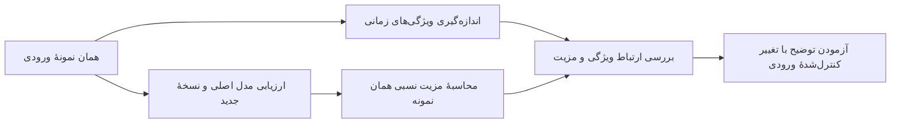

<div dir="rtl" lang="fa">

# نقشهٔ راه اجرای راهنمای استاد: ویژگی‌های ورودی و سازوکارهای تطبیقی

تاریخ: **۱۰ نوامبر ۲۰۲۶**

وضعیت این سند: **مراحل صفر تا هشت در دامنهٔ اکتشافی ثبت‌شده اجرا/بازبینی شده‌اند؛ گزارش نهایی و هزینهٔ مرحلهٔ هشت کامل و تأییدشده است.** [گزارش نهایی](results/experiments/adaptation_stage8_synthesis_v1/SUMMARY.md) و [بازبینی خروج](results/experiments/adaptation_stage8_synthesis_v1/POST_RUN_REVIEW.md) مرجع جاری‌اند. این تکمیل به معنای تأیید علمی مستقل، برتری عمومی معماری، برابری شکل‌های upstream یا اندازه‌گیری انرژی نیست. هیچ آموزش، inference یا آزمایش تازه‌ای در مرحلهٔ هشت اجرا نشد؛ شواهد ذخیره‌شده با واحدها و محدودیت‌های اصلی گزارش شدند. [گزارش فارسی مطابق ساختار راهنمای استاد](supervisor-guideline-report-fa.md) در ریشهٔ پروژه آماده است و جدول‌ها و شکل‌های تأییدشده را با محدودیت‌های علمی توضیح می‌دهد. نسخهٔ [PDF فارسی با فونت B Nazanin و چیدمان راست‌به‌چپ](supervisor-guideline-report-fa.pdf) نیز آماده است.

**سابقهٔ ECG — ۱۴ نوامبر ۲۰۲۶:** در آن مقطع [چهار ارزیابی پاک/حذف](results/experiments/adaptation_ecg_pairs_v2/POST_RUN_REVIEW.md) با ۱۸ anchor، ۱۹ تست، ۷۲ chunk و ۱۴۴۰ ردیف زوجی تأیید شده بود و ویژگی/کشش/آمار هنوز باقی بود. وضعیت جاری، تکمیل افزونهٔ ۱۶ نوامبر در بند بعد و جدول مرحله‌هاست؛ شمار تاریخی ۸/۱۲ دیگر وضعیت جاری بسته‌های جفتی نیست.

**افزونهٔ تأییدشدهٔ ECG — ۱۶ نوامبر ۲۰۲۶:** کاربر [افزونه](docs/experiments/adaptation-ecg-extension-v1.md) را کامل کرد؛ [بازبینی](results/experiments/adaptation_ecg_extension_v1/POST_RUN_REVIEW.md) ۱۶۳ hash خروجی، ۶۴ hash منبع، ۳۴ تست، ۱۸۰ ردیف ویژگی، ۱۰۸ chunk مؤثر (۷۲ قبلی/۳۶ جدید) و ۲۱۶۰ ردیف زوجی را تأیید کرد. هر چهار طراحی توصیفی ۳۰ مورد کامل، صفر حذف، رتبهٔ ۹ و df=21 دارند؛ مدت ثابت صریح حذف شد. هیچ ویژگی ACF در شش شرط undefined/censored نیست. زمان execute ثبت‌شده ۸۳٫۸۹۱ ثانیه، بدون preflight اولیه است؛ latency خالص نیست. عامل فقط شواهد ذخیره‌شده را بررسی کرد و هیچ تست، ویژگی، forward یا fit تازه‌ای اجرا نکرد.

**تشخیص مستقیم SSC تأیید شد — ۱۶ نوامبر ۲۰۲۶:** [بازبینی](results/experiments/adaptation_ssc_windows_v1/POST_RUN_REVIEW.md) ۲۵۶ خروجی، ۷۹ منبع، ۱۲ تست کاربر، شش anchor و صفر تغییر در ۵۹۸۸۶ پیش‌بینی عادی را تأیید کرد. ۲۳۴ chunk، ۱۷۹۶۵۸ ردیف شاخص و ۸۹۸۲۹ ردیف زوجی کامل‌اند. زمان execute ثبت‌شده ۳۸۰٫۹۵۳ ثانیه (حدود ۶ دقیقه و ۲۱ ثانیه)، بدون preflight اولیه است. در همهٔ پهناها بذرهای 42/123 برای MT-TC JS/CE کمتر و دقت پنجره بیشتر دارند، ولی 456 جهت معکوس دارد؛ برتری پایدار ادعا نمی‌شود. ممیزی فقط‌خواندنی دامنه/کد نیز کامل و تصمیم محدودِ خروج از مرحلهٔ شش ثبت شد.

**پایلوت مرحلهٔ هفت تأیید شد؛ پیگیری عددی لازم است — ۱۶ نوامبر ۲۰۲۶:** [بازبینی](results/experiments/adaptation_gradient_pilot_v1/POST_RUN_REVIEW.md) ۵۴۴ hash خروجی، ۵۰ منبع، ۱۸ تست کاربر، دو anchor کامل ۱۶۳۱ رکوردی و ۸۰ گرادیان finite/nonzero را تأیید کرد. state مدل ثابت و اختلاف forward با/بدون autograd در همان حالت تک‌رکوردی صفر است. برای MT رکورد 3896، تغییر batching پیش‌بینی را از 1 صحیح به 9 نادرست و CE را به اندازهٔ +0.3386995792 تغییر داد؛ این رکورد در نتایج حفظ شده و علت عددی هنوز مشخص نیست. زمان execute برابر ۲۴۴٫۹۸۵ ثانیه (حدود ۴ دقیقه و ۵ ثانیه)، بدون preflight اولیه است. پیش از گسترش، بررسی مستقل batching/precision با اجرای کاربر لازم است؛ عامل فقط شواهد ذخیره‌شده را بررسی کرد.

**پیگیری عددی مرحلهٔ هفت آماده — ۱۶ نوامبر ۲۰۲۶:** [workflow مستقل](docs/experiments/adaptation-batch-precision-v1.md) و [فرمان کاربر](command.txt) آماده‌اند. [پیش‌بررسی](results/experiments/adaptation_mechanism_study_v1/BATCH_PRECISION_PREFLIGHT.json) ۵۷ منبع، هویت پایلوت/چک‌پوینت/داده و ورودی/ماسک رکورد 3896 و batch اصلی ۲۵۶×۲۹۵×۱۴۰ را تأیید کرد؛ از cwd متفاوت نیز بررسی شد. ۱۶ تست کاربر، ۵۴۶ forward و مقایسه‌های عددی هنوز اجرا نشده‌اند. سه precision، سه layout برای همان ۴۰ رکورد و چهار کنترل برای 3896 ثبت شده‌اند؛ بدون training/backward و با خروجی مستقل از PC. نتایج سخت‌گیرانه‌تر جایگزین شواهد قبلی نمی‌شوند.

**پیگیری عددی مرحلهٔ هفت تأیید شد — ۱۶ نوامبر ۲۰۲۶:** [بازبینی](results/experiments/adaptation_batch_precision_v1/POST_RUN_REVIEW.md) ۵۶۸ hash خروجی، ۵۷ منبع، دو checkpoint، ۱۶ تست کاربر، ۵۴۶ job، ۹۷۸۶ امتیاز full-validation و ۱۲۴۰ مقایسهٔ ذخیره‌شده را تأیید کرد. anchorهای اصلی با تلرانس قبلی گذشتند و state مدل ثابت ماند. در 3896 حفظ padding یا تغییر همراه/ترتیب، اختلاف پیش‌بینی `source_high` را حذف نکرد؛ `highest_matmul` اختلاف پیش‌بینی layoutهای پایلوت را حذف کرد ولی در کل validation سه MT و پنج AMT را عوض می‌کند. قرینه به تعامل precision ماتریسی و شکل batch اشاره دارد، نه اثبات علت یکتای kernel یا پایداری گرادیان. زمان execute برابر ۲۷۷٫۵۴۷ ثانیه (حدود ۴ دقیقه و ۳۸ ثانیه)، بدون preflight اولیه است. عامل فقط شواهد ذخیره‌شده را بررسی کرد؛ هیچ تست/forward/backward تازه‌ای اجرا نشد.

**پایلوت گرادیانِ precision ثابت آماده — ۱۶ نوامبر ۲۰۲۶:** [workflow مستقل](docs/experiments/adaptation-gradient-strict-v1.md) و [فرمان کاربر](command.txt) آماده‌اند. [پیش‌بررسی](results/experiments/adaptation_mechanism_study_v1/STRICT_GRADIENT_PREFLIGHT.json) ۶۴ منبع، checkpoint/config/data، backend مرجع و ورودی/ماسک همان ۴۰ رکورد را تأیید کرد؛ از cwd متفاوت نیز گذشت. ۱۷ تست، دو reference کامل و ۱۶۴ backward هنوز اجرا نشده‌اند. strict precision پروتکل تشخیصیِ جداست؛ checkpointها و baseline قبلی تغییر نمی‌کنند. ۸۰ جفت تکرار طبیعی، دو جفت padding و چهار مقایسهٔ layout لازم‌اند؛ ۸۰ مقایسه با گرادیان قبلی فقط توصیفی است. صفر بودن گرادیان صریح و نتیجهٔ منفی پایداری قابل ثبت است؛ execution complete به معنی stability passed نیست.

**پایداری پایلوت گرادیان strict تأیید شد — ۱۶ نوامبر ۲۰۲۶:** [بازبینی](results/experiments/adaptation_gradient_strict_v1/POST_RUN_REVIEW.md) ۴۵۶ خروجی، ۶۴ منبع، دو checkpoint، ۱۷ تست کاربر، دو reference کامل و ۱۶۴ گرادیان finite/nonzero را تأیید کرد. هر ۸۶ کنترل لازم (۸۰ تکرار طبیعی، دو تکرار padding و چهار مقایسهٔ layout)، تمام کنترل‌های forward/reference و state ثابت گذشتند. ۸۰ مقایسهٔ singleton با گرادیان قبلی فقط توصیفی است و تفاوت‌های full-batch بین precisionها را نقض نمی‌کند. زمان execute برابر ۲۱۶٫۳۱۳ ثانیه (حدود ۳ دقیقه و ۳۶ ثانیه)، بدون preflight اولیه است. MT در 3896 همچنان اشتباه و دارای گرادیان خام بزرگ است؛ علت/برتری معماری ادعا نمی‌شود. عامل فقط فایل‌های ذخیره‌شده را بررسی کرد؛ هیچ تست/forward/backward تازه اجرا نشد.

**اجرای خودکارِ مجاز مرحلهٔ هفت — ۱۶ نوامبر ۲۰۲۶:** کاربر برای پایان این مرحله صریحاً اجرای command/آزمایش توسط عامل را مجاز کرد. [حذف strict](results/experiments/adaptation_gradient_deletion_v1/POST_RUN_REVIEW.md) با ۱۹ تست و ۵۵۷ خروجی کامل شد. [صف مشترک سه‌داده‌ای](docs/experiments/adaptation-stage7-suite-v1.md) پس از تأیید همهٔ ۵۴ checkpoint، تاریخچه‌های metrics.csv، داده‌ها و ۱۴ تست CPU/CUDA در حال اجراست. ۱۱۲ فایل منبع علمی با hash و path index زیر نتایج snapshot شده‌اند. cohortها و قیود پیش از اجرای صف تثبیت شدند؛ دادهٔ آزمون رسمی باز نمی‌شود و آموزش وزن وجود ندارد. تکمیل مرحله هنوز ادعا نشده است.

**تکمیل مرحلهٔ هفت — اجرای ۱۶ و بازبینی ۱۷ نوامبر ۲۰۲۶:** [بازبینی مستقل](results/experiments/adaptation_stage7_suite_v1/POST_RUN_REVIEW.md) هر ۵۴ job، ۲۹۵۲ آرایهٔ گرادیان و ۵۱۸۴ ارزیابی ورودی مشترک را تأیید کرد. [شکل‌های جاری](results/experiments/adaptation_stage7_suite_v1/presentation_v1/SUMMARY.md) و [هر دو مبدأ انتخاب ورودی](results/experiments/adaptation_stage7_suite_v1/origin_controls_v1/SUMMARY.md) بررسی شدند. اجرا روی یک RTX 4090 انجام شد؛ برنامهٔ سه PC پایین تاریخی است و هویت خروجی‌ها مستقل از رایانه ماند. زمان و provenance کنار نتایج ثبت شده‌اند. یادداشت‌های ۱۶ نوامبر بالا تاریخچهٔ آماده‌سازی/پیشرفت‌اند و وضعیت جاری را جایگزین نمی‌کنند.

**آماده‌سازی مرحلهٔ هشت — ۱۷ نوامبر ۲۰۲۶:** [گردآورندهٔ مستقل](scripts/adaptation_stage8/run.py) و [راهنما](docs/experiments/adaptation-stage8-synthesis-v1.md) آماده‌اند. ورودی‌های علمی و ۵۴ رکورد هزینه به hash ثابت متصل‌اند؛ خروجی در پوشه‌ای مستقل از بسته‌های منجمد تولید خواهد شد. اجرای کاربر، ده تست و بازبینی نهایی گزارش باقی است؛ نیازی به آموزش یا ارزیابی مدل تازه نیست.

**تکمیل مرحلهٔ هشت — ۱۷ نوامبر ۲۰۲۶:** کاربر [گزارش نهایی](results/experiments/adaptation_stage8_synthesis_v1/SUMMARY.md) را تولید کرد؛ [بازبینی](results/experiments/adaptation_stage8_synthesis_v1/POST_RUN_REVIEW.md) ده تست، ۱۶ خروجی، ۱۶۸۱۴ اتصال منبع و هر دو شکل را تأیید کرد. راستی‌آزمایی مستقل، ۳۱۸ تجمع بذر و همهٔ شمارش‌ها/واحدهای گزارش‌شده را بررسی کرد. این مرحله فقط شواهد موجود را گردآوری کرد؛ آموزش/ارزیابی عصبی یا برازش تازه‌ای وجود نداشت. یادداشت آماده‌سازی بالا تاریخی است؛ وضعیت جاری، تکمیل دامنهٔ اکتشافی ثبت‌شده و آمادگی برای ارائهٔ گزارش است.

مبنای کار: [راهنمای استاد و تحلیل تکمیلی](supervisor_guideline.md).

ترجیح اجرایی فعلی، گام‌های کوچک با بازبینی در پایان هر نوبت است. [برنامهٔ سه رایانهٔ RTX 4090](docs/experiments/supervisor-three-pc-daily-plan-fa.md) تاریخچهٔ تقسیم کار قبلی است و تعداد فعلی رایانه‌ها را تعیین نمی‌کند. پایلوت محدود SSC روی یک RTX 4090 در ۴۱۲٫۳۴۴ ثانیه (۶ دقیقه و ۵۲ ثانیه) اجرا شد؛ این زمان ثبت‌شدهٔ لانچر پس از پیش‌بررسی آغازین است، نه latency خالص مدل. برآورد اولیهٔ ۱۰–۲۰ دقیقه صرفاً برنامه‌ریزی بود. مطالعهٔ کامل SSC نیز روی همان یک PC در ۲۱۷۵٫۶۷۱ ثانیه (۳۶ دقیقه و ۱۶ ثانیه) اجرا و بازبینی شد؛ این زمان اجرای ثبت‌شدهٔ لانچر است، نه latency خالص مدل. خروجی‌ها مستقل از PC هستند؛ اجرای بعدی خودکار آغاز نمی‌شود.

برای شروع، بخش‌های ۱، ۲، ۳ و ۱۶ مسیر کلی را توضیح می‌دهند. بخش‌های میانی مرجع جزئیات پیاده‌سازی و کنترل اعتبار نتایج هستند.

## جدول وضعیت مراحل — به‌روزرسانی مستمر

آخرین بازبینی: **۱۷ نوامبر ۲۰۲۶ — اجرای کاربر و بازبینی نهایی مرحلهٔ هشت تأیید شد.** ده تست موفق، ۱۶ hash خروجی، ۱۶۸۱۴ hash منبع، ۲۵ ledger و ۳۱۸ محاسبهٔ تجمعی مستقل بررسی شدند. [بازبینی](results/experiments/adaptation_stage8_synthesis_v1/POST_RUN_REVIEW.md) و [ممیزی دامنه](results/experiments/adaptation_stage8_synthesis_v1/STAGE8_SCOPE_AUDIT.json) مبنای تکمیل‌اند؛ پرونده‌های تاریخی پیش‌بررسی و manifestهای منجمد حفظ شده‌اند. گزارش فارسی به ریشه افزوده شد؛ اعداد جدول‌ها و پیوند شکل‌ها با منابع تأییدشده تطبیق داده شدند و نتیجهٔ علمی تازه‌ای تولید نشد. خروجی PDF فارسی در ۱۷ نوامبر با فونت تعبیه‌شدهٔ B Nazanin و بررسی بصری صفحه‌های متن/جدول تهیه شد؛ شواهد علمی تغییری نکردند.

| مرحله | هدف | وضعیت فعلی |
|---|---|---|
| **۰ — تثبیت مطالعه و شواهد** | ثبت هویت چک‌پوینت‌ها، داده، بذرها و پروتکل | دارایی‌ها و پروتکل‌های SHD*/SSC/ECG در manifestهای نسخه‌دار تثبیت و بررسی شده‌اند. ECG همان ۳۰ رکورد validation با split seed=42 و چک‌پوینت‌های منتخب سه بذر را حفظ کرده؛ test رسمی باز نشده است. |
| **۱ — بررسی کد تحلیلی و تعریف ویژگی‌ها** | شناسایی کد قابل استفاده و تعریف‌ها | [ممیزی کد موجود](docs/audits/supervisor-stage6-closeout-2026-11-16.md) کامل است: forward/تجمیع زیان، لایه‌ها و SLAYER قابل استفاده‌اند؛ مسیر تاریخچهٔ حالت no_grad برای گرادیان مناسب نیست. تعریف‌های عملیاتی محلی نسخه‌دارند. بستهٔ مستقل شکل‌های تحلیلی upstream در inventory محلی شناسایی نشد و برابری تحلیلی با مقاله تأیید نشده است. |
| **۲ — استخراج ویژگی ورودی** | ویژگی روی نمونه‌های ثابت، بدون وابستگی به مدل | شش شرط روی همهٔ ۱۶۳۱ نمونهٔ SHD*، ۹۹۸۱ نمونهٔ SSC و ۳۰ رکورد ECG اجرا/تأیید شده‌اند. ECG دارای ۱۸۰ ردیف ویژگی و صفر undefined/censored است. دو ACF censored در SSC فقط از regression مشترک حذف شده‌اند؛ ارزیابی همهٔ نمونه‌ها را نگه می‌دارد. گزارش جامع بین‌داده‌ای و محدودیت واحدها باید حفظ شوند. [توزیع‌های بین‌داده‌ای](results/experiments/adaptation_stage8_synthesis_v1/SUMMARY.md) در مرحلهٔ هشت با نه خلاصهٔ ویژگی و شکل واحد تکمیل شدند؛ واحدهای بومی و دو ACF censored در SSC صریح‌اند. |
| **۳ — مقایسهٔ AMT و MT** | محاسبهٔ پیش‌بینی و زیان زوجی با چک‌پوینت‌های ثابت | مقایسهٔ پاک SHD* و کل validation رسمی SSC در سه بذر اجرا/تأیید شده است. در SSC، MT برابر 82.1528 ± 0.2719 درصد و AMT برابر 82.0459 ± 0.1735 درصد است؛ اختلاف −0.1069 ± 0.3889 واحد درصدی، میانگین و SD نمونه‌ای سه بذر. این نتایج validation هستند، نه آزمون مستقل. پایلوت v1 ECG تاریخی و ناموفق است؛ در v2 با precision=high هر ۱۸ anchor یکتا از تلرانس‌های ثابت گذشتند و ارزیابی پاک هر چهار جفت اجرا/تأیید شد. [بازبینی ECG](results/experiments/adaptation_ecg_pairs_v2/POST_RUN_REVIEW.md) مرجع جاری است. |
| **۴ — مداخلات و پنجره‌های کنترل‌شده** | حذف رخداد، بازنمونه‌گیری و شواهد زمانی خروجی | دامنهٔ ثبت‌شدهٔ شش شرط برای چهار جفت در هر سه داده اجرا/تأیید است. ECG نگاشت هم‌تراز دارد و شمارش/ترکیب کلاس را مشترکاً تغییر می‌دهد. تشخیص مستقیم SHD* و SSC نیز کامل است؛ SSC پنجره‌های ۵/۱۰/۲۰ فریم، ۱۷۹۶۵۸ شاخص و ۸۹۸۲۹ جفت دارد. offsetهای اضافی پنجره یا منحنی‌های شدت بیشتر اجراشده ادعا نمی‌شوند؛ پیگیری آینده‌اند. |
| **۵ — تحلیل آماری** | رابطهٔ ویژگی و مزیت، کنترل عوامل مخدوش‌کننده و محدودیت عدم‌قطعیت | چهار جفت SHD*/SSC با آمار اکتشافی خوشه‌ای تحلیل شده‌اند. چهار تحلیل توصیفی ECG اجرا/تأیید شد: ۳۰ مورد کامل، صفر حذف، رتبهٔ ۹، df=21 و همهٔ ۳۰ طراحی حذف تک‌رکورد قابل‌برآوردند؛ مدت ثابت صریح حذف شد. نتایج ECG مشروط به همین رکوردها/سه بذر است؛ CI بیمار، p-value، bootstrap و تعمیم مستقل جمعیتی نداریم. |
| **۶ — گسترش مدل‌ها و داده‌ها** | چهار جفت روی SHD*، SSC و ECG | **کامل در دامنهٔ اکتشافی ثبت‌شده.** هر ۱۲ بستهٔ ارزیابی/تحلیل و تشخیص مستقیم پنجرهٔ SSC بررسی و hashهایشان تأیید شد. [ممیزی خروج](docs/audits/supervisor-stage6-closeout-2026-11-16.md) انطباق دامنه/کد/شواهد و محدودیت‌ها را ثبت می‌کند. ECG توصیفی باقی است؛ برابری upstream یا تأیید مستقل ادعا نمی‌شود. COMPLETEهای علمی با flag خودکار stage6_complete=false دست‌نخورده‌اند؛ تصمیم بعدی ممیزی جدا ثبت شده است. |
| **۷ — گرادیان و ورودی تشخیصی** | حساسیت زمانی و الگوهای تشخیصی | **کامل و مستقلاً تأییدشده در دامنهٔ اکتشافی ثبت‌شده.** [بازبینی](results/experiments/adaptation_stage7_suite_v1/POST_RUN_REVIEW.md): هر چهار جفت، سه داده و سه بذر؛ ۵۴ checkpoint، ۲۵۲۰ گرادیان اصلی و ۴۳۲ کنترل تکرار، بدون شکست تکرار/autograd. هر ۲۱۶ تلاش ورودی محدود ثبت شد: ۱۷۱ تغییر پذیرفته و ۴۵ تلاش بی‌اثر حفظ شدند. نه بستهٔ مشترک با ۵۱۸۴ ارزیابی و ۲۸۸ ردیف زوجی، ۱۴ تست و ۱۱۲ hash منبع تأیید شدند؛ وزن‌ها ثابت‌اند. cohortهای گرادیان SHD*=40 / SSC=70 / ECG=30 و بهینه‌سازی چهار رکورد در هر job محدودند. [شکل‌های جاری](results/experiments/adaptation_stage7_suite_v1/presentation_v1/SUMMARY.md) و [هر دو مبدأ بهینه‌سازی](results/experiments/adaptation_stage7_suite_v1/origin_controls_v1/SUMMARY.md) بررسی شدند؛ تعمیم به گرادیان کل validation یا برتری معماری ادعا نمی‌شود. |
| **۸ — گزارش نهایی و هزینه** | ترکیب یافته‌ها، محدودیت‌ها، فعالیت اسپایکی و زمان استنتاج | **کامل؛ اجراشده با کاربر و تأییدشده در دامنهٔ اکتشافی ثبت‌شده.** [گزارش نهایی](results/experiments/adaptation_stage8_synthesis_v1/SUMMARY.md) چهار بخش استاد، ۱۲ مقایسهٔ جفت/داده، ۵۴ رکورد هزینه، ۱۸ گروه مدل/داده، ۲۴ رابطهٔ ویژگی، ۳۶ اثر مداخله و ۲۴ گروه مبدأ تشخیصی را پوشش می‌دهد. [بازبینی مستقل محاسبات](results/experiments/adaptation_stage8_synthesis_v1/INDEPENDENT_FINAL_VERIFICATION.json) هر ۳۱۸ تجمع بذر، شمارش/مخرج فعالیت و نه خلاصهٔ توزیع ویژگی را تأیید کرد؛ هر دو شکل بررسی شدند. ده تست کاربر، ۱۶ خروجی و ۱۶۸۱۴ اتصال hash منبع معتبرند. [بازبینی خروج](results/experiments/adaptation_stage8_synthesis_v1/POST_RUN_REVIEW.md) محدودیت‌های seed/dataset، آزمون تاریخی و تفاوت precision را حفظ می‌کند؛ هیچ محاسبهٔ عصبی، برازش یا resampling تازه لازم نشد. اجرای مجدد نیاز نیست. [گزارش فارسی برای مرور با استاد](supervisor-guideline-report-fa.md) نیز با چهار بخش خواسته‌شده و شواهد هزینه/فعالیت در ریشه موجود است. نسخهٔ [PDF راست‌به‌چپ با فونت B Nazanin](supervisor-guideline-report-fa.pdf) برای ارائه آماده است. |

**تکمیل و بازبینی صف SSC — ۱۴ نوامبر ۲۰۲۶:** کاربر صف را با سازگاری I/O کامل کرد. [خلاصهٔ چهار جفت](results/experiments/adaptation_ssc_suite_v2/SUMMARY.md)، [بازبینی](results/experiments/adaptation_ssc_suite_v2/POST_RUN_REVIEW.md) و [رکورد بررسی](results/experiments/adaptation_ssc_suite_v2/POST_RUN_REVIEW.json) ثبت شد. ۲۳۰ hash خروجی، سه hash provenance I/O، ۶۸ hash علمی ثابت، سه hash کد سازگاری و ۱۸ هویت checkpoint/metrics تأیید شدند. ۱۰۸ chunk یکتای پیش‌بینی و شش ویژگی مشترک با ۷۱۸۶۳۲ ردیف زوجی در چهار مقایسه سازگارند؛ ۱۸ anchor یکتای مدل/بذر در ۲۴ نمای جفتی تکرار می‌شوند و مستقل شمرده نشدند. هر چهار آمار، ۹۹۷۹ مورد کامل/۲۵۶ گوینده و ۲۰۰۰ draw معتبر بدون رد دارند؛ دو حذف censored و وزن‌های bootstrap یکسان‌اند. ۲۵ تست اصلی و هشت تست I/O کاربر موفق بود؛ در اجرای موفق retry واقعی ثبت نشد (پیام‌های lock در تست‌ها شبیه‌سازی‌اند). اختلاف دقت نسخه−والد برای AMT، LT-DTH، SA-MT و MT-TC به‌ترتیب −0.1069، +0.0134، −0.2705 و −0.0401 واحد درصدی است؛ SDها و per-seed در گزارش آمده‌اند. هر هشت بازهٔ ویژگی شامل صفر است؛ تنها اثر مداخله با بازهٔ بدون صفر LT-DTH در کشش 1.1 است و فقط مشروط/اکتشافی تفسیر می‌شود. آخرین resume هسته ۳۴۲۶٫۲۵ ثانیه (۵۷ دقیقه و ۶ ثانیه) ثبت کرده که کار cacheشدهٔ قبلی را شامل نمی‌شود؛ latency کل مدل نیست. عامل فقط فایل‌ها و سازگاری اعداد موجود را بررسی کرد؛ هیچ تست، forward، استخراج ویژگی، fit یا bootstrap تازه‌ای اجرا نکرد.

**توقف I/O و لایهٔ سازگاری مستقل — ۱۴ نوامبر ۲۰۲۶:** [وضعیت ثبت‌شده](results/experiments/adaptation_ssc_suite_v2/PROGRESS.json) آخرین تلاش را failed با PermissionError/WinError 5 روی `PROGRESS.json.tmp` → `PROGRESS.json` نشان می‌دهد؛ زمان این تلاش ۵۳٫۴۸۵ ثانیه است. فایل‌ها read-only نیستند و writable گزارش می‌شوند؛ قفل گذرا محتمل است ولی مالک قفل مشخص نشد. [شواهد خطا و کپی‌های اصلی](results/experiments/adaptation_ssc_suite_v2/io_failure_review/REVIEW.json) حفظ شدند؛ هر ۳۶ فایل پیش‌بینی LT-DTH و CSV با hashهای قبل از resume یکسان‌اند. [راه‌انداز](scripts/resume_ssc_suite.py) و [کمک I/O](scripts/ssc_resume_io.py) خارج از sourceهای منجمدند و سیاست/کد/تست خود را در provenance مستقل ثبت می‌کنند. serialization و atomic replace اصلی حفظ شده، temporary یکتا و retry محدود برای خطاهای Windows اضافه می‌شود؛ مقصد حذف یا درجا بازنویسی نمی‌شود. probe واقعیِ فایل‌های موقت روی دیسک نتایج و پیش‌بررسی ۱۸ checkpoint و ۹۹۷۹ مورد/۲۵۶ گوینده موفق بود. عامل هشت تست I/O تازه، تست‌های اصلی، گزارش، inference، regression یا bootstrap را اجرا نکرد. نتایج نهایی همچنان pending هستند.

**توقف گزارش‌سازی LT-DTH و ادامه بدون تغییر کد — ۱۴ نوامبر ۲۰۲۶:** اجرای کاربر در v2 تمام ۲۵ تست را گذراند؛ snapshot و آمار AMT/MT تکمیل شد. ۶۲ hash ارزیابی بازاستفاده‌شده و هشت hash آمار AMT/MT تأیید شدند. همهٔ ۳۶ cache مربوط به DTH/LT-DTH با ۹۹۸۱ ردیف، هویت checkpoint و value hash معتبرند؛ شش رکورد پارامتر و CSV با ۱۷۹۶۵۸ ردیف نیز موجودند. گزارش‌سازی با `statistics.mean` متوقف شد چون اجرای مستقیم، فایل statistics محلی را وارد کرده بود. [ممیزی](docs/audits/ssc-suite-reporting-import-failure-2026-11-14.md) و [وضعیت/چک‌سام‌های آرشیوی](results/experiments/adaptation_ssc_suite_v2/reporting_failure_review/REVIEW.json) علت و شواهد را ثبت می‌کنند. روش اجرا به package mode اصلاح شد؛ تمام ۶۸ hash کد با manifestها یکسان‌اند و پیش‌بررسی واقعی همان v2 موفق است. عامل هیچ گزارش، inference، fit یا تستی را اجرا نکرد؛ نتیجهٔ کامل LT-DTH یا تکمیل صف ادعا نمی‌شود. زمان ۴۰۸۶٫۷۶۵ ثانیهٔ تلاش متوقف‌شده حفظ شده است؛ زمان پس از resume نباید به‌تنهایی کل زمان استنتاج فرض شود.

**توقف تست‌ها و اصلاح مسیر — ۱۴ نوامبر ۲۰۲۶:** کاربر فرمان صف را اجرا کرد؛ [وضعیت](results/experiments/adaptation_ssc_suite_v1/PROGRESS.json) و [گزارش ۲۵ تست](results/experiments/adaptation_ssc_suite_v1/contract_tests.log) توقف پیش از اولین کار علمی را نشان می‌دهند: دو خطای `Snapshot path index differs`. مسیر کوتاه 8.3 در TEMP با نسخهٔ resolveشدهٔ همان مقصد اختلاف نوشتاری داشت. مقصد اکنون پیش از ساخت نمایه canonical می‌شود و کنترل hash/تغییر شواهد همچنان سخت‌گیرانه است. [کد خطادار و hash شواهد](results/experiments/adaptation_ssc_suite_v1/prelaunch_failure_review/REVIEW.json) پیش از تغییر آرشیو شد؛ manifest و logهای اصلی بازنویسی نشدند. پیش‌بررسی فقط‌خواندنی از cwd متفاوت برای مسیر Windows، ۱۸ checkpoint و طراحی ۹۹۸۱ نمونه/۹۹۷۹ مورد کامل/۲۵۶ گوینده موفق بود؛ عامل هیچ تست، کپی بستهٔ علمی، inference، fit یا bootstrap اجرا نکرد. پروتکل علمی v1 ثابت است؛ اجرای اصلاح‌شده در `results/experiments/adaptation_ssc_suite_v2/` ثبت خواهد شد. گذر تست‌ها یا تکمیل صف هنوز ادعا نمی‌شود.

**سابقهٔ آماده‌سازی صف تک‌فرمانی SSC — ۱۲ نوامبر ۲۰۲۶:** [لانچر صف](scripts/adaptation_ssc_suite/run.py)، [تعریف مطالعه](config/studies/adaptation_ssc_suite_v1.yaml) و [راهنما](docs/experiments/adaptation-ssc-suite-v1.md) آماده‌اند. هر ۱۸ هویت checkpoint/config/epoch، داده و ورودی سه نمونه در پیش‌بررسی واقعی گذشت. طراحی آماری روی ۹۹۸۱ نمونه، ۹۹۷۹ مورد کامل و ۲۵۶ گروه گوینده از نظر پوشش/رتبه بررسی شد؛ fit یا resampling انجام نشد. اجرای کاربر تست‌های هدفمند را ابتدا انجام می‌دهد؛ سپس snapshot دقیق شواهد قبلی با نمایهٔ مسیر، آمار AMT/MT، و ارزیابی/آمار LT-DTH، SA-MT و MT-TC را اجرا می‌کند. MT و ویژگی‌های ورودی بازاستفاده می‌شوند و مشاهدهٔ مستقل تازه شمرده نمی‌شوند. هشت ضریب ویژگی/جفت و دوازده اثر مداخله/جفت در دو خانوادهٔ عدم‌قطعیت جدا ثبت شده‌اند. مسیر جدید `results/experiments/adaptation_ssc_suite_v1/` مستقل از PC است؛ برآورد تأییدنشدهٔ صف روی یک 4090 حدود ۱–۲ ساعت است. عامل صف، تست، کپی snapshot، استنتاج، ویژگی، fit یا bootstrap اجرا نکرده است؛ همهٔ نتایج جدید pending هستند.

**تکمیل و بازبینی کل-validation SSC — ۱۲ نوامبر ۲۰۲۶:** کاربر ارزیابی را روی یک RTX 4090 اجرا کرد؛ [بازبینی](results/experiments/adaptation_ssc_amt_full_validation_v1/POST_RUN_REVIEW.md) و [شواهد ماشین‌خوان](results/experiments/adaptation_ssc_amt_full_validation_v1/POST_RUN_REVIEW.json) ثبت شد. هویت تکمیل، ۵۷ hash خروجی، ۵۲ hash منبع، ۴۲ value hash و هر شش هویت چک‌پوینت/metrics سازگار بود. همهٔ ۹۹۸۱ نمونه در هر شرط و هر بذر پوشش دارد؛ شش anchor با دقت/زیان ذخیره‌شده تطابق دارند و ۱۷۹۶۵۸ ردیف زوجی یکتا با پیش‌بینی‌ها و گزارش‌ها سازگارند. مدت ثبت‌شده ۲۱۷۵٫۶۷۱ ثانیه است. اختلاف دقت پاک AMT−MT برابر −0.1069 ± 0.3889 واحد درصدی و مزیت loss برابر −0.003752 ± 0.027020 است (سه بذر، SD نمونه‌ای). هر سه تغییر مزیتِ مداخله بین بذرها علامت یکسان ندارند؛ تفسیر فقط توصیفی است. دو ACF با شناسه‌های 3552 و 7837 censored هستند؛ از محاسبهٔ دقت/زیان حذف نشده‌اند. عامل فقط فایل‌ها و سازگاری اعداد موجود را بررسی کرد؛ inference، ویژگی، fit، bootstrap یا تستی اجرا نکرد. تست‌ها احراز نشده‌اند و مطالعه همچنان validation اکتشافی است.

**سابقهٔ آماده‌سازی کل-validation SSC — ۱۲ نوامبر ۲۰۲۶:** [تعریف مطالعه](config/studies/adaptation_ssc_amt_full_validation_v1.yaml)، [لانچر جداگانه](scripts/adaptation_ssc_full/evaluate.py) و [راهنما](docs/experiments/adaptation-ssc-amt-full-validation-v1.md) آماده‌اند. پیش‌بررسی واقعی هر شش چک‌پوینت، config و hash داده و تطابق ورودی سه نمونه موفق بود؛ عامل forward، ویژگی، fit، bootstrap یا تست اجرا نکرد. دامنهٔ جدید تمام ۹۹۸۱ نمونه در شش شرط است (۱۷۹۶۵۸ ردیف زوجی برای سه بذر)؛ clean همان‌بار anchor را نیز تأمین می‌کند و پیش از اختلال‌ها باید هر شش anchor تطابق داشته باشند. شمار خروجی برنامه‌ریزی‌شده ۵۷ است، نه نتیجهٔ تولیدشده. کد و شواهد پایلوت حفظ شده‌اند. کاربر یک PC انتخاب کرده؛ برنامه و فرمان اجرای واحد آماده‌اند و فقط اجرای کاربر و تست‌ها pending هستند.

**تکمیل و بازبینی پایلوت SSC — ۱۲ نوامبر ۲۰۲۶:** کاربر اجرا را کامل کرد؛ [بازبینی](results/experiments/adaptation_ssc_amt_pilot_v1/POST_RUN_REVIEW.md) و [رکورد بررسی](results/experiments/adaptation_ssc_amt_pilot_v1/POST_RUN_REVIEW.json) ثبت شد. ۶۳ hash خروجی، ۴۷ hash منبع، ۴۸ hash مقدار cache، شش هویت چک‌پوینت/metrics و ۴۶۰۸ ردیف زوجی یکتا سازگار بودند. هر شش anchor روی ۹۹۸۱ نمونه با metrics ذخیره‌شده تطابق دارد؛ حداکثر اختلاف دقت 2.63e-8 و loss برابر 8.47e-8 است. مدت ثبت‌شده ۴۱۲٫۳۴۴ ثانیه بود. در پایلوت، اختلاف دقت AMT−MT برابر +0.7813 ± 1.7901 واحد درصدی و مزیت loss برابر −0.064817 ± 0.097210 است (میانگین و SD نمونه‌ای سه بذر)؛ بهبود یکدست اثبات نشد و این اعداد مربوط به ۲۵۶ نمونه‌اند. عامل فقط فایل‌ها و سازگاری اعداد ذخیره‌شده را بررسی کرد و inference، ویژگی، fit، bootstrap یا تستی اجرا نکرد. اجرای تست‌ها احراز نشده است.

**سابقهٔ آماده‌سازی پایلوت SSC — ۱۲ نوامبر ۲۰۲۶:** [تعریف نسخه‌دار](config/studies/adaptation_ssc_amt_pilot_v1.yaml)، [لانچر](scripts/adaptation_ssc/evaluate.py) و [راهنما](docs/experiments/adaptation-ssc-amt-pilot-v1.md) آماده‌اند. پیش‌بررسی واقعی شش چک‌پوینت، configهای مخصوص SSC، hash validation و تطابق ورودی/هدف/ماسک سه نمونه موفق بود. فقط preprocessing ورودی برای پیش‌بررسی انجام شد؛ inference، ویژگی، آمار و تست‌ها اجرا نشده‌اند. مسیر پیش‌فرض `results/experiments/adaptation_ssc_amt_pilot_v1/` هنوز نتیجهٔ اجرا ندارد. تمام anchorها پیش از آغاز تشخیص پایلوت کنترل خواهند شد؛ نتایج محدود به پایلوت و مرحلهٔ شش همچنان ناقص است.

**سابقهٔ تکمیل آمار AMT/MT — ۱۲ نوامبر ۲۰۲۶:** تحلیل مرحلهٔ پنج روی همهٔ ۱۶۳۱ نمونهٔ جفت AMT/MT کامل شد؛ حذف نمونه نداشتیم و هر ۲۰۰۰ بازنمونه‌گیری معتبر بود. هشت فایل خروجی آماری و ۵۷ فایل خروجی ارزیابی اصلی تأیید شدند. ۷۰ آزمون هدفمندِ بدون آموزش موفق بود. این تحلیل فقط داده‌های ذخیره‌شده را خواند و هیچ آموزش، استنتاج عصبی تازه یا آزمون رسمی اجرا نشد.

**بستهٔ قابل اشتراک:** [راهنمای بسته](results/experiments/adaptation_mechanism_analysis_local_recheck_v1/README.md) و [نمایهٔ مسیرها](results/experiments/adaptation_mechanism_analysis_local_recheck_v1/ARTIFACT_INDEX.json). تحلیل‌ها در `clean/`، `time_scaling/` و `spike_deletion/` قرار دارند؛ به تعداد یا نام رایانه وابسته نیستند. هر ۸۷ فایل خروجی ثبت‌شده تأیید شد. metadata و ردیف‌های پاک متناظر در بسته موجود است و برای تأیید به archive نیاز ندارد. manifestها و رکوردهای تکمیل قدیمی تغییر نکرده‌اند؛ مسیرهای تاریخی با نمایه حل می‌شوند. پوشهٔ کامل شامل `diagnostic_rows/` برای اشتراک لازم است؛ Git به‌تنهایی کافی نیست.

**شواهد:** [بازبینی مرحلهٔ سه](results/experiments/adaptation_mechanism_analysis_local_recheck_v1/stage3_review/VERIFICATION.md) و [بازبینی مرحلهٔ چهار](results/experiments/adaptation_mechanism_analysis_local_recheck_v1/stage4_review/VERIFICATION.md) به‌عنوان نسخه‌های تاریخی حفظ شده‌اند. جفت‌سازی، شش anchor پاک، هویت چک‌پوینت‌ها و بازسازی ورودی/ویژگی‌های تبدیل‌شده بررسی شده‌اند. اثرها بین بذرها متفاوت‌اند؛ این شواهد برتری پایدار AMT یا تأیید مستقل آزمون رسمی را اثبات نمی‌کنند.

**قدم بعد:** [گزارش فارسی مطابق راهنمای استاد](supervisor-guideline-report-fa.md) با استاد مرور شود و دربارهٔ فرضیه‌ها/پیگیری‌های اختیاری تصمیم گرفته شود. دامنهٔ ثبت‌شدهٔ مراحل صفر تا هشت کامل است؛ هیچ آزمایش یا آموزش تازه‌ای خودکار برنامه‌ریزی نشده است. [فرمان جاری](command.txt) صرفاً صحت فایل‌های گزارش تکمیل‌شده را بررسی می‌کند. نتایج وابسته به داده، بذر و مدل انتخاب‌کنندهٔ ورودی‌اند و برتری عمومی یا تأیید مستقل را ثابت نمی‌کنند.

**شواهد کل اعتبارسنجی:** [گزارش بازبینی](results/experiments/adaptation_mechanism_full_validation_v1/post_run_review/VERIFICATION.md) و [شواهد ماشین‌خوان](results/experiments/adaptation_mechanism_full_validation_v1/post_run_review/VERIFICATION.json). دقت پاک MT برابر 99.2643 ± 0.0613 درصد و AMT برابر 99.0190 ± 0.1062 درصد است؛ میانگین و SD نمونه‌ای روی سه بذر آموزش، با SD در واحد درصدی. دقت پاک AMT در هر سه بذر کمتر از MT است؛ اثرهای اختلال به بذر وابسته‌اند و مزیت پایدار را اثبات نمی‌کنند. این نتایج اعتبارسنجی و توسعه‌اند، نه تأیید مستقل آزمون رسمی.

**شواهد مرحلهٔ پنج:** [تعریف نسخه‌دار](config/studies/adaptation_statistics_v1.yaml)، [روش و محدودیت‌ها](docs/experiments/adaptation-statistics-v1.md)، [خلاصهٔ آماری](results/experiments/adaptation_mechanism_full_validation_v1/statistics_v1/SUMMARY.md)، [تفسیر](results/experiments/adaptation_mechanism_full_validation_v1/statistics_v1/INTERPRETATION.md) و [شکل اثرها](results/experiments/adaptation_mechanism_full_validation_v1/statistics_v1/adjusted_effects.png). ضرایب fast/slow به تفکیک بذر علامت یکسان ندارند و بازهٔ تجمیعی شامل صفر است؛ ضریب متوسط خودهمبستگی مثبت است ولی بذر 42 منفی است. بازهٔ تغییر مزیت در هر سه اختلال شامل صفر است. بازه‌های bootstrap تقریبی، مشروط به سه جفت مدل آموزش‌دیده و با فقط ده خوشهٔ گوینده‌اند؛ آزمون معنی‌داری رسمی یا تأیید علّی محسوب نمی‌شوند. تعریف آماری پس از مشاهدهٔ نتایج توصیفی نوشته شد و پیش‌ثبت‌نام نیست.

**تکمیل ارزیابی LT-DTH/DTH — ۱۲ نوامبر ۲۰۲۶:** [بازبینی و جدول traceها](results/experiments/adaptation_lt_dth_full_validation_v1/post_run_review/VERIFICATION.md) و [شواهد ماشین‌خوان](results/experiments/adaptation_lt_dth_full_validation_v1/post_run_review/VERIFICATION.json). کاربر ارزیابی را اجرا کرد؛ مدت COMPLETE.json حدود ۳۴۵٫۲۹۶ ثانیه است. ۶۳ hash خروجی، هویت کد و cache، پوشش نمونه‌ها، جفت‌سازی، شش anchor و تبدیل واحد traceها تأیید شد. میانگین دقت پاک DTH برابر 99.0803 ± 0.0613 درصد و LT-DTH برابر 99.1416 ± 0.3186 درصد است؛ SD نمونه‌ای روی سه بذر در واحد درصدی است. اختلاف جفتی +0.0613 ± 0.3729 واحد درصدی و وابسته به بذر است: LT-DTH در 42 و 123 کمتر و در 456 بیشتر است؛ برتری پایدار اثبات نشده است. این نتایج اعتبارسنجی‌اند و بازبینی بدون آموزش یا استنتاج جدید انجام شد.

**آماده‌سازی آمار LT-DTH — ۱۲ نوامبر ۲۰۲۶:** [تعریف مطالعه](config/studies/adaptation_lt_dth_statistics_v1.yaml) و [پیاده‌سازی](scripts/adaptation_lt_statistics/analyze.py) آماده‌اند. فایل‌های قدیمی AMT/MT و LT-DTH دست‌نخورده باقی مانده‌اند. هویت منبع و traceها بدون fit بررسی شد؛ تنظیمات عدم‌قطعیت و کنترل‌ها از روش قبلی با فرضیهٔ اختصاصی LT-DTH بازاستفاده می‌شوند. طبق درخواست جدید کاربر، همهٔ اجراها و تست‌های آزمایش را خود کاربر آغاز می‌کند؛ عامل فقط پیش‌بررسی انجام می‌دهد. هیچ نتیجهٔ آماری تازه در این نوبت تولید نشده است.

**تکمیل آمار LT-DTH — ۱۲ نوامبر ۲۰۲۶:** کاربر تحلیل را اجرا کرد. [خلاصه](results/experiments/adaptation_lt_dth_full_validation_v1/statistics_v1/SUMMARY.md) و [تفسیر](results/experiments/adaptation_lt_dth_full_validation_v1/statistics_v1/INTERPRETATION.md) موجود است. هویت تکمیل و هر ۹ hash خروجی با بررسی فقط‌خواندنی فایل‌ها سازگار بود؛ ۱۶۳۱ مورد کامل و ۲۰۰۰ draw معتبر ثبت شده است. بازهٔ ضریب fast/slow و خودهمبستگی شامل صفر است. هر دو اثر کشش زمانی نامشخص‌اند. بازهٔ تغییر مزیت بر اثر حذف ۱۰٪ منفی است، اما علامت اثر بین بذرها یکسان نیست و فقط ده گوینده داریم؛ معنی‌داری رسمی، پایداری بین بذرها یا اثر علّی ادعا نمی‌شود. پارامترهای trace فقط در سطح مدل/لایه توصیف شده‌اند. عامل هیچ تحلیل، bootstrap یا تستی را دوباره اجرا نکرد.

**تکمیل ارزیابی SA-MT/MT — ۱۲ نوامبر ۲۰۲۶:** [گزارش بازبینی فایل‌ها](results/experiments/adaptation_sa_mt_full_validation_v1/POST_RUN_REVIEW.md). کاربر ارزیابی را اجرا کرد؛ زمان COMPLETE.json حدود ۱۵۶٫۹۰۶ ثانیه است و شامل بازاستفادهٔ MT است، نه مقایسهٔ خالص latency مدل‌ها. دقت پاک MT برابر 99.2643 ± 0.0613 درصد و SA-MT برابر 99.1416 ± 0.2452 درصد است؛ میانگین و SD نمونه‌ای در سه بذر، با SD در واحد درصدی. اختلاف جفتی SA-MT−MT برابر −0.1226 ± 0.2211 واحد درصدی است. SA-MT در دو بذر کمتر و در یک بذر بیشتر است؛ برتری پایدار اثبات نشده است. فقط فایل‌ها و hashها بررسی شدند؛ عامل هیچ استنتاج، تحلیل آماری یا تستی اجرا نکرد.

**تکمیل آمار SA-MT — ۱۲ نوامبر ۲۰۲۶:** کاربر تحلیل را اجرا کرد؛ [خلاصه](results/experiments/adaptation_sa_mt_full_validation_v1/statistics_v1/SUMMARY.md) و [تفسیر](results/experiments/adaptation_sa_mt_full_validation_v1/statistics_v1/INTERPRETATION.md) موجود است. هویت تکمیل و هر ۸ hash خروجی سازگار بود؛ ۱۶۳۱ مورد کامل، ده گوینده و ۲۰۰۰ draw معتبر ثبت شده است. بازهٔ ضریب contrast شامل صفر است و انتظار ارتباط مثبت پشتیبانی نشد؛ خودهمبستگی در میانگین cohort مثبت است ولی بذر 456 منفی است. بازهٔ هر سه اثر اختلال شامل صفر است. این یافته‌ها اکتشافی و مشروط به سه جفت مدل‌اند؛ تأیید علّی یا پایداری بین بذرهای آموزش نیستند. عامل تحلیل یا تستی را اجرا/تکرار نکرد و فقط فایل‌های ذخیره‌شده را بررسی کرد.

**تکمیل ارزیابی MT-TC/MT — ۱۲ نوامبر ۲۰۲۶:** کاربر ارزیابی را اجرا کرد؛ [بازبینی](results/experiments/adaptation_mt_tc_full_validation_v1/POST_RUN_REVIEW.md) ثبت شد. زمان COMPLETE.json حدود ۱۵۴٫۲۱۹ ثانیه، شامل بازاستفادهٔ MT است. دقت پاک MT برابر 99.2643 ± 0.0613 درصد و MT-TC برابر 99.1825 ± 0.0937 درصد است؛ میانگین و SD نمونه‌ای سه بذر با SD در واحد درصدی. اختلاف جفتی −0.0817 ± 0.0937 واحد درصدی است: بذر 123 برابر و دو بذر دیگر کمتر از MT. نتیجهٔ آزمون رسمی یا بهبود پایدار نیست. metadata هر سه گزارش، زیان supervised بدون JS را ثبت می‌کند؛ تفاوت objective آموزشی حفظ شده است. فقط فایل‌ها و hashها بررسی شدند و عامل هیچ استنتاج، آمار یا تستی اجرا نکرد.

**آماده‌سازی آمار و تشخیص پنجره‌ای MT-TC — ۱۲ نوامبر ۲۰۲۶:** هر دو پیش‌بررسی واقعی موفق بود: ۱۶۳۱ مورد کامل و ده گوینده برای آمار؛ داده، شش چک‌پوینت و هویت منبع برای تشخیص. ابزار اول فقط ارتباط اکتشافی contrast/ACF با مزیت supervised را می‌سنجد؛ ابزار دوم خروجی زمانی را مستقیماً طی اجرای کاربر تولید خواهد کرد، چون ارزیابی قبلی آن را ذخیره نکرده است. پنجره‌ها مشاهدهٔ مستقل آموزش نیستند؛ پایداری همراه با دقت/جرم کلاس درست تفسیر می‌شود. عامل فقط پیش‌بررسی کرده و هیچ regression، bootstrap، forward یا تستی اجرا نکرده است. نتایج و تست‌ها همچنان pending هستند.

**تکمیل دو مسیر MT-TC — ۱۲ نوامبر ۲۰۲۶:** [بازبینی نتایج](results/experiments/adaptation_mt_tc_full_validation_v1/MT_TC_ANALYSIS_REVIEW.md) ثبت شد. کاربر آمار و تشخیص پنجره‌ای را اجرا کرد؛ هویت‌های تکمیل، ۸ hash آمار و ۱۰ hash تشخیص سازگار بود. ۱۶۳۱ مورد کامل، ۲۰۰۰ draw معتبر و شش chunk پنجره‌ای با پوشش کامل ثبت شده‌اند. ارتباط هر دو ویژگی ورودی نامشخص است؛ فشردگی زمانی .9 در هر سه بذر مزیت نسبی MT-TC را کاهش داد، اما نتیجه اکتشافی و مشروط است. پنجره‌های MT-TC در بذر 42 هموارتر و در 123/456 ناهموارتر از MT هستند؛ پایداری مفیدِ یکسان بین بذرها اثبات نشد. جرم کلاس درست افزایش یافته ولی دقت پنجره‌ای در دو بذر کمتر است. عامل فقط فایل‌ها را بررسی کرد و هیچ تحلیل، forward یا تستی اجرا/تکرار نکرد.

**جمع‌بندی SHD* و آمادگی SSC — ۱۲ نوامبر ۲۰۲۶:** [جدول چهار جفت](results/experiments/adaptation_mechanism_study_v1/SHD_SUMMARY.md)، [منابع/اعداد ذخیره‌شده](results/experiments/adaptation_mechanism_study_v1/SHD_SOURCES.json)، [پیش‌بررسی SSC](results/experiments/adaptation_mechanism_study_v1/SSC_PREFLIGHT.json) و [ممیزی روش و محدودیت](docs/audits/ssc-mechanism-readiness-2026-11-12.md) تهیه شد. هویت تکمیل و ۲۷۹ hash شواهد SHD* بررسی شدند؛ هیچ fit یا آمار تازه محاسبه نشد. هر ۱۸ چک‌پوینت SSC، configهای baseline و تاریخچهٔ کامل ۴۰ epoch و انتخاب validation بررسی شد. فایل رسمی validation hash شد و دو نسخهٔ آن byte-identical بودند؛ هیچ فایلی حذف نشد. سازندهٔ Dataset فراخوانی و فایل test باز نشد. SSC از نظر دارایی/config آمادهٔ طراحی workflow است، نه آمادهٔ ادعای نتایج یا بازتولید تأییدشدهٔ مدل.

**تأیید آماده‌سازی:** ۵۸ آزمون بدون آموزش، تأیید بستهٔ مرتب و پیش‌بررسی واقعی از مسیر کاری متفاوت موفق بود. هیچ استنتاج تازه یا آموزشی برای آماده‌سازی اجرا نشد. [برنامهٔ سه رایانه](docs/experiments/supervisor-three-pc-daily-plan-fa.md) سابقهٔ تقسیم کار قبلی است؛ راهنمای کل اعتبارسنجی مرجع اجرای جاری است.

## ۱. مفهوم اصلی، با یک مثال ساده

قرار است بفهمیم **چرا یک تغییر در مدل، برای بعضی ورودی‌ها مفید و برای بعضی دیگر مضر است**.

این کار سه بخش دارد:

1. یک ویژگی از ورودی اندازه می‌گیریم؛ مثلاً شدت تفاوت تغییرات سریع و آهستهٔ فعالیت.
2. همان نمونه را به مدل اصلی و نسخهٔ تغییر‌یافته می‌دهیم و اختلاف خطای آن‌ها را محاسبه می‌کنیم.
3. بررسی می‌کنیم آیا این اختلاف با ویژگی ورودی ارتباط منظمی دارد؛ سپس با تغییر کنترل‌شدهٔ ورودی، توضیح پیشنهادی را آزمایش می‌کنیم.



مثال زیر **کاملاً آموزشی است و نتیجهٔ پروژه نیست**:

| نوع نمونه | زیان MT | زیان AMT | مزیت AMT |
|---|---:|---:|---:|
| تغییرات سریع و آهستهٔ بسیار متفاوت | 1.00 | 0.60 | +0.40 |
| تغییرات سریع و آهستهٔ مشابه | 0.30 | 0.50 | −0.20 |

در ردیف اول AMT بهتر و در ردیف دوم ضعیف‌تر است. فرضیهٔ ما این خواهد بود که فایدهٔ سازوکار AMT به ویژگی زمانی ورودی وابسته است. برای پذیرش این فرضیه، دو ردیف یا چند تصویر کافی نیست؛ باید الگو در نمونه‌های متعدد و بذرهای مختلف بررسی شود و امکان رد آن نیز وجود داشته باشد.

**ویژگی داده به‌تنهایی دقت را افزایش نمی‌دهد. موضوع تحقیق، تعامل ویژگی داده و سازوکار مدل است.** همچنین بهتر بودن یک میانگین کلی، به‌تنهایی علت بهبود را مشخص نمی‌کند.

## ۲. هدف و محدودهٔ ثابت مطالعه

- چهار جفت اصلی: AMT/MT، MT-TC/MT، SA-MT/MT و LT-DTH/DTH.
- استنتاج معمولی؛ **TTA و میانگین‌گیری پیش‌بینی بین نسخه‌های مختلف ورودی وارد تحلیل اصلی نمی‌شوند**.
- استفاده از چک‌پوینت‌های موجود که قبلاً با اعتبارسنجی انتخاب شده‌اند؛ بدون انتخاب دوباره بر اساس نتیجهٔ این مطالعه.
- شروع روی اعتبارسنجی SHD* با همان تقسیم تصادفی ۲۰٪ و بذر تقسیم 42؛ مطالعهٔ تفکیک گوینده، آزمایش جداگانه‌ای است.
- توسعه و انتخاب ویژگی‌ها بر اساس اعتبارسنجی؛ سپس تثبیت روش تحلیل پیش از مرحلهٔ تأیید.
- فعلاً بدون مدل جدید، تغییر معماری، تنظیم مجدد آموزش یا بازآموزی.
- هر نوع آموزش احتمالی در مراحل بعد، مطالعهٔ جداگانه است و فقط توسط کاربر اجرا می‌شود.

چهار جفت به معنی هشت مدل مستقل نیست: MT میان سه جفت مشترک است. در مجموع **شش نوع مدل** داریم. برای سه مجموعه‌داده و سه بذر، حداکثر **۵۴ چک‌پوینت منتخبِ یکتا** نیاز است. پیش‌بینی MT و ویژگی‌های ورودی باید بازاستفاده شوند، نه اینکه برای هر جفت جداگانه دوباره محاسبه شوند.

## ۳. وضعیت واقعی دارایی‌ها در این سیستم

بررسی فقط‌خواندنی در تاریخ تهیهٔ سند:

| مورد | وضعیت |
|---|---|
| چک‌پوینت‌های منتخب شش مدل روی SHD | ۱۸ مورد موجود؛ تطبیق SHA-256 تأیید شد |
| چک‌پوینت‌های منتخب شش مدل روی SSC | ۱۸ مورد موجود؛ تطبیق SHA-256 تأیید شد |
| چک‌پوینت‌های منتخب شش مدل روی ECG | ۱۸ مورد موجود؛ تطبیق SHA-256 تأیید شد |
| دادهٔ خام SHD | فایل‌های train/test در `data/SHDWrapper/` موجودند |
| دادهٔ خام SSC | به‌روزرسانی ۱۲ نوامبر: validation رسمی در data/SSCWrapper/ssc_valid.h5 موجود است؛ ۹۹۸۱ نمونه و ۲۵۶ گوینده، hash ثبت شد. در snapshot اولیهٔ ۱۰ نوامبر پیدا نشده بود. |
| دادهٔ خام ECG | به‌روزرسانی ۱۴ نوامبر: train MAT موجود و hash تأیید شد؛ ۶۱۸ رکورد با ۱۳۰۱ گام/چهار کانال امضادار، split validation برابر ۳۰ رکورد. ۲۶۷۰ بردار برچسب صفر در validation مطابق argmax اصلی کلاس صفر می‌مانند؛ فایل test باز نشد. |
| استخراج ویژگی، استنتاج زوجی و آزمایش اختلال این مطالعه | هر چهار جفت روی SHD*/SSC اجرا و تأیید است. پایلوت v1 ECG ناموفق و تاریخی است؛ v2 پاک/حذف و افزونهٔ ویژگی/کشش/تحلیل توصیفی آن اجرا و تأیید شدند. ECG دارای ۱۸۰ ویژگی، ۱۰۸ chunk مؤثر و ۲۱۶۰ ردیف زوجی است؛ استنباط جمعیتی بیمار انجام نشده است. |

وجود چک‌پوینت به معنی موجود بودن داده نیست. هیچ فایل داده‌ای در این مرحله دانلود یا منتقل نشده است. پیش از ساخت DataModule باید مسیر داده بررسی شود، چون بعضی سازنده‌های دیتاست می‌توانند دانلود را آغاز کنند.

## ۴. تعریف معیار مشترک مقایسه

برای هر نمونهٔ یکسان و بذر آموزش یکسان:

<div dir="ltr">

```text
benefit(sample, seed) = supervised_loss(parent) - supervised_loss(variant)
```

</div>

- مقدار مثبت: نسخهٔ جدید برای آن نمونه زیان کمتری دارد.
- مقدار منفی: مدل اصلی زیان کمتری دارد.
- برای MT-TC، جریمهٔ کمکی JS داخل این مقایسه قرار نمی‌گیرد؛ زیان پیش‌بینی مشترک مقایسه می‌شود.
- تجمیع زمانی خروجی، برچسب‌های نادیده‌گرفته‌شده، burn-in و ماسک padding مطابق پیکربندی ذخیره‌شده باقی می‌مانند.
- در ECG، زیان ابتدا روی موقعیت‌های معتبر هر رکورد محاسبه می‌شود. میانگین رکوردی و میانگین وزن‌دار بر حسب تعداد گام زمانی باید جداگانه تعریف و گزارش شوند.
- مقدار عددی زیان‌های متفاوتِ سه وظیفه بدون توجیه مستقیماً با هم تجمیع نمی‌شود؛ تحلیل اصلی ابتدا داخل هر مجموعه‌داده انجام می‌شود.

برای بررسی تغییر مزیت بر اثر یک تبدیل ورودی:

<div dir="ltr">

```text
benefit_change = benefit(transformed_input) - benefit(original_input)
```

</div>

این معیار می‌گوید تبدیل ورودی، مزیت نسبی سازوکار جدید را بیشتر یا کمتر کرده است. صرف افت دقت هر دو مدل به معنی برتری یکی از سازوکارها نیست.

## ۵. مرحلهٔ صفر: تثبیت شواهد و تعریف مطالعه

**وضعیت فعلی:** قرارداد پایلوت AMT/MT در [فایل مطالعه](config/studies/adaptation_mechanism_pilot_v1.yaml) ثبت شده و پیش‌بررسی آن با `--check-only` بدون اجرای مدل انجام می‌شود. گسترش فهرست دارایی‌ها به کل مطالعه، مرحلهٔ بعدی است.

برای هر چک‌پوینت ثبت شود: مسیر نسبی، SHA-256، مدل، بذر، مجموعه‌داده، تقسیم داده، پیکربندی کامل، دورهٔ انتخاب‌شده، معیار عادی موجود و خط پایهٔ متناظر. شناسهٔ نسخهٔ کد، داده و خطاهای احتمالی نیز ذخیره شوند.

نمایش ورودی باید بررسی شود: شکل، نوع، مقادیر ممکن، منفی یا غیرمنفی بودن، شمارشی یا دودویی بودن و قرارداد زمان. مقاله ECG را با کدگذاری عبور از سطح توصیف می‌کند؛ `x.float()` به‌تنهایی نشان‌دهندهٔ ورودی آنالوگ نیست. پیش از تحلیل ECG باید مقادیر واقعی فایل MAT بررسی شوند.

**خروجی پیشنهادی:** `STUDY_MANIFEST.json` و فهرست موجود/ناموجود بودن داده و مدل.

**شرط عبور:** چک‌پوینت و نمونهٔ داده جایگزین نشوند؛ ناسازگاری پروتکل یا فایل مفقود، صریحاً مشخص باشد. وضعیت آماده‌بودن دادهٔ SHD نباید با آماده‌بودن SSC/ECG اشتباه شود.

## ۶. مرحلهٔ یک: نقشهٔ کد مقاله و تعریف دو ویژگی اولیه

ابتدا مشخص شود کدام کد تحلیلی مقاله واقعاً در دسترس است. وجود کد آموزش به معنی موجود بودن ابزار همهٔ شکل‌های تحلیلی مقاله نیست.

دو ویژگی پیشنهادی برای پایلوت، پیش از مشاهدهٔ ارتباط آن‌ها با نتایج آزمون:

1. **تضاد فعالیت سریع و آهسته:** معیاری نرمال‌شده از اختلاف روند فعالیت در دو پنجرهٔ کوتاه و بلند.
2. **مقیاس زمانی خودهمبستگی:** یک شاخص مشخص از سرعت کاهش خودهمبستگی فعالیت؛ این شاخص باید به‌عنوان تقریب تعریف شود، نه اندازه‌گیری مستقیم و کامل «حافظه».

تعریف پایلوت برای ویژگی اول، اختلاف فعالیت کوتاه و بلند نسبت به میانگین فعالیت است. پنجره‌های 20 و 200 میلی‌ثانیه و bin چهار میلی‌ثانیه در نسخهٔ فعلی مطالعه تثبیت شده‌اند. فرمول و رفتار ورودی خالی/کوتاه در ابزار ویژگی و راهنمای پایلوت مشخص‌اند. تغییر تعریف‌ها فقط در نسخهٔ جدید و با اعتبارسنجی ثبت‌شده انجام شود.

تعداد کل رخدادها، طول نمونه و کلاس نیز ثبت شوند تا بتوان اثر آن‌ها را کنترل کرد. CV-ISI به مرحلهٔ بعد موکول شود: از فریم‌های شمارشی نمی‌توان زمان دقیق رخدادهای داخل هر فریم را بازیابی کرد. شاخص مبتنی بر زمان خام و تقریب مبتنی بر فریم باید جداگانه نام‌گذاری شوند.

سه طول متفاوت ثبت شوند:

- مدت واقعی/پشتیبانی رخدادهای ورودی؛
- طول ذخیره‌شده پس از padding حداقلی؛
- طول پس از padding دسته‌ای.

ویژگی زمانی نباید به‌طور مصنوعی از دنبالهٔ صفرِ padding نتیجه بگیرد. در عین حال، دنباله‌ای که به مدل داده می‌شود و قرارداد زیان موجود تغییر نکند. ماسک محاسبهٔ ویژگی و ماسک محاسبهٔ زیان الزاماً یکسان نیستند؛ ورودی burn-in می‌تواند بر حالت شبکه اثر بگذارد، حتی اگر خروجی آن در زیان نادیده گرفته شود.

**خروجی پیشنهادی:** `FEATURE_DEFINITIONS.md` شامل فرمول، واحد، مرز پنجره‌ها، رفتار نمونهٔ خالی/کوتاه، شرط حداقل رخداد و کنترل‌های آماری.

**شرط عبور:** تعریف‌ها مشخص، قابل تکرار و دارای فرضیهٔ نظری باشند؛ عبارت‌های مبهمی مانند «burstiness بیشتر» جای فرمول مشخص را نگیرند.

## ۷. مرحلهٔ دو: استخراج ویژگی بدون اجرای مدل

از یک زیرمجموعهٔ کوچک و از پیش ثبت‌شدهٔ اعتبارسنجی SHD شروع شود. شناسهٔ نمونه، کلاس، شناسهٔ گوینده در صورت وجود، طول‌ها، تعداد رخدادها، ویژگی‌ها و پرچم کیفیت محاسبه ذخیره شوند.

شناسه باید به ردیف اصلی داده متصل باشد؛ شمارهٔ نمونه داخل batch برای شناسهٔ پایدار کافی نیست. ویژگی ورودی به بذر آموزش مدل وابسته نیست و برای همهٔ مدل‌ها یک بار محاسبه می‌شود.

**خروجی پیشنهادی:** `FEATURES.parquet` یا CSV و دو نمودار توزیع؛ نام خروجی هنوز پیشنهادی است.

**شرط عبور:** آزمون‌های بدون آموزش برای ورودی صفر، کوتاه، نرخ ثابت و تغییر نرخ معلوم، رفتار مورد انتظار بدهند. نمونهٔ نامعتبر حذف خاموش نشود و مقدار ساختگی دریافت نکند؛ علت نامعتبر بودن ثبت شود.

## ۸. مرحلهٔ سه: پایلوت استنتاج معمولی AMT در برابر MT

ابتدا بذر 42 فقط برای بررسی فنی استفاده شود؛ پیش از هر تفسیر علمی، بذرهای 123 و 456 نیز اضافه شوند.

مدل‌ها با وزن منتخب و پیکربندی ذخیره‌شده در حالت ارزیابی قرار بگیرند؛ dropout و افزایش دادهٔ آموزشی فعال نباشند. پارامترهای مدل تغییر نکنند. برای همان نمونه‌ها، پیش‌بینی، زیان نظارت‌شدهٔ بدون کاهش، درستی پاسخ و مشخصات ماسک ذخیره شود.

پایلوت کوچک برای رفع اشکال است. تطبیق با معیار ذخیره‌شدهٔ کامل، روی **کل همان مجموعهٔ اعتبارسنجی** انجام شود؛ نمی‌توان دقت یک زیرمجموعه را با دقت کامل برابر دانست.

**خروجی پیشنهادی:** `PREDICTIONS.parquet` برای هر مدل/بذر و جدول زوجی ویژگی و مزیت.

**شرط عبور:** تجمیع دوبارهٔ نتایج کامل با معیار اعتبارسنجی ثبت‌شده، در تلورانس عددی از پیش تعیین‌شده سازگار باشد. اختلاف ابتدا از نظر داده، ماسک، padding، مدل و تجمیع بررسی شود؛ برای درست‌شدن عدد، چک‌پوینت یا معیار عوض نشود.

فایل `test_checkpoint.py` میان‌بر مناسبی برای این پایلوت نیست: آن ابزار مجموعهٔ آزمون را ارزیابی می‌کند و ممکن است فایل نتایج آزمون یا خلاصهٔ آموزش را بنویسد. این مطالعه به ابزار تشخیصیِ اعتبارسنجی با خروجی جداگانه نیاز دارد.

## ۹. مرحلهٔ چهار: فقط یک مداخلهٔ کنترل‌شده، حذف اسپایک

در پایلوت فعلی فقط حذف 0% و 10% با سه تحقق ثبت‌شده برای شدت غیرصفر بررسی می‌شود. سطوح 5% و 20% گزینه‌های مرحلهٔ بعد هستند؛ پیش از اجرا باید جداگانه تثبیت شوند. هم‌زمان، PC2 کشش/فشردگی زمانی 0.9، 1.0 و 1.1 را مستقل از خروجی PC1 بررسی می‌کند.

در ورودی شمارشی، مقدار یک فریم می‌تواند بیشتر از یک باشد. حذف باید بر رخدادها اعمال شود؛ نمونه‌گیری دوجمله‌ای از شمارش هر فریم می‌تواند مناسب باشد. حذف کامل یک فریم، معادل حذف مستقل اسپایک‌ها نیست.

- برای هر نمونه/شدت/تکرار، همان ورودی تبدیل‌شده به مدل اصلی و نسخهٔ جدید داده شود.
- بذر تبدیل ورودی از بذر آموزش مدل جدا باشد و ثبت شود.
- ویژگی‌ها پس از تبدیل دوباره محاسبه شوند.
- برای هر شدت، عملکرد جداگانه گزارش شود؛ پیش‌بینی نسخه‌های مختلف ورودی با هم میانگین‌گیری نشود.
- تکرار تصادفیِ اختلال، بذر مستقلِ آموزش به شمار نیاید.
- شدت صفر باید عین ورودی و نتیجهٔ اصلی را بازتولید کند.

این آزمایش TTA برای افزایش نمره نیست؛ مطالعهٔ حساسیت مدلِ ثابت تحت شرایط ورودی مشخص است. حذف اسپایک ممکن است هم‌زمان نرخ، تنکی و بعضی شاخص‌های تغییرپذیری را تغییر دهد؛ نباید آن را بدون کنترل، دست‌کاری خالص یک ویژگی نامید.

**خروجی پیشنهادی:** منحنی مزیت نسبی بر حسب شدت حذف و تغییر واقعی ویژگی‌ها.

**شرط عبور:** شمارش‌ها معتبر بمانند، شدت صفر هویت باشد، تبدیلات زوجی تکرارپذیر باشند و خواص حفظ‌شده/تغییرکرده ثبت شوند.

## ۱۰. مرحلهٔ پنج: تحلیل آماریِ قابل رد

تحلیل ابتدا داخل هر مجموعه‌داده و برای هر جفت مدل انجام شود. کلاس، طول و فعالیت کلی کنترل شوند و وابستگی بین پیش‌بینی‌های همان نمونه، بذرهای آموزش و گوینده/رکورد لحاظ شود. شناسهٔ بیمار فقط در صورت موجود و معتبر بودن استفاده شود.

سه میانگین مجموعه‌داده، برای نتیجه‌گیری آماری دربارهٔ رابطهٔ ویژگی و عملکرد کافی نیستند. همچنین هزاران پیش‌بینی تکراری از سه مدل آموزش‌دیده، هزاران اجرای مستقل محسوب نمی‌شوند.

آزمون رابطه، اندازهٔ اثر، عدم‌قطعیت و قواعد اصلاح چندگانگی پیش از نتیجهٔ نهایی مشخص شوند. اگر «سختی نمونه» از همان زیان خط پایه ساخته شود که داخل تعریف مزیت است، ارتباط مصنوعی ممکن است ایجاد شود؛ این کنترل باید مستقل یا با روش مناسب اعتبارسنجی متقاطع تعریف شود.

ویژگی‌های یادگرفته‌شدهٔ مدل مانند ثابت زمانی نیز سطح تحلیل خود را دارند: یک ثابت زمانیِ ثابتِ مدل را نباید به هزاران نمونه نسبت داد و آن هزاران ردیف را مشاهدهٔ مستقل از پارامتر تلقی کرد.

**خروجی پیشنهادی:** گزارش اندازهٔ اثر و عدم‌قطعیت، به تفکیک بذر، و نتیجهٔ «پشتیبانی»، «رد» یا «شواهد ناکافی» برای هر فرضیه.

**شرط عبور:** نتیجهٔ منفی یا نامشخص نیز گزارش شود. آستانهٔ انتخاب زیرگروه یا ویژگی بر اساس بهترین نتیجهٔ آزمون تنظیم نشود.

## ۱۱. مرحلهٔ شش: گسترش به بقیهٔ مدل‌ها و داده‌ها

پس از معتبرشدن مسیر پایلوت، همین قرارداد برای MT-TC/MT، SA-MT/MT و LT-DTH/DTH و سپس SSC/ECG اعمال شود. دادهٔ خامِ مفقود باید ابتدا تأمین و هویت آن با پروتکل ذخیره‌شده تطبیق داده شود.

در اجرای تک‌مسیره، پس از حذف اسپایک، کشش/فشردگی زمانی و جابه‌جایی پنجره‌ها اضافه شوند. در برنامهٔ سه PC، پس از عبور از پایلوت مشترک، حذف و کشش زمانی می‌توانند در دو شاخهٔ کوچک موازی بررسی شوند؛ شرط‌های اعتبارسنجی مشترک همچنان برقرارند. برای ECG، برچسب‌ها در زمان تغییر می‌کنند؛ تبدیل برچسب و ماسک باید سازگار باشد یا مداخله به قطعه‌های مناسب محدود شود. تبدیل شدیدِ گفتار نیز ممکن است هویت یا قابلیت تشخیص کلاس را تغییر دهد. نتیجهٔ مقاومت در برابر ورودی تخریب‌شده با بهبود روی دادهٔ طبیعی یکی نیست.

مرحلهٔ تأیید بر اساس تعریف‌های تثبیت‌شده انجام شود. مجموعه‌های آزمون رسمی قبلاً در توسعه مشاهده شده‌اند؛ استفاده از بذرهای تازه یا نام‌گذاری «تأیید» این سابقه را پاک نمی‌کند. در صورت نبود دادهٔ واقعاً مستقل، این محدودیت صریحاً گزارش شود.

## ۱۲. مرحلهٔ هفت: تحلیل گرادیان و ورودی تشخیصی

تحلیل گرادیان پس از معتبرشدن تحلیل ویژگی/زیان و اختلال اضافه شود. از مسیر معمول و مشتق‌پذیر `MLPSNN.forward` استفاده شود؛ مسیر تاریخچهٔ حالت که با `no_grad` برای نمایش تهیه شده، برای این کار مناسب نیست.

گرادیان SLAYER، حساسیت با تقریب گرادیان جانشین را نشان می‌دهد. آن را به‌تنهایی اثبات علّی ندانیم. برای ساخت ورودی تشخیصی، فقط خود ورودی بهینه شود؛ وزن مدل ثابت بماند و دامنهٔ مجاز، غیرمنفی/شمارشی بودن، طول و بودجهٔ رخدادها رعایت شوند. الگوی خارج از توزیع، بدون شاهد مداخله‌ای، توضیح مستقیم رفتار روی دادهٔ واقعی نیست.

**خروجی پیشنهادی:** شکل‌های قابل مقایسه با تنظیمات یکسان و ارجاع روشن به نتایج مداخله‌ای.

## ۱۳. مرحلهٔ هشت: گزارش نهایی و هزینه

گزارش شامل چهار بخش خواسته‌شدهٔ استاد باشد: عملکرد عادی، توزیع ویژگی‌ها/نمایش الگوها، رابطهٔ آماری ویژگی و مزیت، و آزمایش‌های کنترل‌شده.

فعالیت اسپایکی لایه‌های پنهان، تعریف نرخ شلیک، طول معتبر و اثر padding جداگانه گزارش شوند. لایهٔ خروجی فعلی از نوع انتگرال‌گیر بدون شلیک است؛ اصطلاح «اسپایک خروجی» باید دقیقاً به لایهٔ مورد اندازه‌گیری اشاره کند. زمان اجرا با سخت‌افزار، batch و روش اندازه‌گیری مشخص گزارش شود. اسپایک کمتر، به‌تنهایی اثبات کاهش انرژی یا زمان اجرا نیست.

برای هر سازوکار، یک نتیجهٔ روشن اما محدود نوشته شود: در چه شرایطی مفید/مضر است، اندازهٔ اثر چقدر است، کدام شاهد از توضیح حمایت می‌کند و چه چیزی هنوز ثابت نشده است. بهترشدن جهانی روی دو مجموعه‌داده شرط لازمِ این سؤال مکانیزمی نیست؛ ادعای چنین بهبودی فقط در صورت وجود شواهد مستقلِ کافی مطرح شود.

## ۱۴. پیاده‌سازی پایلوت و ساختار مراحل آینده

پیاده‌سازی فعلی در [pilot.py](scripts/adaptation_analysis/pilot.py)، [features.py](scripts/adaptation_analysis/features.py)، [perturbations.py](scripts/adaptation_analysis/perturbations.py) و [shd_data.py](scripts/adaptation_analysis/shd_data.py) قرار دارد. نسخهٔ تاریخی پایلوت حفظ شده است؛ ابزار کل اعتبارسنجی SHD* در [evaluate.py](scripts/adaptation_analysis/evaluate.py) و [راهنمای اجرای آن](docs/experiments/adaptation-mechanism-full-validation-v1.md) قرار دارد. ابزار جاری SSC در [لانچر مستقل کل-validation](scripts/adaptation_ssc_full/evaluate.py) و [راهنمای SSC](docs/experiments/adaptation-ssc-amt-full-validation-v1.md) موجود است؛ پایلوت و مطالعهٔ کامل SSC اجرا و بازبینی شده‌اند؛ صف چهار جفت SSC در [run.py](scripts/adaptation_ssc_suite/run.py) اجرا و [بازبینی](results/experiments/adaptation_ssc_suite_v2/POST_RUN_REVIEW.md) شده است؛ افزونهٔ ECG نیز [اجرا و تأیید شده](results/experiments/adaptation_ecg_extension_v1/POST_RUN_REVIEW.md)؛ تشخیص مستقیم پنجرهٔ SSC نیز [اجرا و تأیید شده](results/experiments/adaptation_ssc_windows_v1/POST_RUN_REVIEW.md)؛ [ممیزی خروج مرحلهٔ شش](docs/audits/supervisor-stage6-closeout-2026-11-16.md) کامل است. سپس [مرحلهٔ هفت اجرا و مستقلاً ممیزی شد](results/experiments/adaptation_stage7_suite_v1/POST_RUN_REVIEW.md)؛ گرادیان‌های cohort محدود و ورودی‌های تشخیصی تأیید شده‌اند، اما تأیید علمی مستقل روی دادهٔ آزمون رسمی ادعا نمی‌شود.

چیدمان زیر طرح اولیهٔ مراحل گسترده‌تر است و ساختار خروجی فعلی را تعیین نمی‌کند. نام‌های فعلی و روش ادامهٔ ارزیابی در [راهنمای پایلوت](docs/experiments/adaptation-mechanism-pilot-v1.md) آمده‌اند:

<div dir="ltr">

```text
scripts/adaptation_analysis/
    preflight.py
    features.py
    evaluate.py
    perturbations.py
    statistics.py
    saliency.py

results/experiments/adaptation_mechanism_analysis_v1/
    STUDY_MANIFEST.json
    FEATURE_DEFINITIONS.md
    SHD/validation/features.parquet
    SHD/validation/seed_42/MT_SE_adLIF/...
    SHD/validation/seed_42/AMT_SE_adLIF/...
    pairs/AMT_vs_MT/SHD/...
```

</div>

ماژول‌های تحلیل جدید باید از رابط‌های موجود استفاده کنند و رفتار آموزش را عوض نکنند:

- [تجمیع خروجی و منطق زیان](models/pl_module.py): تابع `aggregate_temporal_outputs` و منطق `process_predictions_and_compute_losses`. زیان موجود کاهش‌یافته است؛ ابزار آینده باید زیان بدون کاهش را با همان قرارداد استخراج کند.
- [padding و شاخص بلوک‌ها](datasets/utils/pad_tensors.py): هدف نادیده‌گرفته‌شده و `block_idx` حفظ شوند.
- [تبدیلات آموزشی SHD](datasets/shd_augmentation.py): مرجع فنی احتمالی، نه جایگزین آمادهٔ تبدیل کنترل‌شده با شدت و بذر صریح.
- [منظم‌سازی زمانی](functional/temporal_consistency.py): مبنای شناخت ماسک‌ها و مرز کلاس؛ جریمهٔ کمکی وارد زیان مقایسه‌ای نشود.
- [حل و ثبت مسیرها](project_paths.py): مسیرها نسبت به ریشهٔ مخزن ثبت شوند و به تغییر مسیر کاری Hydra وابسته نباشند.

کد اصلی مدل‌ها، `run.py`، `runner.py`، فایل baseline، `evaluation.yaml`، کش‌های قبلی و نتایج آموزش موجود در این مرحله تغییر نمی‌کنند. هر آموزش احتمالی آینده از مسیر رسمی runner و با مجوز صریح اجرای کاربر خواهد بود.

## ۱۵. یادگیری مفاهیم در کنار پیشرفت فنی

نیازی نیست پیش از اولین خروجی، تمام تحلیل مقاله را کاملاً بدانیم. هر مرحله می‌تواند یک خروجی کوچک و یک مفهوم آموزشی داشته باشد:

| مرحله | خروجی ملموس | مفهوم قابل یادگیری |
|---|---|---|
| فهرست دارایی‌ها | یک فهرست مدل، داده و بذر | تفاوت مدل، وزن آموزش‌دیده و تقسیم داده |
| ویژگی‌ها | دو نمودار توزیع ورودی | ویژگی از ورودی می‌آید و به مدل وابسته نیست |
| مقایسهٔ زوجی | یک جدول زیان برای همان نمونه‌ها | تفاوت میانگین دقت و مزیت نمونه‌ای |
| اختلال کنترل‌شده | یک منحنی شدت و مزیت | تفاوت همبستگی و شاهد مداخله‌ای |
| تحلیل آماری | اثر و عدم‌قطعیت | تفاوت تعداد نمونه و تعداد مدل مستقل |
| جمع‌بندی | یک فرضیهٔ تأییدشده، ردشده یا نامشخص | نتیجهٔ معتبر الزاماً نتیجهٔ مثبت نیست |

پیشرفت فنی باید با خروجی کوچک، قابل بررسی و قابل توضیح انجام شود؛ هم‌زمان فرصت مطالعهٔ عمیق‌تر باقی می‌ماند. مراحل نامعتبر برای سریع‌تر رسیدن به نتیجهٔ مثبت کنار گذاشته نمی‌شوند.

## ۱۶. قدم‌های عملی بعدی، به ترتیب

1. مرحلهٔ شش در دامنهٔ اکتشافی نسخه‌دار کامل و [ممیزی شد](docs/audits/supervisor-stage6-closeout-2026-11-16.md). هر ۱۲ بستهٔ جفتی و تشخیص‌های مستقیم پنجرهٔ موجود بررسی شدند؛ اجرای مجدد بدون دلیل لازم نیست.
2. [پایلوت مرحلهٔ هفت](docs/experiments/adaptation-gradient-pilot-v1.md) با کاربر اجرا و [بازبینی شد](results/experiments/adaptation_gradient_pilot_v1/POST_RUN_REVIEW.md): ۵۴۴ خروجی، ۵۰ منبع، ۱۸ تست، دو anchor کامل و ۸۰ گرادیان finite/nonzero تأیید شدند؛ state مدل ثابت و drift ناشی از فعال‌کردن autograd در همان حالت صفر است. عامل هیچ تست یا forward/backward اجرا نکرد.
3. [پیگیری مستقل batching/precision](docs/experiments/adaptation-batch-precision-v1.md) با کاربر اجرا و [بازبینی شد](results/experiments/adaptation_batch_precision_v1/POST_RUN_REVIEW.md): ۱۶ تست، ۵۶۸ خروجی و ۵۴۶ job تأیید شدند. source-high با تلرانس اصلی معتبر است. precision سخت‌گیرانه اختلاف پیش‌بینی layoutهای پایلوت را حذف کرد؛ در کل validation سه MT و پنج AMT تغییر پیش‌بینی دارند، پس baseline قبلی جایگزین نمی‌شود. این تشخیص forward به‌تنهایی پایداری مشتق را بررسی نمی‌کرد؛ کنترل‌های تکرار در پایلوت strict و صف مرحلهٔ هفت بعداً اجرا و تأیید شدند.
4. پایلوت حذف مشترک strict اجرا و [تأیید شد](results/experiments/adaptation_gradient_deletion_v1/POST_RUN_REVIEW.md). سپس [صف مرحلهٔ هفت](docs/experiments/adaptation-stage7-suite-v1.md) هر چهار جفت/سه بذر/سه داده را با مدل ثابت اجرا کرد؛ [ممیزی مستقل](results/experiments/adaptation_stage7_suite_v1/POST_RUN_REVIEW.md) همهٔ ۵۴ job، کنترل‌های تکرار، دامنه/بودجه، انتقال مشترک و شکل‌ها را تأیید کرد. دامنهٔ ثبت‌شدهٔ مرحلهٔ هفت کامل است؛ همهٔ تلاش‌های بی‌اثر و ردشده حفظ شده‌اند.
5. [مرحلهٔ هشت اجرا و تأیید شد](results/experiments/adaptation_stage8_synthesis_v1/POST_RUN_REVIEW.md): چهار بخش گزارش، دو شکل، هزینه/فعالیت ۵۴ checkpoint و هر دو مبدأ ورودی تشخیصی حاضرند. ده تست کاربر و همهٔ hashها گذشتند؛ ۳۱۸ تجمع بذر، توزیع ویژگی و مخرج فعالیت مستقلاً راستی‌آزمایی شدند. [گزارش](results/experiments/adaptation_stage8_synthesis_v1/SUMMARY.md) آمادهٔ مرور با استاد است. پیگیری‌های اختیاری نیازمند تصمیم بعدی‌اند؛ اجرای مجدد یا آزمایش تازه‌ای برنامه‌ریزی نشده است.

</div>
